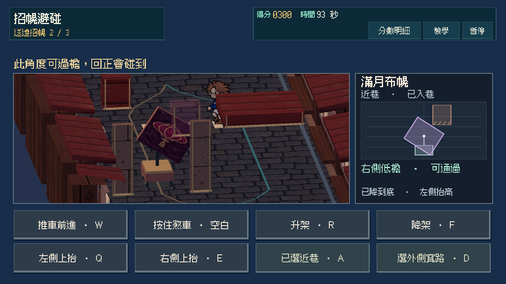

# [SG-59] 實作招幌避碰與側傾推車

> 狀態：完成

## 內文

### 需求

開放霓虹夜市第六款小遊戲「招幌避碰」。推車載著三幅不同尺寸的招幌。能在行走時調整架高與側傾，依檐高、巷寬、招幌輪廓和行人間隙，選擇停等、通窄巷或走外側寬路。遊戲畫面須看得出車輪、地面和招幌的實際位置。

### 來源

[小遊戲目錄 game-042](../../design/02-minigames/catalog.md#game-042-招幌避碰) 與 2026-11-26 使用者要求增加不同玩法並打磨光源、動態及操作手感。

### 驗收條件

- [x] 推進、煞停、調高與側傾會改變推車和招幌的實際移動、空間輪廓及碰撞。三幅完整送抵才算通關。
- [x] 兩套檐高、巷寬與行人間隙至少各有一條可完成路線。可停等、繞行或實際以側傾穿過相鄰低檐；只調角度卻未穿過不計挑戰。
- [x] 鍵盤、滑鼠、觸控與手把可操作。輔助保留主動試角及過檐，畫面能讀出安全空間，減少動態時保留功能訊號。
- [x] 夜市入口、圖解、結算、雙拍貼、補拍、局部回歸、三種原生尺寸及 Windows 封裝重開驗證接通。PM 只留一張所需畫面及結論。

### 測試流程

1. 以不同招幌在兩套檐口與巷道比較同一輪廓的直立、降架及側傾，重跑可行的安全路線。
2. 用真實推車通過交錯低檐，確認比對失敗角度、碰撞、停車等待、輔助及練習回合。
3. 從夜市進場並以獨立存檔完成結算、免費補拍與重開。

---

# 跟其他票的關係

- Blocks：無
- Blocked by：無
- Related：無

---

# Commit-1

## 內文

夜市北街開放「招幌避碰」。三幅布幌共用推車，架高和側傾會改變實際輪廓。外側寬路可先降架，近巷要回正過窄口，再先後避開左右低檐。行人在兩路交會處穿越，可以煞車等空檔。巷道、可見檐緣和側欄橫截面跟著實際阻擋更新，減少動態仍可讀出招幌的姿態及行人位置。原生驗證採程式化輸入。

### 測試結果

| 檢查 | 結果 |
|---|---|
| 規則與操作 | 146 項模型檢查。兩套巷道的一般與輔助均可完成，另驗行人阻擋、續推、側傾差異及跨幅通檐不列入挑戰。 |
| 局部回歸 | 15 組 Godot、215 項 Python 和五項設計檢查通過。 |
| 800×600 Windows 內嵌成品 | 正式回合 153 項、獨立重開 27 項。 |
| 1280×720 Windows 內嵌成品 | 正式回合 150 項、獨立重開 27 項。 |
| 1920×1080 Windows 內嵌成品 | 正式回合 150 項、獨立重開 27 項。 |
| Windows 免費補拍 | 實際操作 157 項、獨立重開 24 項。 |

### 截圖

