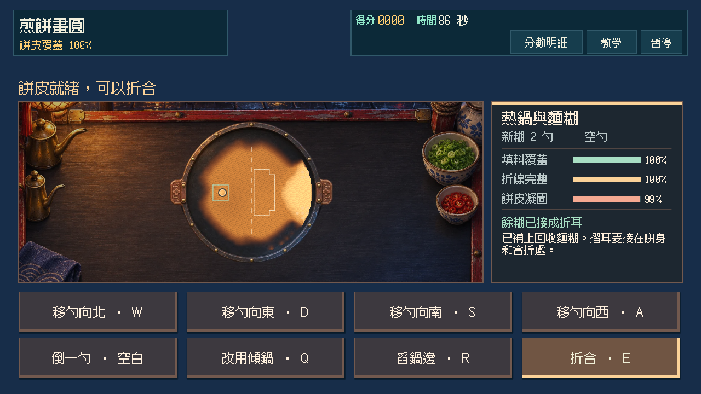

# [SG-60] 實作煎餅畫圓與餘糊折耳

> 狀態：完成

## 內文

### 需求

開放霓虹夜市第七款小遊戲「煎餅畫圓」。依配料形狀倒糊、傾鍋、看薄區並補糊。鍋面熱點影響凝固，稀糊能移動，凝固後可折。成品要覆蓋配料和折線並能包起；小惡魔用鍋邊流出的可用餘糊補出能折的耳片。

### 來源

[小遊戲目錄 game-043](../../design/02-minigames/catalog.md#game-043-煎餅畫圓) 與 2026-11-26 使用者要求增加不同玩法、完善動態、照明及操作。

### 驗收條件

- [x] 能實際控制倒糊、傾鍋和折合。麵糊會因重力、熱點、厚薄及凝固改變，畫面看得出流向、薄孔和黏結。
- [x] 兩套鍋面熱點及填料輪廓都可完成。鍋邊餘糊確實回流、形成能折的耳片，再成功包餡才算小惡魔。
- [x] 鍵盤、滑鼠、觸控與手把可操作。輔助凸顯薄區並放寬焦化壓力，仍須自己補糊與折合，降低動態保留功能提示。
- [x] 夜市實際入口、圖解、結算、雙卡及免費補拍接通。局部回歸、原生三種尺寸、Windows 封裝重開通過，PM 保留一張畫面及摘要。

### 測試流程

1. 比對兩種熱點、倒糊及傾斜方向，驗證同一份糊能流動與扣回，凝固後不會流走。
2. 製作正常和輔助的完整薄餅，分別驗證薄孔、焦化、餘糊折耳及未成功的對照。
3. 從夜市進場，以隔離存檔通關、取得收藏、免費補拍及獨立重開。

---

# 跟其他票的關係

- Blocks：無
- Blocked by：無
- Related：無

---

# Commit-1

## 內文

夜市西北煎台開放「煎餅畫圓」。玩家倒糊、傾鍋、等凝固再沿折線包餡。兩套鍋面熱點和餡料形狀讓薄區不同。把實際流到鍋邊的餘糊舀回，接在餅皮上形成折耳，並完整包餡可得小惡魔。畫面根據麵糊厚薄、熱度和真實折合更新；減少動態仍可讀出薄區及成品。原生驗證採程式化輸入。

### 測試結果

| 檢查 | 結果 |
|---|---|
| 規則與操作 | 158 項模型檢查。兩套熱點及配料的一般與輔助均可完成，另驗質量保存、凝固、焦化、連接折線及鍋邊餘糊來源。 |
| 局部回歸 | 15 組 Godot、215 項 Python 和五項設計檢查通過。 |
| 800×600 Windows 內嵌成品 | 正式回合 158 項、獨立重開 27 項。 |
| 1280×720 Windows 內嵌成品 | 正式回合 155 項、獨立重開 27 項。 |
| 1920×1080 Windows 內嵌成品 | 正式回合 155 項、獨立重開 27 項。 |
| Windows 免費補拍 | 實際操作 164 項、獨立重開 24 項。 |

### 截圖

