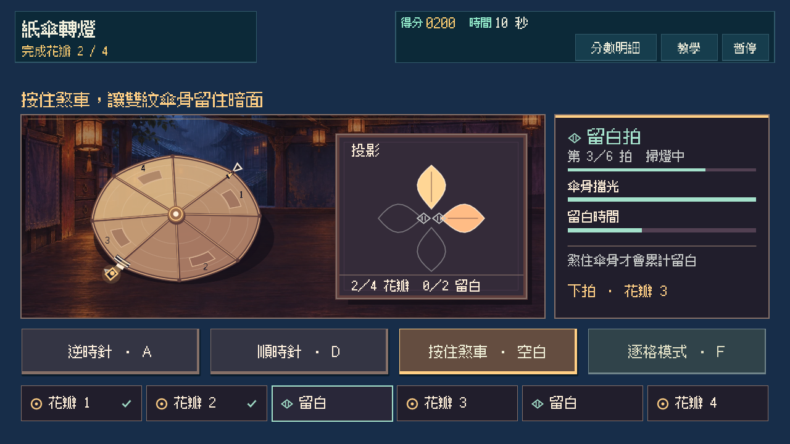

# [SG-61] 實作紙傘轉燈與雙段留白

> 狀態：完成

## 內文

### 需求

開放霓虹夜市第八款小遊戲「紙傘轉燈」。轉動紙傘迎向掃過的燈束，讓光經過指定傘骨空隙，接出四段花瓣。看留白預告，在指定角度短停，利用傘骨遮住兩段燈束，拼出中央花芯。

### 來源

[小遊戲目錄 game-044](../../design/02-minigames/catalog.md#game-044-紙傘轉燈) 與 2026-11-26 使用者要求往後增加多樣玩法並打磨光源、動態與手感。

### 驗收條件

- [x] 掃燈、傘面轉動、煞停、角度和實際遮光共同決定花瓣。四段要接受足夠真實曝光。
- [x] 兩套掃角、方向及留白都可完成。兩段都有辨識清楚的預告，指定傘骨被主動停住並實際遮光才有花芯挑戰。
- [x] 鍵盤、滑鼠、觸控及手把可操作。角度和時機有形狀提示，輔助可按格轉傘並放寬角窗，減少動態保留必要訊號。
- [x] 夜市入口、圖解、結算、雙卡、免費補拍、局部回歸、原生多尺寸和 Windows 封裝重開接通。PM 留一張畫面與摘要。

### 測試流程

1. 比較轉傘方向、角度誤差、鬆手與主動煞停。以兩套掃角完成四段花。
2. 比對早晚停傘、單段留白、無操作、真實雙段遮光及輔助回合。
3. 從夜市實際進場，以隔離存檔完成結算、補拍及重開。

---

# 跟其他票的關係

- Blocks：無
- Blocked by：無
- Related：無

---

# Commit-1

## 內文

夜市西側屋頂開放「紙傘轉燈」。順著掃燈轉傘，讓指定光窗接光，投影便逐片亮起。留白要先轉傘，再在燈來前主動煞停，讓指定傘骨實際擋光。兩次留白及四片花瓣都完成才有花芯。減少動態仍保有拍序、停點與曝光狀態。原生驗證採程式化輸入。

### 測試結果

| 檢查 | 結果 |
|---|---|
| 規則與操作 | 222 項模型檢查，兩套掃角的一般、輔助與逐格操作均可通關。無操作、過晚煞車、提前鬆手和錯骨遮光不列入留白挑戰。 |
| 局部回歸 | 15 組 Godot、215 項 Python 和五項設計檢查通過。 |
| 800×600 Windows 內嵌成品 | 正式回合 159 項、獨立重開 27 項。 |
| 1280×720 Windows 內嵌成品 | 正式回合 155 項、獨立重開 27 項。 |
| 1920×1080 Windows 內嵌成品 | 正式回合 155 項、獨立重開 27 項。 |
| Windows 免費補拍 | 實際操作 163 項、獨立重開 24 項。 |

### 截圖

