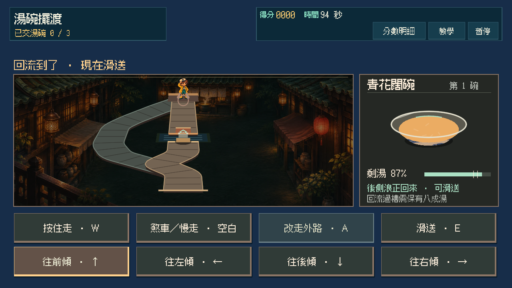

# [SG-62] 實作湯碗擺渡與回流過槽

> 狀態：完成

## 內文

### 需求

開放霓虹夜市第九款小遊戲「湯碗擺渡」。端著碗盤走過轉角和交接槽，依腳步、煞停及傾身觀察液面回流，保留足夠湯量後交給接盤處。三碗的深度和路線會變化，玩家可以慢端保量或抓準時機滑過較短的小缺口。

### 來源

[小遊戲目錄 game-045](../../design/02-minigames/catalog.md#game-045-湯碗擺渡) 與 2026-11-26 使用者要求開發後續不同玩法並打磨動作、效能和操作。

### 驗收條件

- [x] 加速、轉向、停步和傾身會改變可見液面與實際灑出量。三碗送達時都達安全線。
- [x] 兩套槽和轉角各有可完成路線。小惡魔須在同一碗液面確實回流時滑過真實缺口，並送齊三碗。
- [x] 鍵盤、滑鼠、觸控和手把可操作；交接就緒和安全線可辨，輔助提高阻尼並可重試當前一碗，減少動態保留液面訊號。
- [x] 夜市入口、圖解、結算、雙卡、免費補拍、局部回歸、原生多尺寸及 Windows 封裝重開接通。PM 留一張畫面及摘要。

### 測試流程

1. 在兩套路線比較直行、急停、轉向、傾身、無操作和錯過接盤。
2. 比對回流時滑過缺口與普通時機，完成普通及小惡魔路線，核對三碗湯量與結算。
3. 由夜市步行進場，以隔離存檔通關、補拍並獨立重開。

---

# 跟其他票的關係

- Blocks：無
- Blocked by：無
- Related：無

---

# Commit-1

## 內文

霓虹夜市西南湯攤開放湯碗擺渡。選安全外路或帶缺口的近路，觀察加速、轉彎和煞停如何晃動湯面。槽邊可提早按住滑送，等玩家傾出的後側湯浪實際回來且落點進接板。三碗都要等接盤人伸手再交。大字與減少動態保留落點、湯量和可交碗訊號。原生驗證採程式化輸入。

### 測試結果

| 檢查 | 結果 |
|---|---|
| 規則與輸入 | 124 項模型檢查。兩套佈局的一般及輔助均可實際取得 550 分，錯過回流仍有 450 分路徑。輸入驗證涵蓋點按、預備滑送、放開取消及跨裝置持有。 |
| 局部回歸 | 15 組 Godot、215 項 Python、五項設計檢查通過。 |
| 800×600 Windows 內嵌成品 | 實際遊戲 213 項，獨立重開 27 項。 |
| 1280×720 Windows 內嵌成品 | 實際遊戲 208 項，獨立重開 27 項。 |
| 1920×1080 Windows 內嵌成品 | 實際遊戲 208 項，獨立重開 27 項。 |
| Windows 免費補拍 | 實際操作 165 項，獨立重開 24 項。 |

### 截圖

