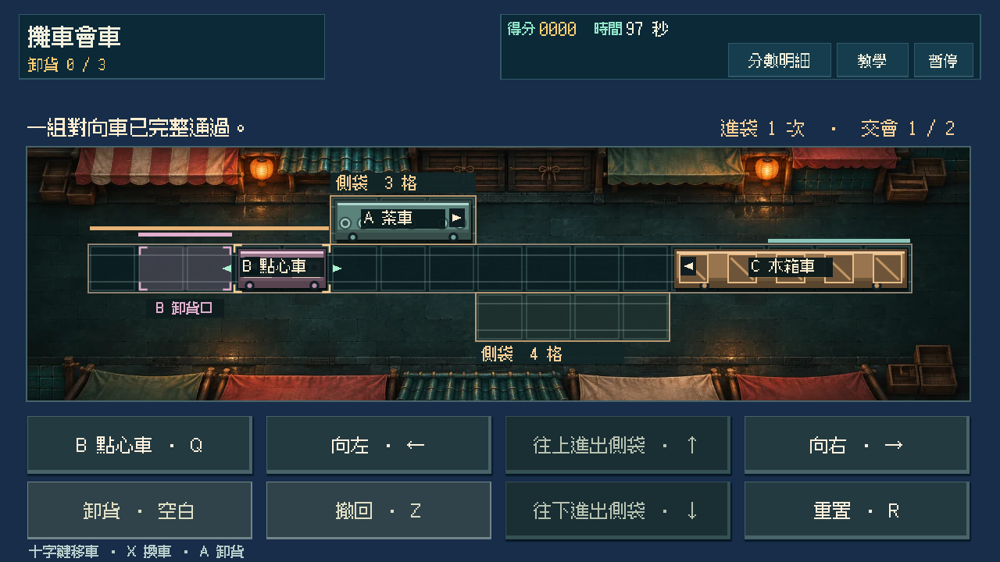

# [SG-63] 實作攤車會車與單袋避讓

> 狀態：完成

## 內文

### 需求

開放霓虹夜市第十款小遊戲「攤車會車」。操作夜市攤車在窄巷交會。車長、卸貨順序和側袋空間會影響能否通過。至少兩套佈局需要不同退讓策略，每局可清楚看出下一步的空間。

### 來源

[小遊戲目錄 game-046](../../design/02-minigames/catalog.md#game-046-攤車會車) 與 2026-11-26 使用者要求多樣化後續玩法和打磨操作。

### 驗收條件

- [x] 三輛不同攤車依據實際車身占用通過並卸貨。堵塞的方向不可穿車或越牆。
- [x] 兩套側袋和卸貨佈局均可完成。小惡魔需一次進袋、全數會車且中途不用重置。
- [x] 鍵盤、觸控、滑鼠和手把可選車與操作；阻塞原因和可用空間可辨。輔助提供撤回或適當預告，保有實際占用與挑戰條件。
- [x] 夜市實際入口、圖解、結算、雙卡與免費補拍接通，以原生多尺寸、獨立存檔重開和 Windows 封裝驗證。

### 測試流程

1. 在兩套路線用不同走法選車、推拉與退讓，確認車身、卸貨口及空袋。
2. 確認卡住、倒車、輔助撤回和正常完成。以一袋路線完成挑戰，並比較多次進袋。
3. 從夜市步行進場，隔離存檔完成通關及補拍後重新開啟。

---

# 跟其他票的關係

- Blocks：無
- Blocked by：無
- Related：無

---

---

# Commit-1

## 內文

夜市東南卸貨巷開放攤車會車。車身每一格都占空間，能借用的側袋取決於車長。第二套佈局可在尾貨格卸掉一段貨，留出剛好可退進側袋的長度。Q 換車保留 Tab 的介面焦點操作。減少動態直接定位，完整占用和受阻提示仍可讀。原生驗證採程式化輸入。

### 測試結果

| 檢查 | 結果 |
|---|---|
| 規則與輸入 | 1010 項模型檢查。兩套佈局在一般及輔助各有實際 450 與 550 分路徑。驗證完整車身、卸尾、合法倒車、一次側袋、交會、取消與撤回。 |
| 局部回歸 | 16 組 Godot、215 項 Python、五項設計檢查通過。 |
| 800×600 Windows 內嵌成品 | 實際遊戲 184 項，獨立重開 19 項。 |
| 1280×720 Windows 內嵌成品 | 實際遊戲 181 項，獨立重開 19 項。 |
| 1920×1080 Windows 內嵌成品 | 實際遊戲 181 項，獨立重開 19 項。 |
| Windows 免費補拍 | 實際操作 151 項，獨立重開 24 項。 |

### 截圖

