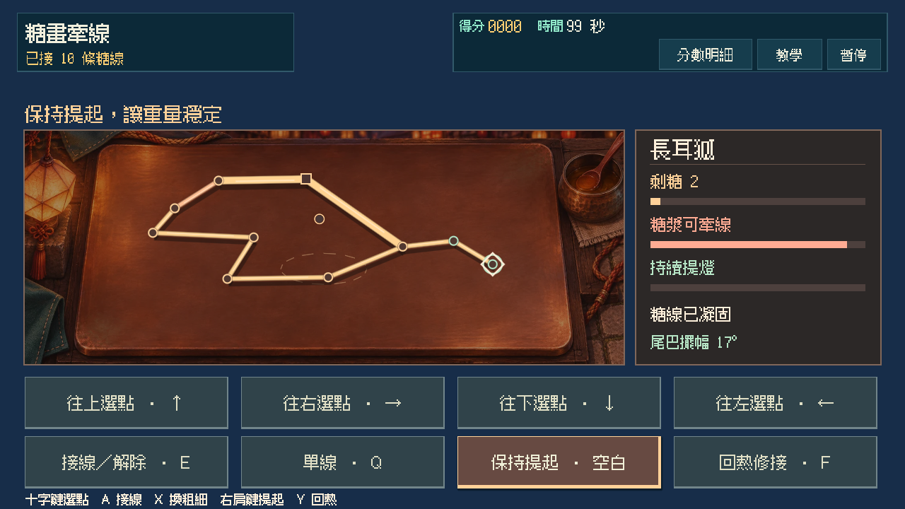

# [SG-64] 實作糖畫牽線與活動尾巴

> 狀態：完成

## 內文

### 需求

開放霓虹夜市第十一款「糖畫牽線」。玩家在至少兩種獸形支架上牽糖線、等節點接合，利用不同走線或雙線分擔重量，再將燈獸整體提起。剩餘材料可以接成活動尾巴，抬起時仍要承受重量與擺動。

### 來源

[小遊戲目錄 game-047](../../design/02-minigames/catalog.md#game-047-糖畫牽線) 與 2026-11-26 使用者要求製作不同類型的後續玩法並打磨視覺、動畫和操作。

### 驗收條件

- [x] 有實際接合、凝固、額度與受力判定。兩套獸形各有至少兩種可提起的走線。
- [x] 無效接點、未凝固與受力過大有可辨回饋。挑戰需以剩糖做出確實相連且可擺動的尾巴，再維持整體穩定。
- [x] 鍵盤、手把與指標皆能操作。輔助可回熱重接，減少動態保留受力與凝固訊號。
- [x] 夜市實際入口、圖解、結算、雙卡與免費補拍接通，完成隔離原生與 Windows 封裝重開驗證。

### 測試流程

1. 在兩套支架試出多種合接方式，觀察濕接點、雙線與提起時的重量。
2. 比對開路、單線拉斷、凝固後普通路線、加尾巴且仍能提起的路線。
3. 從夜市進場完成圖解、實際結算、免費補拍和獨立重開。

---

# 跟其他票的關係

- Blocks：無
- Blocked by：無
- Related：無

---

---

# Commit-1

## 內文

夜市東側屋頂開放糖畫牽線。長耳狐和角鹿使用不同支點，單線與雙線要兼顧剩糖、凝固、重量與走線。放下後可以回熱補接。已凝固的尾巴需在提起時維持實際擺幅與整體穩定。鍵盤、手把、滑鼠和觸控都可選點，減少動態仍會顯示受力、凝固與真實擺幅。原生驗證採程式化輸入。

### 測試結果

| 檢查 | 結果 |
|---|---|
| 規則與輸入 | 154 項模型檢查。兩種獸形各有至少兩種能承重的牽線。驗證凝固、超載斷裂、回熱修補與實際活動尾巴。一般與輔助均能完成尾巴的 600 分路徑。 |
| 局部回歸 | 17 組 Godot、215 項 Python、五項設計檢查通過。 |
| 800×600 Windows 內嵌成品 | 實際遊戲 259 項，獨立重開 39 項。 |
| 1280×720 Windows 內嵌成品 | 實際遊戲 256 項，獨立重開 39 項。 |
| 1920×1080 Windows 內嵌成品 | 實際遊戲 256 項，獨立重開 39 項。 |
| Windows 免費補拍 | 實際操作 180 項，獨立重開 36 項。 |

### 截圖

