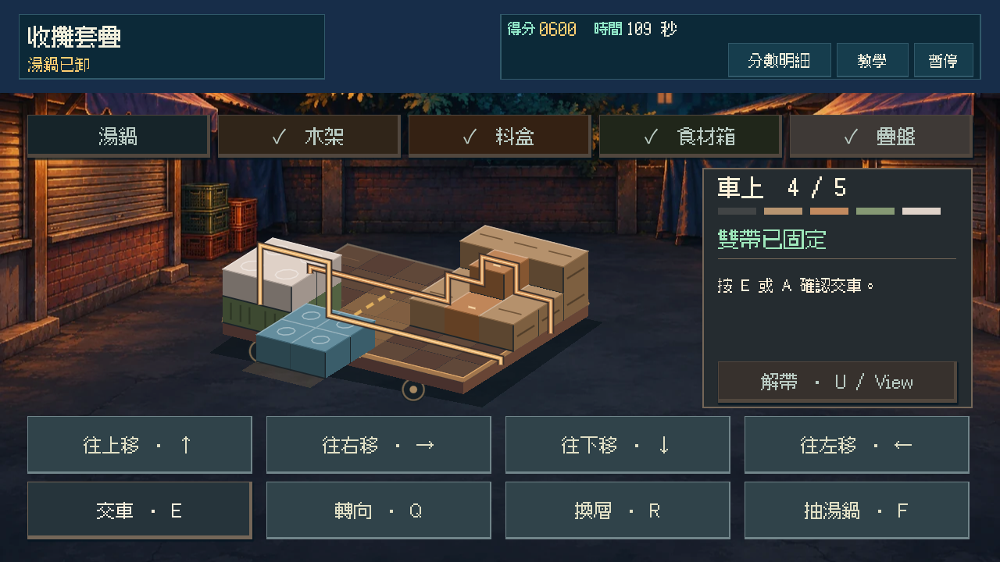

# [SG-65] 實作收攤套疊與先卸湯鍋

> 狀態：完成

## 內文

### 需求

開放霓虹夜市第十二款「收攤套疊」。玩家旋轉五件形狀不同的攤具，把它們平放、分層或套疊進車架，再扣緊綁帶。想取得小惡魔，須在裝好後從開口滑出底層湯鍋。

### 來源

[小遊戲目錄 game-048](../../design/02-minigames/catalog.md#game-048-收攤套疊) 與 2026-11-26 使用者要求製作後續章節並打磨地圖、介面、操作手感與動畫。

### 驗收條件

- [x] 兩套裝車配置各有五件實體攤具。輪廓、旋轉、局部套疊、承托及車架邊界都會影響放置。
- [x] 裝車後的綁帶與實際出入口可見。至少有一種普通解會堵住底層湯鍋，挑戰解可沿真實路徑先卸且其餘器具仍穩定。
- [x] 鍵盤、手把、指標與簡短 Hover 可完成全回合。撤銷與輔助保留套疊及出車判定，減少動態仍清楚顯示位置與受阻處。
- [x] 夜市實體入口、圖解、結算、兩張拍貼與免費補拍接通，通過隔離原生和 Windows 封裝重開驗證。

### 測試流程

1. 使用不同旋向和高度裝五件攤具，確認越界、相撞、套疊與承托判定。
2. 各試一次堵口的普通解與可從底層卸下湯鍋的挑戰解，觀察綁帶和各器具位置。
3. 從夜市入口完成正式回合、教學、免費補拍與獨立重開。

---

# 跟其他票的關係

- Blocks：無
- Blocked by：無
- Related：無

---

# Commit-1

## 內文

東南收攤台開放夜市第十二款。五件攤具有實際輪廓與承托，可旋轉和套入不同高度。綁帶依兩個真實堆疊截面繃緊。留出底部滑行通道，讓湯鍋完整出車並維持其他器具穩固，可取得小惡魔。輔助回合不限時，減少動態直接到位並保留真實路徑。原生驗證採程式化輸入。補拍面板與區域往返的 Linux CI 個別上限調為 180 秒，保留既有流程及斷言。

### 測試結果

| 檢查 | 結果 |
|---|---|
| 規則與輸入 | 436 項模型檢查。兩套平面及攤具變化均可一般或輔助完成。驗證體積旋轉、實際套疊、每格承托、拉帶接觸及完整抽鍋。 |
| 局部回歸 | 18 組 Godot、215 項 Python、五項設計檢查通過。 |
| 800×600 Windows 內嵌成品 | 實際遊戲 204 項，獨立重開 30 項。 |
| 1280×720 Windows 內嵌成品 | 實際遊戲 201 項，獨立重開 30 項。 |
| 1920×1080 Windows 內嵌成品 | 實際遊戲 201 項，獨立重開 30 項。 |
| Windows 免費補拍 | 實際操作 161 項，獨立重開 33 項。 |
| Linux 局部回歸 | 補拍面板 123.60 秒，區域往返 117.50 秒，均通過。 |

### 截圖

