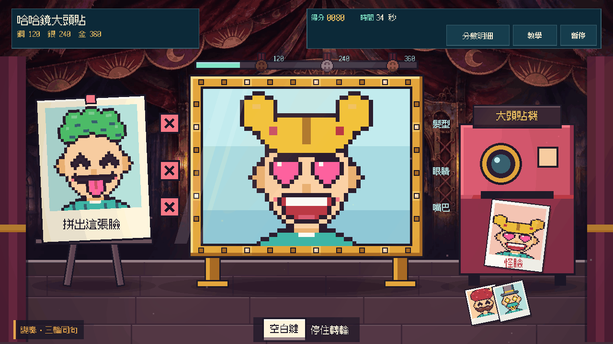

# [SG-66] 建立街機式小遊戲流程與哈哈鏡大頭貼

> 狀態：完成

## 內文

### 需求

既有小遊戲多半是多按鈕、長教學與分數明細的精密操作，玩起來像作業。建立一套街機式小遊戲的共用流程（開場示範、單一分數、銅銀金獎牌、好笑的失敗演出），並交付鏡之馬戲團第一款「哈哈鏡大頭貼」：髮型、眼睛、嘴巴三個轉輪各按一下停，拼出指定的臉。

### 來源

2026-11-27 使用者說明原始願景是類似 Bomberman Land 3 的主題樂園小遊戲：內容不要有機械感或作業感，單純好玩就好，也歡迎有創意與特色的玩法。準則見 design/00-principles/simple-fun-minigames.md。

### 驗收條件

- [x] 街機式小遊戲有共用的開場倒數與一行玩法提示、獎牌目標線與結算，新增一款不需重寫這些流程。
- [x] 哈哈鏡大頭貼：三個轉輪依序停下，拼對越多分數越高，轉速隨回合加快並出現干擾圖。
- [x] 拼錯的怪臉會以失敗拍貼的樣子展示出來。
- [x] 鏡之馬戲團有這款的入口，收藏冊、地圖與重拍都認得這一款。
- [x] 整款只用方向鍵與一到兩顆按鍵，畫面上沒有操作按鈕面板。
- [x] 進場五秒內開始操作，沒有強制教學頁；開場示範與一行提示足以理解玩法。
- [x] 一回合不超過 60 秒，回合內速度或變化明顯升級。
- [x] 結算只顯示一個分數、銅銀金獎牌與一句評語；銅牌即可取得普通拍貼，金牌取得小惡魔拍貼。
- [x] 失敗有專屬的好笑演出。
- [x] 同一款至少有兩種隨機出現的變奏。
- [x] 鍵盤與手把都能完成；開啟減少動態後仍可遊玩。
- [x] 通過稽核十問，結果寫在設計目錄的該款說明。
- [x] 鏡之馬戲團原有互動、動線與其他小遊戲不受影響。

### 測試流程

1. 從區域入口進場，不看說明直接玩一回合。
2. 故意失敗一次，再玩到銅牌與金牌。
3. 開啟減少動態與手把各玩一回合，確認拍貼入冊與重開後保留。

---

# 跟其他票的關係

- Blocks：SG-67、SG-68、SG-69、SG-70
- Blocked by：無
- Related：SG-1、ART-42

---

# Commit-1

## 內文

原本每款小遊戲都要自己做開場、計時、計分與結算，而且第一次進場一定先看教學頁，結算是一排分數明細。
現在街機式小遊戲共用一套流程：進場後是一行玩法提示與三拍倒數，2.4 秒就能動手；畫面上方三面獎牌標出銅、銀、金的分數線，下方只有一行按鍵提示，沒有操作按鈕面板；時間到會落下獎牌，結算只顯示一個分數、一面獎牌與一句評語。銅牌收藏普通拍貼，未開輔助的金牌再得小惡魔拍貼；輔助只放慢速度，不發小惡魔拍貼。教學改為自願開啟，原有 48 款的流程與結算不變。
鏡之馬戲團入口西側多了一台有斜簷與鏡面的大頭貼機，開放第一款「哈哈鏡大頭貼」。左邊立牌是目標臉，哈哈鏡裡髮型、眼睛、嘴巴三排各有六種圖案橫向滑過，按一下停一排，由上到下。停對一排 10 分，三排全對再加 30 分。一回合 45 秒，轉輪越轉越快，中段起混入形狀相同、顏色不對的干擾圖。每回合隨機一種變奏：三輪同向、中輪逆轉、目標只看一眼。每張臉都會印成拍貼滑出來；拼錯的怪臉被哈哈鏡拉寬，卡卡地慢慢印出，蓋上「怪臉」章。
以實際按鍵事件在原生畫面完整玩過標準與減少動態各一回合，拿到金牌並收藏普通與小惡魔拍貼。規則測試另以模擬輸入玩出金牌 780 分、銅牌 220 分、亂按 40 分（不得牌）與輔助金牌（不發小惡魔）。手把以按鍵與搖桿事件驗證，沒有接實體手把。難度與「看一眼就懂」是依畫面與模擬輸入判斷，尚未由真人試玩。

### 測試結果

| 項目 | 結果 |
|---|---|
| 街機共用流程 | 通過：倒數、計時、獎牌線、輔助、變奏種子、鍵盤／手把／點擊輸入、單列結算 |
| 哈哈鏡規則 | 通過：停輪順序、計分、加速、干擾圖、三種變奏、金牌與銅牌整回合 |
| 局部回歸 | 19 組 Godot 測試通過：啟動、主場景、參與結算、補拍面板與補拍流程、區域往返與進度、收藏冊、地圖、教學、馬戲團世界與主線、場景規範、遊戲目錄等 |
| 設計與資料驗證 | 5 個範圍通過；216 項 Python 測試通過 |
| 原生畫面 | 標準與減少動態各一回合，每格 72 至 102 次繪製呼叫、425 個節點（進場前園區 350 個）；遊玩過程無 ERROR |

### 截圖

