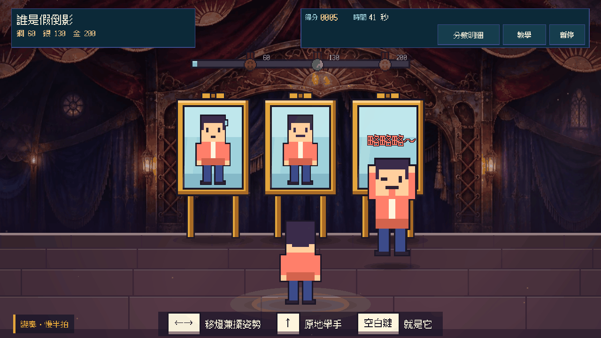

# [SG-67] 實作誰是假倒影

> 狀態：完成

## 內文

### 需求

交付鏡之馬戲團第二款街機式小遊戲「誰是假倒影」：所有鏡子都跟著玩家的動作動，只有一面慢半拍或做錯動作，用左右選出它再按下確認。

### 來源

2026-11-27 使用者說明原始願景是類似 Bomberman Land 3 的主題樂園小遊戲：內容不要有機械感或作業感，單純好玩就好，也歡迎有創意與特色的玩法。準則見 design/00-principles/simple-fun-minigames.md。

### 驗收條件

- [x] 玩家做動作時所有倒影同步，只有一面有延遲或錯誤；鏡子數量與差異細微度隨回合升級。
- [x] 選錯時假倒影吐舌頭走出鏡子。
- [x] 整款只用方向鍵與一到兩顆按鍵，畫面上沒有操作按鈕面板。
- [x] 進場五秒內開始操作，沒有強制教學頁；開場示範與一行提示足以理解玩法。
- [x] 一回合不超過 60 秒，回合內速度或變化明顯升級。
- [x] 結算只顯示一個分數、銅銀金獎牌與一句評語；銅牌即可取得普通拍貼，金牌取得小惡魔拍貼。
- [x] 失敗有專屬的好笑演出。
- [x] 同一款至少有兩種隨機出現的變奏。
- [x] 鍵盤與手把都能完成；開啟減少動態後仍可遊玩。
- [x] 通過稽核十問，結果寫在設計目錄的該款說明。
- [x] 鏡之馬戲團原有互動、動線與其他小遊戲不受影響。

### 測試流程

1. 從區域入口進場，不看說明直接玩一回合。
2. 故意失敗一次，再玩到銅牌與金牌。
3. 開啟減少動態與手把各玩一回合，確認拍貼入冊與重開後保留。

---

# 跟其他票的關係

- Blocks：無
- Blocked by：SG-66
- Related：SG-1、ART-42

---

# Commit-1

## 內文

鏡之馬戲團原本只有一款街機式小遊戲，鏡廊沒有可玩的設施。
現在鏡廊西端多了一座立鏡攤位，開放第二款「誰是假倒影」。舞台上一排鏡子，主角背對鏡頭站在聚光燈裡。按左、右會移動聚光燈並向那一側伸手，按上原地舉手；所有倒影立刻照做，只有一面是假的：慢半拍、做錯動作，或左右相反，每回合隨機一種。把聚光燈移到它上面再按確認，鏡子就蓋上「假的！」章。連續抓到越多越高分（5、10、15、20 分）。一回合 45 秒，鏡子由三面增加到五面，延遲越來越短，做錯的動作也越來越少。選錯時，真正的假倒影吐著舌頭走出鏡框，喊著「略略略～」慢慢晃出舞台，被冤枉的倒影冒汗；這段謝幕會佔掉時間，連抓也從頭算。倒數時主角會自己示範兩個姿勢，假倒影當場露出馬腳。
這一款只新增自己的規則與畫面，開場倒數、獎牌線、結算、輔助與收藏都沿用共用流程。接上第二款時發現連玩兩款街機式遊戲後，結束程式會留下未釋放資源的錯誤訊息，已一併修正。以實際按鍵事件在原生畫面玩過三種變奏各一回合（其中一回合開啟減少動態），都拿到金牌並收藏普通與小惡魔拍貼，存檔重新讀取後仍在。規則測試以模擬輸入玩出三種變奏的金牌（550、450、350 分）、會失手的銅牌回合 95 分、亂猜 10 分（不得牌）與輔助金牌（不發小惡魔）。手把以按鍵與搖桿事件驗證，沒有接實體手把。難度與「看一眼就懂」是依畫面與模擬輸入判斷，尚未由真人試玩。

### 測試結果

| 項目 | 結果 |
|---|---|
| 假倒影規則 | 通過：倒影同步、三種破綻、聚光燈與姿勢共用方向鍵、指認計分、升級、金牌與銅牌整回合 |
| 局部回歸 | 16 組 Godot 測試通過：啟動、主場景、參與結算、補拍、區域往返、收藏冊、教學、馬戲團世界與主線、場景規範、遊戲目錄、街機共用流程與哈哈鏡大頭貼等 |
| 設計與資料驗證 | 5 個範圍通過；216 項 Python 測試通過 |
| 原生畫面 | 三種變奏各一回合，每格 71 至 94 次繪製呼叫、444 個節點（進場前園區 369 個）；遊玩過程無 ERROR |

### 截圖

