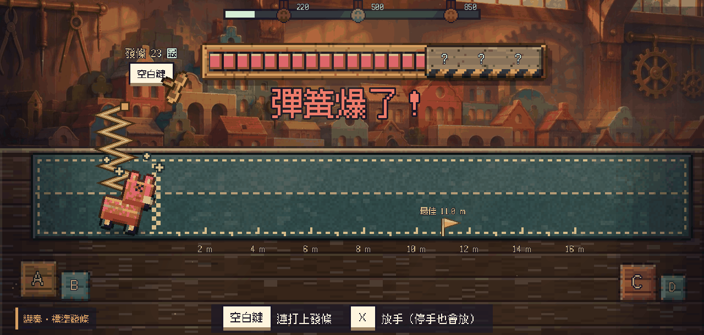

# [SG-68] 實作發條衝刺

> 狀態：完成

## 內文

### 需求

交付發條玩具城第一款街機式小遊戲「發條衝刺」：連打上發條後放手讓玩具衝出去，轉越多跑越遠，但超過極限彈簧會爆開。

### 來源

2026-11-27 使用者說明原始願景是類似 Bomberman Land 3 的主題樂園小遊戲：內容不要有機械感或作業感，單純好玩就好，也歡迎有創意與特色的玩法。準則見 design/00-principles/simple-fun-minigames.md。

### 驗收條件

- [x] 連打累積發條圈數，放手後玩具依圈數衝刺；極限點每回合不同且後段被遮住。
- [x] 上過頭時彈簧彈出、玩具原地打轉；對手玩具會在後段回合加入比距離。
- [x] 整款只用方向鍵與一到兩顆按鍵，畫面上沒有操作按鈕面板。
- [x] 進場五秒內開始操作，沒有強制教學頁；開場示範與一行提示足以理解玩法。
- [x] 一回合不超過 60 秒，回合內速度或變化明顯升級。
- [x] 結算只顯示一個分數、銅銀金獎牌與一句評語；銅牌即可取得普通拍貼，金牌取得小惡魔拍貼。
- [x] 失敗有專屬的好笑演出。
- [x] 同一款至少有兩種隨機出現的變奏。
- [x] 鍵盤與手把都能完成；開啟減少動態後仍可遊玩。
- [x] 通過稽核十問，結果寫在設計目錄的該款說明。
- [x] 發條玩具城原有互動、動線與其他小遊戲不受影響。

### 測試流程

1. 從區域入口進場，不看說明直接玩一回合。
2. 故意失敗一次，再玩到銅牌與金牌。
3. 開啟減少動態與手把各玩一回合，確認拍貼入冊與重開後保留。

---

# 跟其他票的關係

- Blocks：無
- Blocked by：SG-66
- Related：SG-1、ART-42

---

# Commit-1

## 內文

發條玩具城原本沒有任何可玩的小遊戲，只能看列車與鐘樓。
現在鐘樓廣場西側多了一座屋頂插著大發條鑰匙的攤位，開放玩具城第一款「發條衝刺」。工作檯上鋪著賽道，玩具貓背上插著鑰匙：連打按鍵上發條，放手（或停手半秒）牠就衝出去，轉越多圈跑越遠，一公尺 10 分。發條表的後三分之一被鐵皮蓋住，彈簧的極限就藏在裡面，每一次都不一樣；敢轉進蓋住的那一段，每圈跑兩倍遠。快到極限時音越來越高、玩具發抖冒汗、按鍵變紅並冒出「喀！」「好緊！」；再多轉一圈，彈簧就從背上彈出來，鑰匙飛走，玩具貓原地打轉冒星星，那一次沒有距離。一回合 45 秒，能衝幾次算幾次。第三次起旁邊跑道會有對手玩具，旗子標出牠會跑多遠、發條表上也標出要轉幾圈才贏，贏了多 30 分；對手越來越強，後面幾隻一定得往蓋住的地方轉才贏得了，彈簧的極限範圍也越來越難猜。每回合隨機一種變奏：標準發條、要多按幾下的鐵皮重玩具、滑得更遠也更久的打蠟地板、整條發條表都蓋住只能靠聲音與發抖判斷。倒數時玩具會自己示範一次上發條與衝刺。
以實際按鍵事件在原生畫面玩過標準、蓋住發條表與打蠟地板三種變奏各一回合（銀牌 820 分、金牌 910 分、開啟減少動態的金牌 891 分），並看過開場、上緊、衝刺、對手、爆彈簧與結算畫面後調整了玩具大小、跑道分層與鑰匙飛出的方向。規則測試以模擬輸入玩出四種變奏的金牌（1136 至 1223 分）、會爆彈簧的銅牌回合 360 分、只轉到看得見處的銀牌 780 分、一直連打不放手 5 分（不得牌）與輔助金牌（不發小惡魔）。減少動態時玩具不抖、不旋轉，改以冒汗、文字、變色與靜止的爆彈簧姿勢提示。手把以按鍵事件對應驗證，沒有接實體手把。難度與「看一眼就懂」是依畫面與模擬輸入判斷，尚未由真人試玩。

### 測試結果

| 項目 | 結果 |
|---|---|
| 發條衝刺規則 | 通過：上發條、蓋住的極限、放手與自動放手、爆彈簧、對手、四種變奏、金牌與銅牌整回合 |
| 局部回歸 | 17 組 Godot 測試通過：啟動、主場景、參與結算、補拍、區域往返、收藏冊、教學、玩具城世界與主線、溫室世界、場景規範、遊戲目錄、街機共用流程與馬戲團兩款 |
| 設計與資料驗證 | 5 個範圍通過；Python 測試全數通過 |
| 原生畫面 | 每格 86 至 108 次繪製呼叫、417 個節點（進場前玩具城 360 個，攤位佔 5 個）；遊玩過程無 ERROR |

### 截圖

# Commit-2

## 內文

2026-11-27 使用者指出街機式小遊戲的物件像貼在背景圖上的色塊：大片單色、沒有材質與明暗，和細緻的背景格格不入。
發條衝刺的畫面全部重畫成粗像素：賽道是有縫線與起跑格的絨布墊，鋪在有木紋與板縫的工作檯上；發條表是鎖了螺絲的黃銅框，每轉一圈亮一格線圈，後段蓋著鉚釘鐵皮與磨損的警示漆；玩具貓與對手是有腰線、鉚釘、亮面與暗面的鐵皮玩具，背上是蝴蝶形的黃銅鑰匙；積木、距離牌與旗子也都有材質。所有物件左上受光，外框改用加深的同色，並在檯面與牆上留下陰影；配色改取背景的暮色，畫面兩側略暗。規則、分數與操作都沒有改。
同時把這套作法做成街機式小遊戲共用的像素烘焙工具，並在設計準則加上「畫面下限」清單，之後每一款都照同一標準檢查。教學截圖與本票截圖已換成新畫面。以實際按鍵事件在原生畫面重玩一回合（銀牌 825 分），逐張看過開場、上緊、對手與爆彈簧畫面。

### 測試結果

| 項目 | 結果 |
|---|---|
| 發條衝刺規則 | 通過，規則與分數與上一段相同 |
| 局部回歸 | 18 組 Godot 測試通過：啟動、主場景、參與結算、補拍、區域往返、收藏冊、教學、玩具城與溫室世界、場景規範、遊戲目錄、街機共用流程與其餘三款街機遊戲 |
| 設計與資料驗證 | 5 個範圍通過；Python 測試全數通過 |
| 原生畫面 | 每格 118 至 136 次繪製呼叫、422 個節點；遊玩過程無 ERROR |

### 截圖

