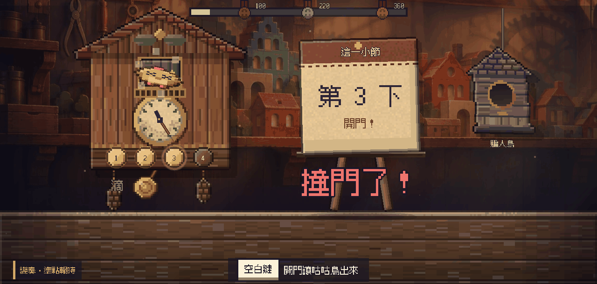

# [SG-69] 實作整點咕咕

> 狀態：完成

## 內文

### 需求

交付發條玩具城第二款街機式小遊戲「整點咕咕」：跟著時鐘的滴答聲，在指定的拍子按下讓咕咕鳥出門報時。

### 來源

2026-11-27 使用者說明原始願景是類似 Bomberman Land 3 的主題樂園小遊戲：內容不要有機械感或作業感，單純好玩就好，也歡迎有創意與特色的玩法。準則見 design/00-principles/simple-fun-minigames.md。

### 驗收條件

- [x] 滴答有畫面與聲音的節拍提示，指定拍按下才算成功；速度會變化並加入反拍。
- [x] 按錯拍時咕咕鳥撞到門後暈頭轉向。
- [x] 整款只用方向鍵與一到兩顆按鍵，畫面上沒有操作按鈕面板。
- [x] 進場五秒內開始操作，沒有強制教學頁；開場示範與一行提示足以理解玩法。
- [x] 一回合不超過 60 秒，回合內速度或變化明顯升級。
- [x] 結算只顯示一個分數、銅銀金獎牌與一句評語；銅牌即可取得普通拍貼，金牌取得小惡魔拍貼。
- [x] 失敗有專屬的好笑演出。
- [x] 同一款至少有兩種隨機出現的變奏。
- [x] 鍵盤與手把都能完成；開啟減少動態後仍可遊玩。
- [x] 通過稽核十問，結果寫在設計目錄的該款說明。
- [x] 發條玩具城原有互動、動線與其他小遊戲不受影響。

### 測試流程

1. 從區域入口進場，不看說明直接玩一回合。
2. 故意失敗一次，再玩到銅牌與金牌。
3. 開啟減少動態與手把各玩一回合，確認拍貼入冊與重開後保留。

---

# 跟其他票的關係

- Blocks：無
- Blocked by：SG-66
- Related：SG-1、ART-42

---

# Commit-1

## 內文

發條玩具城只有一款街機式小遊戲，鐘樓旁沒有可玩的設施。
現在鐘樓廣場北側多了一座屋頂掛著小咕咕鐘的攤位，開放第二款「整點咕咕」。工作坊牆上掛著一座木雕咕咕鐘：鐘擺每擺到一邊就是一下，鐘座上四盞小燈跟著一格一格亮，畫架上的卡片寫著這一小節咕咕鳥要在「第幾下」出門，那一格的燈戴著金圈。在那一下按一次，門彈開，咕咕鳥乘著伸縮臂探出來唱歌；連續準時越多次越高分（10、15、20、25、30 分），按得特別準再加 5 分。每小節的速度都不一樣，而且越來越快；後段會出現「第 2 下半」這種滴答之間的時機，旁邊歪歪的小屋裡還有一隻騙人鳥會在別的拍子探頭亂叫。太早開門時門後沒有鳥，門還會卡住；不開門也一樣，咕咕鳥會一頭撞扁在門板上、揚起一陣灰，再滑到陽台上冒星星，時鐘指針亂轉，連續紀錄歸零。每回合隨機一種變奏：準點報時、長短交替的搖擺滴答、一小節要放兩隻鳥的雙鳥輪唱、每隔一小節沒有滴答聲只能看鐘擺的靜音小節。倒數時鐘會自己示範一小節。
畫面依使用者 2026-11-27 的要求以粗像素重畫過一輪：咕咕鐘有屋瓦、雕花、陽台欄杆、斜面鐘面、松果鐘錘與會反光的鐘擺，卡片、騙人鳥屋與檯面都有材質、受光面與陰影，配色取自背景的暮色。以實際按鍵事件在原生畫面玩過一回合（銀牌 305 分，含故意開錯與不開門），逐張看過開場、準時、開錯、撞門、連續與騙人鳥畫面。規則測試以模擬輸入玩出四種變奏的金牌（425 至 444 分）、常撞門的銅牌回合 150 分、每一下都開門 15 分（不得牌）與輔助金牌 460 分（不發小惡魔）。滴答聲沿用既有的音符播放路徑，沒有新增音檔；實際聽感沒有由真人確認。手把以按鍵事件對應驗證，沒有接實體手把；減少動態時鐘擺改為每一下直接跳到另一邊，未另外原生擷取。難度與「看一眼就懂」是依畫面與模擬輸入判斷，尚未由真人試玩。

### 測試結果

| 項目 | 結果 |
|---|---|
| 整點咕咕規則 | 通過：滴答、準時判定、撞門、連續加分、變速、半拍、騙人鳥、四種變奏、金牌與銅牌整回合 |
| 局部回歸 | 18 組 Godot 測試通過：啟動、主場景、參與結算、補拍、區域往返、收藏冊、教學、玩具城與溫室世界、場景規範、遊戲目錄、街機共用流程與其餘三款街機遊戲 |
| 設計與資料驗證 | 5 個範圍通過；Python 測試全數通過 |
| 原生畫面 | 每格 82 至 94 次繪製呼叫、422 個節點；玩具城重建後含兩座攤位共 259 個節點，每座攤位佔 5 個；遊玩過程無 ERROR |

### 截圖

