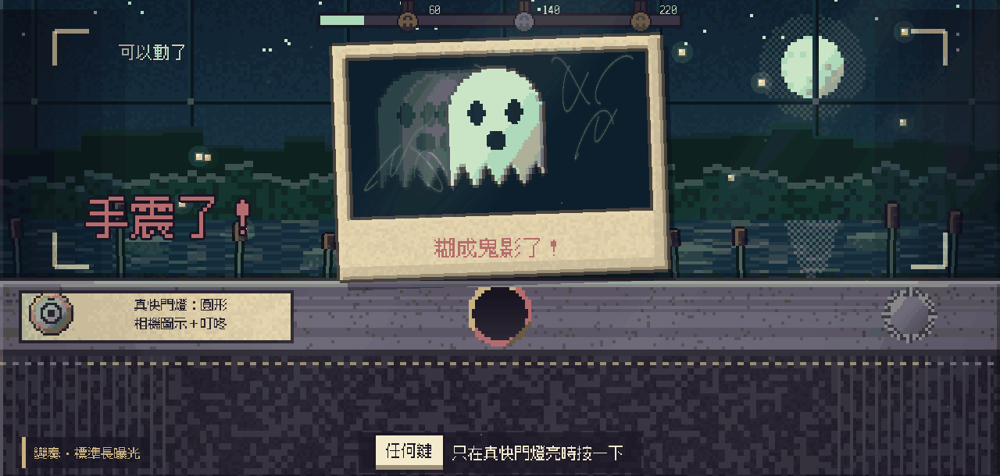

# [SG-70] 實作螢火蟲長曝光

> 狀態：完成

## 內文

### 需求

交付苔光溫室第一款街機式小遊戲「螢火蟲長曝光」：長曝光期間什麼都不能按，畫面會用假提示引誘玩家，只有真正的快門燈亮起才按一次。

### 來源

2026-11-27 使用者說明原始願景是類似 Bomberman Land 3 的主題樂園小遊戲：內容不要有機械感或作業感，單純好玩就好，也歡迎有創意與特色的玩法。準則見 design/00-principles/simple-fun-minigames.md。

### 驗收條件

- [x] 曝光期間任何按鍵都會讓照片晃動；真快門燈亮起後限時內按下才成功。
- [x] 誘餌隨回合越來越像真的；忍不住按下時照片糊成一團鬼影並展示出來。
- [x] 整款只用方向鍵與一到兩顆按鍵，畫面上沒有操作按鈕面板。
- [x] 進場五秒內開始操作，沒有強制教學頁；開場示範與一行提示足以理解玩法。
- [x] 一回合不超過 60 秒，回合內速度或變化明顯升級。
- [x] 結算只顯示一個分數、銅銀金獎牌與一句評語；銅牌即可取得普通拍貼，金牌取得小惡魔拍貼。
- [x] 失敗有專屬的好笑演出。
- [x] 同一款至少有兩種隨機出現的變奏。
- [x] 鍵盤與手把都能完成；開啟減少動態後仍可遊玩。
- [x] 通過稽核十問，結果寫在設計目錄的該款說明。
- [x] 苔光溫室原有互動、動線與其他小遊戲不受影響。

### 測試流程

1. 從區域入口進場，不看說明直接玩一回合。
2. 故意失敗一次，再玩到銅牌與金牌。
3. 開啟減少動態與手把各玩一回合，確認拍貼入冊與重開後保留。

---

# 跟其他票的關係

- Blocks：無
- Blocked by：SG-66
- Related：SG-1、ART-42

---

# Commit-1

## 內文

苔光溫室原本沒有任何可玩的小遊戲。
現在濕地床南岸多了一座架著相機與螢火蟲罐的攤位，開放溫室第一款「螢火蟲長曝光」。畫面是越過老相機頂蓋看出去的夜池：快門一開，螢火蟲開始在底片上拖出光軌，這段時間任何按鍵、方向鍵或手把按鈕都算手震。畫面會想盡辦法騙你按：跳出「快按！」、蚊子停在鏡頭上、鼻子好癢的計量條、插座裡亮起形狀不對的假燈。只有真正的快門燈亮了才按一下，那盞燈一定是圓形、中間有相機圖示、還會叮咚響兩聲；假燈是方形、菱形或三角形並帶著自己的記號，只有一聲低音，後段就算顏色和真燈一樣，形狀與記號仍然不同，所以不必靠顏色分辨。相機頂蓋上的銘牌全程畫著真快門燈的樣子。按對了就印出清晰的光軌照片，曝光越久分數越高（一秒 10 分）；手一抖，整個畫面一晃，印出來的是一隻糊掉的鬼影；燈亮了太久沒按則過曝成一片白。一回合 50 秒，曝光由 3 秒拉長到 6 秒，干擾由一個增加到三個。每回合隨機一種變奏：標準長曝光、只用柔和閃光與怪聲干擾、真快門燈會換插座、要等真燈亮兩次的雙重曝光。倒數時相機會自己示範拍一張。閃光是半秒內淡出的柔和白霧，減少動態時改為靜止的外框。
畫面依使用者 2026-11-27 的要求以粗像素繪製：夜空、溫室鐵架、月亮、樹籬、池面與睡蓮是一整張烘焙的場景，相機有金屬頂蓋、琺瑯銘牌、滾花轉盤與皮革紋，照片是有底片窗的相紙。以實際按鍵事件在原生畫面玩過一回合（含故意手震與故意不按各一次，仍以 220 分拿到金牌），逐張看過開場、曝光中的干擾、真快門燈、清晰照片、鬼影與過曝畫面後，修正了真燈亮起時仍顯示「別按」、回饋文字蓋住照片評語兩個問題，並把攤位移離溫室角落的鐵架。規則測試以模擬輸入玩出四種變奏的金牌（289 分）、三張裡被騙兩張的銅牌回合 135 分、每次都被第一個干擾騙到 0 分（不得牌）與輔助金牌（不發小惡魔）。提示音沿用既有的音符播放路徑，沒有新增音檔；實際聽感沒有由真人確認。手把以按鈕事件驗證，沒有接實體手把；減少動態時畫面不晃動、閃光改為靜止外框，這部分只以程式檢查，未另外原生擷取。難度與「看一眼就懂」是依畫面與模擬輸入判斷，尚未由真人試玩。

### 測試結果

| 項目 | 結果 |
|---|---|
| 螢火蟲長曝光規則 | 通過：曝光、真快門燈、任何鍵都算手震、過曝、干擾排程與升級、四種變奏、金牌與銅牌整回合 |
| 局部回歸 | 19 組 Godot 測試通過：啟動、主場景、參與結算、補拍、區域往返、收藏冊、教學、玩具城與溫室世界、溫室主線、場景規範、遊戲目錄、街機共用流程與其餘四款街機遊戲 |
| 設計與資料驗證 | 5 個範圍通過；Python 測試全數通過 |
| 原生畫面 | 每格 100 至 111 次繪製呼叫、355 個節點（進場前溫室 299 個，攤位佔 5 個）；遊玩過程無 ERROR |

### 截圖

