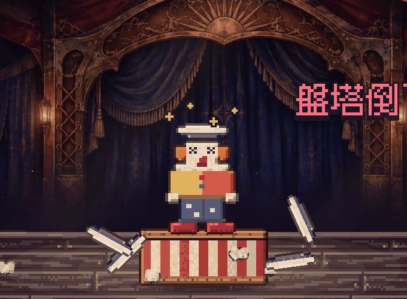

# [SG-71] 實作接飛碟

> 狀態：完成

## 內文

### 需求

小丑從舞台兩側丟出飛碟，在飛碟飛到手邊的那一瞬按鍵接住；接得越漂亮分數越高，連續接住會疊成越來越高的盤塔。佔用鏡之馬戲團的 game-052 位置，取代原本偏向規劃與多按鈕的設計。

### 來源

2026-11-27 使用者要求持續新增多樣化、不重複、不讓人厭倦的玩法，小遊戲要單純好玩（Bomberman Land 3 方向）。原目錄的設計偏向規劃與多按鈕，改寫為單一動詞的街機式小遊戲；準則見 design/00-principles/simple-fun-minigames.md。

### 驗收條件

- [x] 飛碟的速度、弧度與同時數量隨回合增加，偶爾混入要放過的炸彈派。
- [x] 接漏時盤塔整疊倒下砸在小丑頭上。
- [x] 整款只用方向鍵與一到兩顆按鍵，畫面上沒有操作按鈕面板；進場五秒內開始操作，沒有強制教學頁。
- [x] 一回合不超過 60 秒，回合內速度或變化明顯升級；至少兩種隨機出現的變奏。
- [x] 結算只顯示一個分數、銅銀金獎牌與一句評語；銅牌取得普通拍貼，未用輔助的金牌取得小惡魔拍貼。
- [x] 失敗有專屬的好笑演出。
- [x] 玩法物件達到街機小遊戲的畫面下限：沒有大面積純色、有材質與受光、描邊、接地陰影，色調與背景一致。
- [x] 鍵盤與手把都能完成；開啟減少動態後仍可遊玩。
- [x] 通過稽核十問，結果寫在設計目錄的該款說明；該區原有互動與其他小遊戲不受影響。

### 測試流程

1. 從區域入口進場，不看說明直接玩一回合。
2. 故意失敗一次，再玩到銅牌與金牌。
3. 開啟減少動態與手把各玩一回合，確認拍貼入冊與重開後保留。

---

# 跟其他票的關係

- Blocks：無
- Blocked by：無
- Related：SG-66、ART-57

---

---

# Commit-1

## 內文

鏡之馬戲團原本只有兩款小遊戲，入口東側那塊空地墊一直空著。
現在那裡立起一台頂著一疊盤子的機台，開放「接飛碟」，與哈哈鏡大頭貼左右對稱。畫面是帳篷舞台：小丑站在紅白條紋鼓上，兩側絲絨側幕裡伸出戴白手套的手丟盤子，盤子轉著飛向小丑身後的金圈；每個飛來的東西都帶一個外圈，外圈縮到金圈那一刻按空白鍵（或 E、手把 A 鈕、點畫面）就接住，盤子翻上小丑的禿頭疊成盤塔。盤塔越高每接一個越多分（10 分起，每層加 2 分，最多加 20），正中再加 5 分；盤塔越高晃得越厲害。沒東西時亂按，最上面的盤子會滑掉。奶油派是紅色外圈、上面打叉並寫著「別接！」，放過去得 10 分，接到就滿臉奶油、盤塔整疊倒光。漏接一個盤子，整座盤塔砸在小丑頭上、碎了一地，他頭頂卡著一個盤子眼冒金星；每回合第一次漏接不算失誤。一回合 45 秒，盤子由 1.7 秒飛到 0.95 秒，間隔變短，後段兩側一前一後成雙飛來並混入奶油派。每回合隨機一種變奏：標準飛碟、奶油派大放送、成雙飛碟、高拋飛碟。倒數時小丑自己示範接一個盤子。獎牌線為銅 250、銀 600、金 950。
這款依目錄位置排在第四號，沿用溫室先落地的「每款保留自己的目錄位置」規則：拍貼、成就與收藏冊都以 game-052 的第四號登記，尚未交付的 game-051、game-053 保留原位。
以實際按鍵事件在原生畫面玩完一回合（奶油派大放送，故意漏接一個、接一塊派，948 分銀牌），逐張看過開場、外圈縮小、盤塔倒下、滿臉奶油與結算畫面後，修正了金圈被小丑身體擋住、高拋盤子撞上獎牌條、回饋字蓋住盤塔三個問題，並改用共用的舞台地板、絲絨側幕與落地揚塵。規則測試以模擬輸入玩出四種變奏的金牌（1175 至 1655 分）、每次慢半拍又每五個漏一個的銅牌回合、狂按按鍵不得牌與輔助金牌（不發小惡魔）。提示音沿用既有音符，實際聽感未經真人確認；手把以按鈕事件驗證，未接實體手把；減少動態時盤塔不晃、盤子不轉、碎片與揚塵不飛，只以程式檢查，未另外原生擷取。難度與「看一眼就懂」依畫面與模擬輸入判斷，尚未由真人試玩。

### 測試結果

| 項目 | 結果 |
|---|---|
| 接飛碟規則 | 通過：金圈時機、盤塔加分、亂按掉盤、漏接倒塔、奶油派、加速與成雙、四種變奏、金牌與銅牌整回合 |
| 局部回歸 | 18 組 Godot 測試通過：啟動、主場景、參與結算、區域往返、馬戲團世界、場景規範、遊戲目錄、教學三組、街機共用流程與其餘五款街機遊戲；「像素教學頁」一組在 game-061 與 game-073 的教學文字溢出，主線上原本就失敗，與本款無關 |
| 設計與資料驗證 | 5 個範圍通過；Python 測試 216 項通過 |
| 原生畫面 | 遊玩中每格 82 至 99 次繪製呼叫、363 個節點；遊玩過程無 ERROR |

### 截圖

