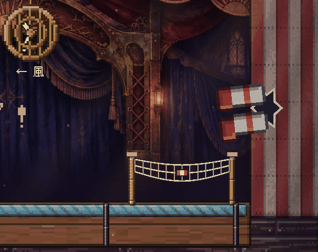

# [SG-72] 實作人肉砲彈

> 狀態：完成

## 內文

### 需求

按住壓緊彈簧砲，放開把小丑射向左右移動的救生網；落點越接近網心分數越高。佔用鏡之馬戲團的 game-055 位置，取代原本偏向規劃與多按鈕的設計。

### 來源

2026-11-27 使用者要求持續新增多樣化、不重複、不讓人厭倦的玩法，小遊戲要單純好玩（Bomberman Land 3 方向）。原目錄的設計偏向規劃與多按鈕，改寫為單一動詞的街機式小遊戲；準則見 design/00-principles/simple-fun-minigames.md。

### 驗收條件

- [x] 網子移動越來越快、會變小，並出現吹偏彈道的風扇。
- [x] 射偏時小丑卡進帳篷布或掉進水桶。
- [x] 整款只用方向鍵與一到兩顆按鍵，畫面上沒有操作按鈕面板；進場五秒內開始操作，沒有強制教學頁。
- [x] 一回合不超過 60 秒，回合內速度或變化明顯升級；至少兩種隨機出現的變奏。
- [x] 結算只顯示一個分數、銅銀金獎牌與一句評語；銅牌取得普通拍貼，未用輔助的金牌取得小惡魔拍貼。
- [x] 失敗有專屬的好笑演出。
- [x] 玩法物件達到街機小遊戲的畫面下限：沒有大面積純色、有材質與受光、描邊、接地陰影，色調與背景一致。
- [x] 鍵盤與手把都能完成；開啟減少動態後仍可遊玩。
- [x] 通過稽核十問，結果寫在設計目錄的該款說明；該區原有互動與其他小遊戲不受影響。

### 測試流程

1. 從區域入口進場，不看說明直接玩一回合。
2. 故意失敗一次，再玩到銅牌與金牌。
3. 開啟減少動態與手把各玩一回合，確認拍貼入冊與重開後保留。

---

# 跟其他票的關係

- Blocks：無
- Blocked by：無
- Related：SG-66、ART-57

---

---

# Commit-1

## 內文

鏡之馬戲團的大帳篷裡有一門人體大砲，卻沒有可以玩的人肉砲彈。
現在表演圈西北側的空地墊換成一台頂著小砲管的藍色機台，開放「人肉砲彈」。畫面左邊是架在橡木砲車上的紅色條紋大砲，砲尾露出彈簧、旁邊有壓力錶；中間是一長條水槽，救生網架在水槽上左右滑動，右邊是紅白條紋的帳篷布。按住空白鍵（或 E、手把 A 鈕、點住畫面）彈簧越壓越短、壓力錶指針往上走，水槽邊同時出現寫著「落點」的金色箭頭；放開就把小丑射出去。落進網子就有分，越靠近網中間的紅布越高（20 到 50 分），正中網心再加 20 分，連續進網每次多 5 分。力道不夠，小丑噗通掉進水槽、只露出戴蛙鏡的頭；壓太緊，他整個人卡進帳篷布，只剩兩條腿在破洞外亂踢；壓過壓力錶紅區彈簧會自己彈出去，所以最好的力道永遠不是最大。每回合第一次失手不算失誤。一回合 45 秒，網子由每秒 150 滑到 400 像素、由 230 縮到 120 寬，後半段吊在上方的風扇會把落點吹偏（畫面標出風向）。每回合隨機一種變奏：標準砲、迷你網、大風扇（一開始就有風）、看不到落點（後半段落點箭頭消失）。倒數時大砲自己示範射一發進網。獎牌線為銅 250、銀 550、金 850。
以實際按鍵事件在原生畫面玩完一回合（大風扇變奏，故意射短一發、壓爆一發，965 分金牌），逐張看過蓄力、飛行、進網、掉水槽、卡帳篷與結算畫面後，修正了砲管浮在砲車上方、砲車被輪子遮住、砲身花紋像棋盤格、落點箭頭太小、卡帳篷時只看得到一點點腳五個問題。規則測試以模擬輸入玩出四種變奏的金牌（1195 至 1309 分）、只提前一半的銅牌回合（372 分）、按住不放每發都穿帳篷的 0 分回合與輔助金牌（不發小惡魔）。提示音沿用既有音符，實際聽感未經真人確認；手把以按鈕事件驗證，未接實體手把；減少動態時砲身不抖、水花與碎布不飛、網子不彈，只以程式檢查，未另外原生擷取。難度與「看一眼就懂」依畫面與模擬輸入判斷，尚未由真人試玩。

### 測試結果

| 項目 | 結果 |
|---|---|
| 人肉砲彈規則 | 通過：蓄力與發射、壓過頭自動發射、網心計分與連續加分、掉水槽與卡帳篷、網子加速縮小、風扇吹偏、四種變奏、金牌與銅牌整回合 |
| 局部回歸 | 15 組 Godot 測試通過：啟動、主場景、參與結算、區域往返、馬戲團世界、場景規範、遊戲目錄、教學兩組、街機共用流程、接飛碟與其餘馬戲團街機遊戲 |
| 設計與資料驗證 | 5 個範圍通過 |
| 原生畫面 | 遊玩中每格約 100 至 115 次繪製呼叫、369 個節點；遊玩過程無 ERROR |

### 截圖

