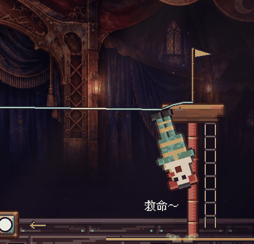

# [SG-73] 實作走鋼索

> 狀態：完成

## 內文

### 需求

小丑自動往前走，玩家用左右平衡搖晃的長桿，撐過風、鴿子與觀眾丟的帽子走到對岸。佔用鏡之馬戲團的 game-057 位置，取代原本偏向規劃與多按鈕的設計。

### 來源

2026-11-27 使用者要求持續新增多樣化、不重複、不讓人厭倦的玩法，小遊戲要單純好玩（Bomberman Land 3 方向）。原目錄的設計偏向規劃與多按鈕，改寫為單一動詞的街機式小遊戲；準則見 design/00-principles/simple-fun-minigames.md。

### 驗收條件

- [x] 晃動來源越來越多、節奏越來越亂，鋼索後段會上下彈。
- [x] 失衡時小丑抱住鋼索倒吊晃來晃去。
- [x] 整款只用方向鍵與一到兩顆按鍵，畫面上沒有操作按鈕面板；進場五秒內開始操作，沒有強制教學頁。
- [x] 一回合不超過 60 秒，回合內速度或變化明顯升級；至少兩種隨機出現的變奏。
- [x] 結算只顯示一個分數、銅銀金獎牌與一句評語；銅牌取得普通拍貼，未用輔助的金牌取得小惡魔拍貼。
- [x] 失敗有專屬的好笑演出。
- [x] 玩法物件達到街機小遊戲的畫面下限：沒有大面積純色、有材質與受光、描邊、接地陰影，色調與背景一致。
- [x] 鍵盤與手把都能完成；開啟減少動態後仍可遊玩。
- [x] 通過稽核十問，結果寫在設計目錄的該款說明；該區原有互動與其他小遊戲不受影響。

### 測試流程

1. 從區域入口進場，不看說明直接玩一回合。
2. 故意失敗一次，再玩到銅牌與金牌。
3. 開啟減少動態與手把各玩一回合，確認拍貼入冊與重開後保留。

---

# 跟其他票的關係

- Blocks：無
- Blocked by：無
- Related：SG-66、ART-57

---

---

# Commit-1

## 內文

影子台東北角的空地墊一直空著，馬戲團也還沒有考平衡的遊戲。
現在那裡立起一台頂著迷你鋼索的綠色機台，開放「走鋼索」。畫面是帳篷高處：兩根紅色桅杆之間拉著一條鋼索，下面是遠遠的舞台地板和一排觀眾的頭。小丑拿著長長的平衡桿自己往前走，玩家只負責左右撐住：按左（A、十字鍵或左搖桿）桿子往左撐，按右往右撐。每走一步小丑都會晃一下，畫面最下方的黃銅水平儀顯示他歪了多少，氣泡在綠色中間時算站穩、每走 10 像素得 2 分，晃著走只得三分之一；走到對面平台加 60 分，然後轉身走回來。干擾一律提前 0.8 秒出現：側邊吹來的風（畫面標出風向）、飛來停在桿子一端的鴿子（「咕！」）、從觀眾席丟上來咚一聲撞到身上的帽子；後段鋼索還會上下彈。歪過頭時小丑會翻過去用腳勾住鋼索倒吊、晃來晃去喊「救命～」，平衡桿掉到地上揚起灰塵，等 2.2 秒爬回來才能繼續；每回合第一次倒吊不算失誤。一回合 50 秒，小丑越走越快、越來越容易倒，干擾由約 3 秒一次變成 1 秒多一次。每回合隨機一種變奏：標準鋼索、穿堂風、鴿子大會、彈簧鋼索（一開始就會彈）。倒數時小丑自己晃著走幾步示範。獎牌線為銅 350、銀 650、金 950。
以實際按鍵事件在原生畫面玩完一回合（標準鋼索，中途故意放手一次讓他倒吊，1026 分金牌），逐張看過開場、風、鴿子、倒吊、走到對岸與結算畫面後，修正了一開始撐桿方向相反的錯誤、水平儀壓到提示列，並在空蕩的下半部加上觀眾席。規則測試以模擬輸入玩出四種變奏的金牌、反應慢又撐過頭的銅牌回合（393 分）、完全不碰的 262 分回合（不得牌）與輔助金牌（不發小惡魔）。提示音沿用既有音符，實際聽感未經真人確認；手把以按鈕事件驗證，未接實體手把；減少動態時小丑不晃步、觀眾不動、鴿子與帽子直接到位、倒吊不擺盪，只以程式檢查，未另外原生擷取。難度與「看一眼就懂」依畫面與模擬輸入判斷，尚未由真人試玩。

### 測試結果

| 項目 | 結果 |
|---|---|
| 走鋼索規則 | 通過：自動前進、左右撐桿、站穩加倍、倒吊與爬回、風鴿子帽子的預告與推力、加速與鋼索彈跳、四種變奏、金牌與銅牌整回合 |
| 局部回歸 | 23 組 Godot 測試通過：啟動、主場景、參與結算、區域往返、馬戲團世界、場景規範、遊戲目錄、教學三組、街機共用流程與全部十二款街機遊戲；「教學頁與目錄」一組在機器滿載時超過自身 45 秒看門狗一次，單獨重跑 40 秒通過 |
| 設計與資料驗證 | 5 個範圍通過 |
| 原生畫面 | 遊玩中每格約 90 至 105 次繪製呼叫、375 個節點；遊玩過程無 ERROR |

### 截圖

