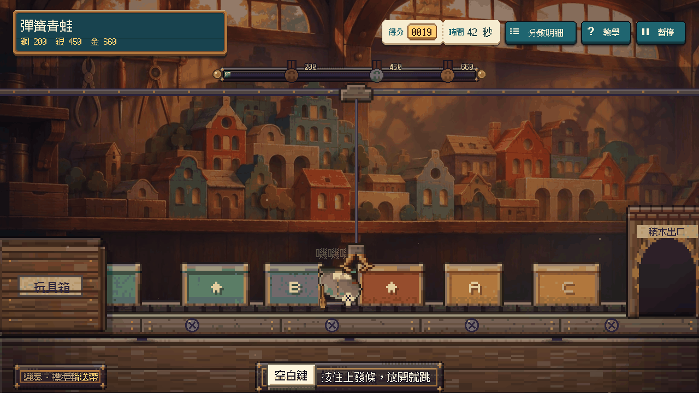

# [SG-74] 實作彈簧青蛙

> 狀態：完成

## 內文

### 需求

按住蓄力、放開讓發條青蛙跳上在輸送帶上移動的積木，跳得越遠越接近終點。佔用發條玩具城的 game-065 位置，取代原本偏向規劃與多按鈕的設計。

### 來源

2026-11-27 使用者要求持續新增多樣化、不重複、不讓人厭倦的玩法，小遊戲要單純好玩（Bomberman Land 3 方向）。原目錄的設計偏向規劃與多按鈕，改寫為單一動詞的街機式小遊戲；準則見 design/00-principles/simple-fun-minigames.md。

### 驗收條件

- [x] 積木間距與速度增加，出現會縮回的積木與彈跳墊。
- [x] 跳空時青蛙發條鬆掉，在地上原地打轉。
- [x] 整款只用方向鍵與一到兩顆按鍵，畫面上沒有操作按鈕面板；進場五秒內開始操作，沒有強制教學頁。
- [x] 一回合不超過 60 秒，回合內速度或變化明顯升級；至少兩種隨機出現的變奏。
- [x] 結算只顯示一個分數、銅銀金獎牌與一句評語；銅牌取得普通拍貼，未用輔助的金牌取得小惡魔拍貼。
- [x] 失敗有專屬的好笑演出。
- [x] 玩法物件達到街機小遊戲的畫面下限：沒有大面積純色、有材質與受光、描邊、接地陰影，色調與背景一致。
- [x] 鍵盤與手把都能完成；開啟減少動態後仍可遊玩。
- [x] 通過稽核十問，結果寫在設計目錄的該款說明；該區原有互動與其他小遊戲不受影響。

### 測試流程

1. 從區域入口進場，不看說明直接玩一回合。
2. 故意失敗一次，再玩到銅牌與金牌。
3. 開啟減少動態與手把各玩一回合，確認拍貼入冊與重開後保留。

---

# 跟其他票的關係

- Blocks：無
- Blocked by：無
- Related：SG-66、ART-57

---

---

# Commit-1

## 內文

發條玩具城只有兩款街機式小遊戲，積木街北端沒有可玩的設施。
現在積木街北端、維修台旁多了一座櫃台上有發條青蛙與一排積木的攤位，開放第五站「彈簧青蛙」。工作坊長凳上有一條鉚釘鐵皮輸送帶，把彩色字母積木從右邊的隧道一路送向左邊的玩具箱；按住按鍵，青蛙蹲低、背上的蝴蝶鑰匙轉動、頭上的黃銅錶指針往右掃，放開就跳，按越久跳越遠。落在積木正中間最多分，跨過一塊積木再加分，連跳越多次越高分；在同一塊上原地跳不算分。跳進縫裡、撞到隧道或待太久被送進玩具箱，青蛙會肚子朝天在輸送帶上打轉、發條嘰嘰嘰鬆掉，等吊車沿著軌道過來把牠撈回積木上。輸送帶越跑越快、縫越拉越大，後段出現底下有黃黑條紋、抖一抖就縮回去的積木，以及會自動把青蛙彈到下一塊正中間的彈跳墊。每回合隨機一種變奏：標準輸送帶、迷你積木、彈簧派對、加速輸送帶；倒數時青蛙會自己示範一跳。
另外補回玩具城街機遊戲共用的工作坊背景圖：先前改建玩具城時原圖被刪掉，只剩本機匯入快取，乾淨的環境會退回純色牆。
以原生畫面送出按鍵事件玩過開場、上發條、起跳與結算，跳空畫面以程式指定落點觸發；逐張看過，並在玩具城以原生畫面確認攤位位置與互動提示。規則測試以模擬輸入玩出四種變奏的金牌、粗略跳法的銅牌、只會連點的回合（不得牌）與輔助金牌（不發小惡魔）。手把以 A 鈕事件驗證，沒有接實體手把；減少動態時打轉、揚塵與錶面反光會停下，未另外原生擷取。難度與「看一眼就懂」是依畫面與模擬輸入判斷，尚未由真人試玩。

### 測試結果

| 項目 | 結果 |
|---|---|
| 彈簧青蛙規則 | 通過：示範跳、上發條、落點分數、跨塊加分、跳空與吊車、玩具箱、縮回積木、彈跳墊、加速、四種變奏、手把、金牌與銅牌整回合 |
| 局部回歸 | 遊戲目錄、參與結算、補拍、玩具城世界、區域往返、教學目錄、場景規範、街機共用流程、其餘街機遊戲、主場景與啟動通過 |
| 設計與資料驗證 | 全部範圍通過；Python 測試全數通過 |
| 原生畫面 | 遊戲中每格約 125 至 140 次繪製呼叫、331 個節點；玩具城含三座攤位時共 264 個節點 |

### 截圖

