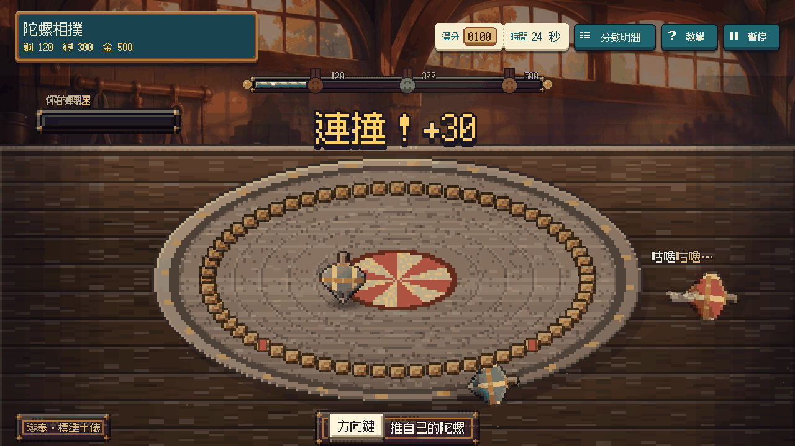

# [SG-75] 實作陀螺相撲

> 狀態：完成

## 內文

### 需求

用方向鍵推動自己的陀螺，把對手陀螺撞出圓盤；陀螺會慢慢失速，撞擊能讓它重新加速。佔用發條玩具城的 game-068 位置，取代原本偏向規劃與多按鈕的設計。

### 來源

2026-11-27 使用者要求持續新增多樣化、不重複、不讓人厭倦的玩法，小遊戲要單純好玩（Bomberman Land 3 方向）。原目錄的設計偏向規劃與多按鈕，改寫為單一動詞的街機式小遊戲；準則見 design/00-principles/simple-fun-minigames.md。

### 驗收條件

- [x] 對手數量與體型增加，圓盤邊緣會縮小。
- [x] 被撞出場時陀螺倒地滾到桌角，捲起一團灰塵。
- [x] 整款只用方向鍵與一到兩顆按鍵，畫面上沒有操作按鈕面板；進場五秒內開始操作，沒有強制教學頁。
- [x] 一回合不超過 60 秒，回合內速度或變化明顯升級；至少兩種隨機出現的變奏。
- [x] 結算只顯示一個分數、銅銀金獎牌與一句評語；銅牌取得普通拍貼，未用輔助的金牌取得小惡魔拍貼。
- [x] 失敗有專屬的好笑演出。
- [x] 玩法物件達到街機小遊戲的畫面下限：沒有大面積純色、有材質與受光、描邊、接地陰影，色調與背景一致。
- [x] 鍵盤與手把都能完成；開啟減少動態後仍可遊玩。
- [x] 通過稽核十問，結果寫在設計目錄的該款說明；該區原有互動與其他小遊戲不受影響。

### 測試流程

1. 從區域入口進場，不看說明直接玩一回合。
2. 故意失敗一次，再玩到銅牌與金牌。
3. 開啟減少動態與手把各玩一回合，確認拍貼入冊與重開後保留。

---

# 跟其他票的關係

- Blocks：無
- Blocked by：無
- Related：SG-66、ART-57

---

---

# Commit-1

## 內文

發條玩具城的積木街南段沒有可玩的設施，原目錄第八站「陀螺迴廊」要拉繩起轉再預判碰撞折向，偏規劃與作業感。
現在球池旁多了一座櫃台上有錫盤和兩顆陀螺對峙、屋頂頂著大陀螺的攤位，開放第八站「陀螺相撲」。工作坊長凳上擺著一只壓花錫盤，圍著一圈草繩；用方向鍵推頭上標著「你」的紅陀螺，把其他陀螺撞出草繩。被你撞出去才算分（一個 20 分，大個子 35 分，一秒半內連撞再加 10 分）；每顆陀螺都會慢慢沒力、越晃越大，用力撞到對手時會迸出火花，左上的轉速條跟著補回來。自己衝出草繩或被撞出去，紅陀螺會倒下咕嚕咕嚕滾到桌角、揚起灰塵；轉速掉光也會原地倒下，等一下才有新陀螺從中間落下。草繩會一路往內縮，對手從一個增加到三個，後段出現撞不太動的大個子；被撞到的對手會暈一下再追過來。每回合隨機一種變奏：標準土俵、滑溜鐵盤、大亂鬥、重量級；倒數時自己的陀螺會先撞一下對手示範。
以原生畫面送出方向鍵事件玩過一段，逐張看過開場、撞擊、被撞出去與結算，並在玩具城以原生畫面確認攤位位置與互動提示；被撞出去的畫面以程式把陀螺放到草繩外觸發。規則測試以模擬方向鍵玩出四種變奏的金牌、常發呆的銅牌、站著不動的回合（不得牌）與輔助金牌（不發小惡魔），並以手把搖桿事件驗證操作。減少動態時晃動、火花與揚塵會停下，未另外原生擷取。難度與「看一眼就懂」是依畫面與模擬輸入判斷，尚未由真人試玩。

### 測試結果

| 項目 | 結果 |
|---|---|
| 陀螺相撲規則 | 通過：示範撞擊、推動、轉速流失、撞擊補轉、得分與連撞、出場與倒下、草繩內縮、對手增加與大個子、四種變奏、手把、金牌與銅牌整回合 |
| 局部回歸 | 遊戲目錄、參與結算、補拍、玩具城世界、區域往返、教學目錄、場景規範、街機共用流程、彈簧青蛙、主場景與啟動通過 |
| 設計與資料驗證 | 全部範圍通過；Python 測試全數通過 |
| 原生畫面 | 遊戲中每格約 87 至 97 次繪製呼叫、331 個節點；玩具城含四座攤位共 269 個節點 |

### 截圖

