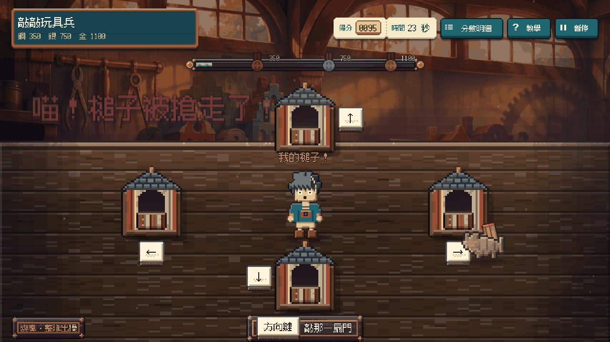

# [SG-76] 實作敲敲玩具兵

> 狀態：完成

## 內文

### 需求

四扇小門會隨機冒出玩具兵，按對應方向敲回去；冒出偷懶的貓咪時不能敲。佔用發條玩具城的 game-070 位置，取代原本偏向規劃與多按鈕的設計。

### 來源

2026-11-27 使用者要求持續新增多樣化、不重複、不讓人厭倦的玩法，小遊戲要單純好玩（Bomberman Land 3 方向）。原目錄的設計偏向規劃與多按鈕，改寫為單一動詞的街機式小遊戲；準則見 design/00-principles/simple-fun-minigames.md。

### 驗收條件

- [x] 冒出速度加快、出現同時兩扇與假動作。
- [x] 敲到貓咪時貓咪生氣把槌子搶走。
- [x] 整款只用方向鍵與一到兩顆按鍵，畫面上沒有操作按鈕面板；進場五秒內開始操作，沒有強制教學頁。
- [x] 一回合不超過 60 秒，回合內速度或變化明顯升級；至少兩種隨機出現的變奏。
- [x] 結算只顯示一個分數、銅銀金獎牌與一句評語；銅牌取得普通拍貼，未用輔助的金牌取得小惡魔拍貼。
- [x] 失敗有專屬的好笑演出。
- [x] 玩法物件達到街機小遊戲的畫面下限：沒有大面積純色、有材質與受光、描邊、接地陰影，色調與背景一致。
- [x] 鍵盤與手把都能完成；開啟減少動態後仍可遊玩。
- [x] 通過稽核十問，結果寫在設計目錄的該款說明；該區原有互動與其他小遊戲不受影響。

### 測試流程

1. 從區域入口進場，不看說明直接玩一回合。
2. 故意失敗一次，再玩到銅牌與金牌。
3. 開啟減少動態與手把各玩一回合，確認拍貼入冊與重開後保留。

---

# 跟其他票的關係

- Blocks：無
- Blocked by：無
- Related：SG-66、ART-57

---

---

# Commit-1

## 內文

發條玩具城積木街中段沒有可玩的設施，原目錄第十站「鐘擺敲門」要配合擺錘在窗口間規劃敲擊，偏規劃與作業感。
現在積木街的告示牌旁多了一座櫃台上有哨亭、探頭玩具兵與木槌，屋頂架著大木槌的攤位，開放第十站「敲敲玩具兵」。工作坊長凳上，島上的主角扛著大木槌站在四座紅白條紋哨亭中間，每座哨亭旁的按鍵標著上、左、右、下；戴高帽的玩具兵從哪座哨亭的半截門後冒出來，就按那個方向，主角往那邊一指，木槌掄過去砸下，玩具兵被敲扁冒星星。冒出來 0.35 秒內敲到再加分，連敲越多次越高分；沒敲到的兵會吐舌頭溜走，敲到空哨亭扣 5 分、槌子還要彈一下。窗台上有時會睡著一隻打呼的虎斑貓，敲下去貓咪會氣得叼走木槌大搖大擺走開，主角兩手空空大叫「我的槌子！」，過一陣子才拿回來。玩具兵冒得越來越快、停得越來越短，後段同時開兩扇門，也有探個頭就縮回去的假動作。每回合隨機一種變奏：整隊出操、雙門齊開、貓咪巡邏、快步操練；倒數時木槌會自己敲掉第一個兵。
以原生畫面送出方向鍵事件玩過一段，逐張看過開場示範、玩具兵與貓咪同時出現、敲中、敲到貓咪與結算，並在玩具城以原生畫面確認攤位位置與互動提示；同時出現的畫面以程式指定哪兩座哨亭開門。規則測試以模擬方向鍵玩出四種變奏的金牌、反應慢又漏敲的銅牌、四個方向亂按的回合（不得牌）與輔助金牌（不發小惡魔），並以手把十字鍵事件驗證操作。減少動態時貓咪呼吸、星星與揚塵會停下，未另外原生擷取。教學頁的版面檢查會逐課翻過每一頁，課數變多後在機器忙碌時超過固定的 45 秒逾時上限，改為依課數放寬（每課 1.5 秒），檢查內容不變。難度與「看一眼就懂」是依畫面與模擬輸入判斷，尚未由真人試玩。

### 測試結果

| 項目 | 結果 |
|---|---|
| 敲敲玩具兵規則 | 通過：示範、四個方向、計分與連敲、溜走、敲空、假動作、貓咪搶槌與歸還、加速、兩扇門、四種變奏、手把、金牌與銅牌整回合 |
| 局部回歸 | 遊戲目錄、參與結算、補拍、玩具城世界、區域往返、教學目錄、場景規範、街機共用流程與其他街機遊戲、主場景與啟動通過 |
| 設計與資料驗證 | 全部範圍通過；Python 測試全數通過 |
| 原生畫面 | 遊戲中每格約 96 至 110 次繪製呼叫、331 個節點；玩具城含五座攤位共 274 個節點 |

### 截圖

