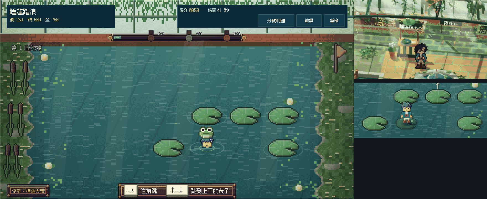

# [SG-77] 實作睡蓮踏浪

> 狀態：完成

## 內文

### 需求

睡蓮葉會慢慢下沉，按方向跳到下一片葉子，在沉下去之前跳過整個池塘。佔用苔光溫室的 game-077 位置，取代原本偏向規劃與多按鈕的設計。

### 來源

2026-11-27 使用者要求持續新增多樣化、不重複、不讓人厭倦的玩法，小遊戲要單純好玩（Bomberman Land 3 方向）。原目錄的設計偏向規劃與多按鈕，改寫為單一動詞的街機式小遊戲；準則見 design/00-principles/simple-fun-minigames.md。

### 驗收條件

- [x] 葉子下沉越來越快、會漂動，出現會把人彈高的大葉子。
- [x] 落水時角色冒出水面頭頂一隻青蛙。
- [x] 整款只用方向鍵與一到兩顆按鍵，畫面上沒有操作按鈕面板；進場五秒內開始操作，沒有強制教學頁。
- [x] 一回合不超過 60 秒，回合內速度或變化明顯升級；至少兩種隨機出現的變奏。
- [x] 結算只顯示一個分數、銅銀金獎牌與一句評語；銅牌取得普通拍貼，未用輔助的金牌取得小惡魔拍貼。
- [x] 失敗有專屬的好笑演出。
- [x] 玩法物件達到街機小遊戲的畫面下限：沒有大面積純色、有材質與受光、描邊、接地陰影，色調與背景一致。
- [x] 鍵盤與手把都能完成；開啟減少動態後仍可遊玩。
- [x] 通過稽核十問，結果寫在設計目錄的該款說明；該區原有互動與其他小遊戲不受影響。

### 測試流程

1. 從區域入口進場，不看說明直接玩一回合。
2. 故意失敗一次，再玩到銅牌與金牌。
3. 開啟減少動態與手把各玩一回合，確認拍貼入冊與重開後保留。

---

# 跟其他票的關係

- Blocks：無
- Blocked by：無
- Related：SG-66、ART-57

---

# Commit-1

## 內文

苔光溫室只有一款街機小遊戲，設計目錄的 game-077 還是要選落腳點、蓄力又推算葉子位移的舊案。
現在日照窗北側、噴泉與夜芽床之間多了一座屋頂趴著睡蓮葉與青蛙、櫃檯上擺著小水盆的攤位，開放「睡蓮踏浪」。畫面是午後陽光照進溫室的睡蓮池：主角站在左岸，三條水道的葉子一路排到右岸插旗的地方。→、空白鍵或手把 A 鈕往前跳，↑、↓ 跳到上一條或下一條水道；下一排可以落腳的葉子上會標出箭頭。葉子一被踩就開始變暗、縮小、冒泡往下沉，站太久或跳到沒有葉子的水面都會噗通落水，主角先沉下去冒泡，再頂著一隻青蛙浮上來，從原地的新葉子繼續；再落水青蛙會疊成兩隻、三隻，跳上對岸才洗掉。每跳一片 10 分，上岸加 50 分並換一座新排過的池塘。一回合 45 秒，葉子浮力由 2.6 秒降到 1 秒，後段葉子會在兩條水道間漂、出現頂著花苞的彈跳大葉，一踩就把人彈過兩排。每回合隨機一種變奏：平靜池塘、漂流荷葉、彈跳大葉。倒數時主角自己示範跳幾片。
同一張票也讓遊戲編號跟著設計目錄走：每區十二格固定編號，新款沿用它取代的那一格（睡蓮踏浪是溫室第五格，拍貼與成就也是第五格），中間還在設計的格子可以空著，資料驗證與設計驗證都改成檢查編號遞增且落在該區十二格內。
以實際按鍵事件在原生畫面玩過（跳葉、故意站到葉子沉下、跳上對岸、結算），逐張看過開場、跳躍中、下沉、落水、頂青蛙浮上、上岸與銀牌結算，修掉了只露出帽子看不到臉的浮起畫面、像紗窗的浮萍與方塊狀的岸邊石頭，並改用共用的主角像素圖。規則測試以模擬輸入玩出三種變奏的金牌（1070 至 1130 分）、反應慢又偶爾跳錯的銅牌 410 分、站在岸上不動 0 分與輔助金牌（不發小惡魔）；八十個種子、三條起跑水道、前後段各產生池塘，每片葉子都有路可走，彈跳大葉的落點都是不動的葉子。手把以十字鍵與按鈕事件驗證，沒有接實體手把；減少動態時葉子不晃、水光與漣漪靜止，只以程式檢查。難度與「看一眼就懂」依畫面與模擬輸入判斷，尚未由真人試玩。

### 測試結果

| 項目 | 結果 |
|---|---|
| 睡蓮踏浪規則 | 通過：跳躍與排隊輸入、下沉、落水與青蛙、上岸換池、池塘可走、升級、三種變奏、金牌與銅牌整回合 |
| 局部回歸 | Godot 測試通過：遊戲目錄、溫室世界、區域往返、收藏冊、教學、補拍、場景規範、街機共用流程、參與結算、啟動、主場景與其餘五款街機遊戲 |
| 設計與資料驗證 | 5 個範圍通過；Python 測試 216 項通過 |
| 原生畫面 | 遊戲中每格 95 至 135 次繪製呼叫；溫室含新攤位 304 個節點、226 次繪製；遊玩過程無 ERROR |

### 截圖

