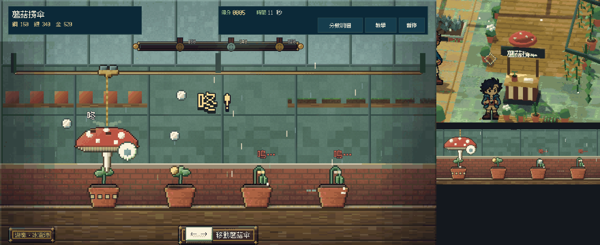

# [SG-78] 實作蘑菇撐傘

> 狀態：完成

## 內文

### 需求

左右移動蘑菇傘，替口渴的幼苗接住雨滴、擋開冰雹。佔用苔光溫室的 game-079 位置，取代原本偏向規劃與多按鈕的設計。

### 來源

2026-11-27 使用者要求持續新增多樣化、不重複、不讓人厭倦的玩法，小遊戲要單純好玩（Bomberman Land 3 方向）。原目錄的設計偏向規劃與多按鈕，改寫為單一動詞的街機式小遊戲；準則見 design/00-principles/simple-fun-minigames.md。

### 驗收條件

- [x] 雨勢與冰雹的變化增加，幼苗會輪流口渴。
- [x] 幼苗被冰雹打到時垂頭喪氣、蘑菇傘被打凹。
- [x] 整款只用方向鍵與一到兩顆按鍵，畫面上沒有操作按鈕面板；進場五秒內開始操作，沒有強制教學頁。
- [x] 一回合不超過 60 秒，回合內速度或變化明顯升級；至少兩種隨機出現的變奏。
- [x] 結算只顯示一個分數、銅銀金獎牌與一句評語；銅牌取得普通拍貼，未用輔助的金牌取得小惡魔拍貼。
- [x] 失敗有專屬的好笑演出。
- [x] 玩法物件達到街機小遊戲的畫面下限：沒有大面積純色、有材質與受光、描邊、接地陰影，色調與背景一致。
- [x] 鍵盤與手把都能完成；開啟減少動態後仍可遊玩。
- [x] 通過稽核十問，結果寫在設計目錄的該款說明；該區原有互動與其他小遊戲不受影響。

### 測試流程

1. 從區域入口進場，不看說明直接玩一回合。
2. 故意失敗一次，再玩到銅牌與金牌。
3. 開啟減少動態與手把各玩一回合，確認拍貼入冊與重開後保留。

---

# 跟其他票的關係

- Blocks：無
- Blocked by：無
- Related：SG-66、ART-57

---

# Commit-1

## 內文

設計目錄的 game-079 還是要調傘角並計算落雨的舊案，苔光溫室也只有兩款可玩。
現在溫室東南角、育苗架旁多了一座屋頂撐著紅色斑點蘑菇、櫃檯上放著一盆幼苗的攤位，開放「蘑菇撐傘」。畫面是下雨天的溫室育苗室：雨從玻璃屋頂漏下來，長凳上排著四盆幼苗，一把大蘑菇傘掛在黃銅軌道的吊車上。按住 ←、→ 或手把十字鍵左右移動，放開就停。旁邊冒出水滴泡泡的那株幼苗口渴，傘停在它正上方時，接到的雨會沿著傘柄滴進盆子，盆上的四格水滴逐格亮起，喝滿就開一朵花，再換另一株口渴。冰雹落下前會在盆上投下越來越大的影子；用傘擋住會「咚」一聲彈開、傘頂被打凹一個坑（過幾秒才彈回來），漏接打到幼苗，它就彎成一個勾、貼上OK繃哭一聲「嗚…」並扣 20 分，口渴的幼苗還會忘了剛喝的水。每接一滴 10 分，開花加 30 分，擋開冰雹 5 分。一回合 45 秒，雨越下越密，冰雹由後段加入並會三顆連下。每回合隨機一種變奏：溫室小雨、斜風細雨、冰雹陣。倒數時傘會自己移到口渴的幼苗上接雨示範。
以實際按鍵事件在原生畫面玩過（追著口渴的幼苗、故意站著不動讓冰雹打到、擋冰雹、結算），逐張看過開場、接雨、開花、冰雹影子、擋開與凹痕、彎腰的幼苗與結算，修掉了口渴泡泡被傘蓋住、被打到的幼苗太小看不出在生氣兩個問題。規則測試以模擬輸入玩出三種變奏的金牌（610 至 725 分）、只追口渴幼苗不擋冰雹的銅牌 245 分、站著不動 0 分與輔助金牌（不發小惡魔）。手把以搖桿事件驗證，沒有接實體手把；減少動態時幼苗、泡泡與水花都不動，只以程式檢查。難度與「看一眼就懂」依畫面與模擬輸入判斷，尚未由真人試玩。

### 測試結果

| 項目 | 結果 |
|---|---|
| 蘑菇撐傘規則 | 通過：移動與牆邊、接雨與滴進盆子、開花與換株、冰雹擋開與凹痕、幼苗被打到、雨勢與冰雹升級、三種變奏、金牌與銅牌整回合 |
| 局部回歸 | Godot 測試通過：遊戲目錄、溫室世界、區域往返、收藏冊、教學、補拍、場景規範、街機共用流程、參與結算、啟動、主場景與睡蓮踏浪、螢火蟲長曝光 |
| 設計與資料驗證 | 5 個範圍通過；Python 測試全數通過 |
| 原生畫面 | 遊戲中每格 82 至 110 次繪製呼叫；溫室含新攤位 309 個節點、236 次繪製；遊玩過程無 ERROR |

### 截圖

