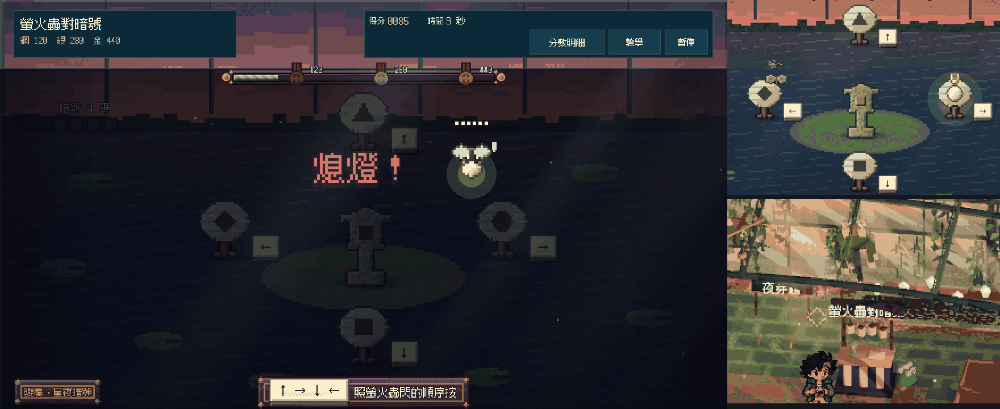

# [SG-79] 實作螢火蟲對暗號

> 狀態：完成

## 內文

### 需求

螢火蟲用四個方向的閃光打出一段暗號，玩家照順序按回去；每答對一輪暗號就加長。佔用苔光溫室的 game-080 位置，取代原本偏向規劃與多按鈕的設計。

### 來源

2026-11-27 使用者要求持續新增多樣化、不重複、不讓人厭倦的玩法，小遊戲要單純好玩（Bomberman Land 3 方向）。原目錄的設計偏向規劃與多按鈕，改寫為單一動詞的街機式小遊戲；準則見 design/00-principles/simple-fun-minigames.md。

### 驗收條件

- [x] 暗號越來越長、越來越快，出現閃兩下的音符與假閃光。
- [x] 答錯時螢火蟲全部熄燈，只剩一隻在黑暗中尷尬眨眼。
- [x] 整款只用方向鍵與一到兩顆按鍵，畫面上沒有操作按鈕面板；進場五秒內開始操作，沒有強制教學頁。
- [x] 一回合不超過 60 秒，回合內速度或變化明顯升級；至少兩種隨機出現的變奏。
- [x] 結算只顯示一個分數、銅銀金獎牌與一句評語；銅牌取得普通拍貼，未用輔助的金牌取得小惡魔拍貼。
- [x] 失敗有專屬的好笑演出。
- [x] 玩法物件達到街機小遊戲的畫面下限：沒有大面積純色、有材質與受光、描邊、接地陰影，色調與背景一致。
- [x] 鍵盤與手把都能完成；開啟減少動態後仍可遊玩。
- [x] 通過稽核十問，結果寫在設計目錄的該款說明；該區原有互動與其他小遊戲不受影響。

### 測試流程

1. 從區域入口進場，不看說明直接玩一回合。
2. 故意失敗一次，再玩到銅牌與金牌。
3. 開啟減少動態與手把各玩一回合，確認拍貼入冊與重開後保留。

---

# 跟其他票的關係

- Blocks：無
- Blocked by：無
- Related：SG-66、ART-57

---

# Commit-1

## 內文

設計目錄的 game-080 還是要遮放手燈、追蹤閃光間隔的舊案「螢光尋伴」。
現在噴泉北側、夜芽床前多了一座櫃檯上放著小石燈籠、招牌下吊著四盞亮著螢光的紙燈籠的攤位，開放「螢火蟲對暗號」。畫面是黃昏的溫室睡蓮池：池中小島上立著石燈籠，四周有四座燈座，每座刻著自己的形狀（上三角、右圓、下方塊、左菱形）並標著對應的方向鍵。螢火蟲輪流停到燈座上，形狀柔和地亮起並響出該方向自己的音，打完一段暗號後左上角寫著「換你了！」，玩家用方向鍵或十字鍵照順序按回去，左上角的格子一格格填滿。整段對上後下一段沿用同一段暗號再多一碼。按錯或太久沒按，全場燈火熄掉，只剩一隻臉紅冒汗、眼睛別開的螢火蟲尷尬地亮著尾巴，接著換一段短一碼的新暗號。每答對一碼 10 分，整段對上再加每碼 5 分。一回合 50 秒，閃光由每碼 0.78 秒加快到 0.44 秒，後段出現標著 ×2、要按兩下的雙閃，以及只會嗡嗡叫、沒有形狀的灰色飛蛾。每回合隨機一種變奏：星夜暗號、雙閃之夜、飛蛾搗蛋。倒數時螢火蟲會閃一段兩碼暗號並自己答一次。
和螢火蟲長曝光分開：那款在相機腳架後忍住不按，這款在黃昏池邊的燈座圈記住順序、照著按。四個方向各有位置、形狀與音高，不靠顏色辨認；閃光是約半拍的淡入淡出，不做頻閃，減少動態時改為靜止亮起。
以實際按鍵事件在原生畫面玩過（答對兩段、後段雙閃與飛蛾、故意按錯熄燈、結算），逐張看過開場、出題、作答、飛蛾、熄燈與結算，修掉了石燈籠擋住上方燈座、暗號格子壓在燈座上、熄燈時那隻螢火蟲太小看不出表情，以及攤位上的燈籠被溫室鐵肋擋住四個問題。規則測試以模擬輸入玩出三種變奏的金牌（555 至 660 分）、反應慢且每三段錯一次的銅牌 270 分、完全不按 0 分與輔助金牌（不發小惡魔）。手把以十字鍵對應同一組方向驗證，沒有接實體手把；四個方向的音高只以程式確認各不相同，實際聽感沒有由真人確認。難度與「看一眼就懂」依畫面與模擬輸入判斷，尚未由真人試玩。

### 測試結果

| 項目 | 結果 |
|---|---|
| 螢火蟲對暗號規則 | 通過：出題、作答、暗號加長、雙閃、飛蛾、熄燈與換題、加速、三種變奏、金牌與銅牌整回合 |
| 局部回歸 | 18 組 Godot 測試通過：遊戲目錄、溫室世界、區域往返、收藏冊、教學、補拍、場景規範、街機共用流程、參與結算、啟動、主場景與其餘七款街機遊戲 |
| 設計與資料驗證 | 5 個範圍通過；Python 測試全數通過 |
| 原生畫面 | 遊戲中每格 96 至 113 次繪製呼叫；溫室含三座新攤位 314 個節點（原本 299 個）、235 次繪製；遊玩過程無 ERROR |

### 截圖

