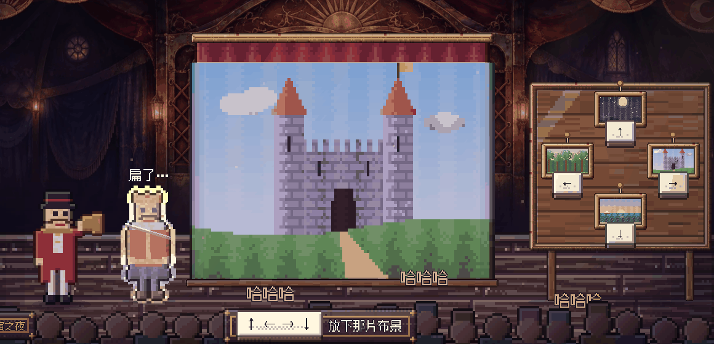

# [SG-80] 實作舞台換景

> 狀態：完成

## 內文

### 需求

演員在舞台上走，旁白喊出場景（森林、城堡、月夜），按對應方向把那片布景從天花板放下來；放錯或放慢觀眾就噓。佔用鏡之馬戲團的 game-051 位置，取代原本偏向規劃與多按鈕的設計。

### 來源

2026-11-28 使用者要求持續精進遊戲內容與畫面、做到票都完成後繼續找可做的事；鏡之馬戲團十二格只開放了一部分。依 design/00-principles/simple-fun-minigames.md 改寫為單一動詞的街機式小遊戲（Bomberman Land 3 方向）。

### 驗收條件

- [x] 布景越換越快，偶爾旁白同時喊兩片或故意喊錯又改口。
- [x] 放錯時布景砸在演員身上，演員變成紙片人從布景後走出來。
- [x] 整款只用方向鍵與一到兩顆按鍵，畫面上沒有操作按鈕面板；進場五秒內開始操作，沒有強制教學頁。
- [x] 一回合不超過 60 秒，回合內速度或變化明顯升級；至少兩種隨機出現的變奏。
- [x] 結算只顯示一個分數、銅銀金獎牌與一句評語；銅牌取得普通拍貼，未用輔助的金牌取得小惡魔拍貼。
- [x] 玩法物件達到街機小遊戲的畫面下限：沒有大面積純色、有材質與受光、描邊、接地陰影，色調與背景一致。
- [x] 鍵盤與手把都能完成；開啟減少動態後仍可遊玩。
- [x] 通過稽核十問，結果寫在設計目錄的該款說明；該區原有互動與其他小遊戲不受影響。

### 測試流程

1. 從區域攤位進場，不看說明直接玩一回合。
2. 故意失敗一次，再玩到銅牌與金牌。
3. 開啟減少動態與手把各玩一回合，確認拍貼入冊與重開後保留。

---

# 跟其他票的關係

- Blocks：無
- Blocked by：無
- Related：SG-66、ART-57

---

# Commit-1

## 內文

設計目錄的 game-051 還是要滑動三層布景、替演員規劃路線的舊案「口袋舞台」，馬戲團第三格沒有可玩的遊戲。
現在影子台東南角多了一座頂上放著小劇場（紅色幕簾、降到一半的城堡布景與拉繩）的攤位，開放「舞台換景」。畫面是帳篷裡的金色拱門小劇場：拱門裡掛著絲絨帷幔，戴紙皇冠的演員在台前來回踱步；左邊的旁白舉著喇叭喊下一場，對話框裡直接畫著那片布景，下緣的引信慢慢燒短；右邊的吊桿架上掛著四張小圖，各標著方向鍵：↑ 月夜、← 森林、→ 城堡、↓ 海邊。按對的方向，那片手繪布景就從帷幔後降下來、落地揚塵，演員舉手亮相。放錯了，那片布景整片砸在演員身上「咚！」，過一拍他被壓成帶著折痕、白邊的紙片人，從布景旁邊翻著身走出來說「扁了…」，觀眾哈哈大笑；引信燒完還沒放，全場「噓～」，一顆番茄從台下飛上來砸在演員臉上。
一回合 50 秒，作答時間由 2.4 秒縮到 1.1 秒、喊景間隔越來越短。後段旁白會同時喊兩片（兩片各降一半，拼出「月夜＋海邊」這種怪場景），或先冒著汗喊錯、名字後面拖著「……」，再打叉改口；等他改口後放對的那片有額外加分，讓搶快和聽清楚成為取捨。每片 10 分，按得快最多再加 10 分，連續放對有連擊加分。每回合隨機一種變奏：首演之夜、雙景連演、口誤旁白。倒數時旁白先喊一次「森林！」、森林自己降下來示範。第一次砸到演員不算失誤。
在原生畫面以實際按鍵事件走過倒數示範、放下布景、雙景、口誤與改口、砸到演員與紙片人、被噓與番茄、結算與收藏，逐張看過後修掉了：月夜天空的星星太密像雜訊、雙景時半邊看不到月亮與太陽、城堡塔樓和城牆分不出來、紙片人走到吊桿架後面被擋住、吊桿架的方向鍵蓋住小圖、海面的陽光反射像一道白色鋸齒，以及布景比帳篷亮太多。規則測試以模擬輸入在三種變奏都以約 0.6 秒的反應拿到金牌（928 至 1124 分）、反應慢又常上當的玩家拿到銅牌 219 分、完全不按 0 分，輔助金牌不發小惡魔拍貼。手把以十字鍵對應同一組方向驗證，沒有接實體手把；減少動態以原生畫面確認布景直接落定、演員與觀眾不晃、紙片人直接站在台側。難度與「看一眼就懂」依畫面與模擬輸入判斷，尚未由真人試玩。

### 測試結果

| 項目 | 結果 |
|---|---|
| 舞台換景規則 | 通過：喊景、放布景、快手分與連擊、放錯砸人與紙片人、被噓、雙景、口誤改口、加速、三種變奏、金牌與銅牌整回合 |
| 局部回歸 | 9 組 Godot 測試通過：遊戲目錄、馬戲團世界、區域往返、街機共用流程、失敗拍貼、教學頁、場景規範、啟動與走鋼索 |
| 設計與資料驗證 | 5 個範圍通過；Python 測試 全數通過 |
| 原生畫面 | 遊玩與結算過程無 ERROR；攤位放在影子台東南角，不擋進影子台的走道，互動點可走到 |

### 截圖

