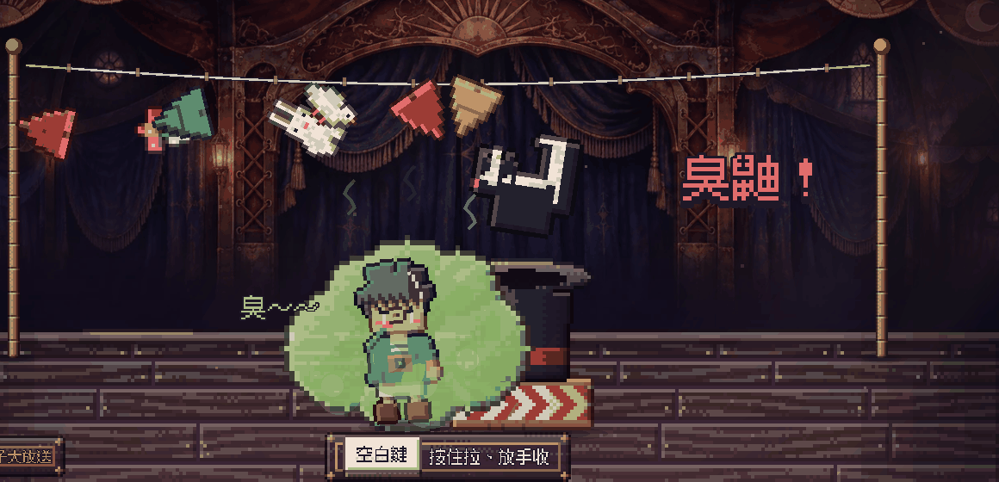

# [SG-81] 實作帽中套物

> 狀態：完成

## 內文

### 需求

按住從魔術帽裡一直拉出彩巾、兔子、花束，拉越長分數越高，但隨時可能拉出臭鼬，要在那之前放手。佔用鏡之馬戲團的 game-053 位置，取代原本偏向規劃與多按鈕的設計。

### 來源

2026-11-28 使用者要求持續精進遊戲內容與畫面、做到票都完成後繼續找可做的事；鏡之馬戲團十二格只開放了一部分。依 design/00-principles/simple-fun-minigames.md 改寫為單一動詞的街機式小遊戲（Bomberman Land 3 方向）。

### 驗收條件

- [x] 帽子會抖動或冒煙預告危險，預告有真有假。
- [x] 拉出臭鼬時一團綠煙罩住主角，主角捏著鼻子眼睛冒淚。
- [x] 整款只用方向鍵與一到兩顆按鍵，畫面上沒有操作按鈕面板；進場五秒內開始操作，沒有強制教學頁。
- [x] 一回合不超過 60 秒，回合內速度或變化明顯升級；至少兩種隨機出現的變奏。
- [x] 結算只顯示一個分數、銅銀金獎牌與一句評語；銅牌取得普通拍貼，未用輔助的金牌取得小惡魔拍貼。
- [x] 玩法物件達到街機小遊戲的畫面下限：沒有大面積純色、有材質與受光、描邊、接地陰影，色調與背景一致。
- [x] 鍵盤與手把都能完成；開啟減少動態後仍可遊玩。
- [x] 通過稽核十問，結果寫在設計目錄的該款說明；該區原有互動與其他小遊戲不受影響。

### 測試流程

1. 從區域攤位進場，不看說明直接玩一回合。
2. 故意失敗一次，再玩到銅牌與金牌。
3. 開啟減少動態與手把各玩一回合，確認拍貼入冊與重開後保留。

---

# 跟其他票的關係

- Blocks：無
- Blocked by：無
- Related：SG-66、ART-57

---

# Commit-1

## 內文

設計目錄的 game-053 還是要翻帽、推道具、開暗袋的舊案，馬戲團第五格沒有可玩的遊戲。
現在砲彈安全墊東側多了一座頂上放著倒放魔術帽、兔子探頭、彩巾垂出帽緣的攤位，開放「帽中套物」。畫面在帳篷的金色拱門前：一頂倒放的黑色魔術帽擺在紅白人字紋的馬戲鼓上，舞台上方拉著一條晾衣繩。按住空白鍵（或手把 A 鍵），主角把手伸進帽子一直拉，彩巾、花束、鴿子、兔子一樣一樣飛上晾衣繩夾好，鼓旁的小牌子即時寫著「這一帽」值多少；放手就鞠躬收下整條繩子。拉越多越值錢：三樣照原價，六樣變兩倍。每一帽裡都藏著一隻臭鼬：牠出來之前，帽子會又抖（「喀喀喀」）又冒煙；只抖或只冒煙是帽子在演戲，可以繼續拉。真預告時放手「好險！」再加 10 分。拉到臭鼬時牠從帽口跳出來搖尾巴，一團綠色臭氣罩住主角，他捏著鼻子、眼睛擠成一條線流眼淚，繩上的東西全部掉到地上。帽子拉空另加 30 分。
一回合 50 秒，拉出速度由每 0.5 秒一樣加快到 0.3 秒，臭鼬越來越早出現，預告由 0.75 秒縮到 0.45 秒，假預告越來越多。每回合隨機一種變奏：今晚的帽子、愛演的帽子（假預告多很多）、兔子大放送（兔子多、臭鼬也來得早）。倒數時主角自己拉出兩條彩巾和一隻兔子再鞠躬示範；倒數時就按住的話，一開始就會直接拉。第一次被臭到不算失誤。輔助只把預告提早、拉長，不放慢拉出的速度，避免輔助回合反而分數變低。
共用的主角小圖多了捏鼻子的姿勢與被臭到的表情（眼睛擠成線、流淚），之後其他遊戲也能用。
在原生畫面以實際按鍵事件走過倒數示範、拉出、假預告、真預告、臭鼬與綠煙、真預告時放手的「好險！」、結算，並開啟減少動態再走一次（帽子不抖、煙霧靜止、掉落的東西直接躺在地上）。逐張看過後修掉了：綠煙把主角整個蓋住看不到捏鼻子、捏鼻子的手和袖子融進臉和外套看不出來、臭鼬太小像一團黑影、「臭鼬！」字樣蓋住臭鼬，以及「喀喀喀」被主角擋住。規則測試以模擬輸入在三種變奏都以約 0.25 秒的反應、只在真預告放手拿到金牌（1471 至 1640 分），容易被假預告嚇到、最多只拉四樣的玩家拿到銅牌 648 分，只拉三樣完全不冒險約 590 至 680 分（銅牌），一直不放手每一帽都被臭到，完全不按 0 分；輔助金牌不發小惡魔拍貼。手把以 A 鍵對應同一顆按鍵驗證，沒有接實體手把。難度與「看一眼就懂」依畫面與模擬輸入判斷，尚未由真人試玩。

### 測試結果

| 項目 | 結果 |
|---|---|
| 帽中套物規則 | 通過：拉出、晾衣繩、收下、分數加乘、真假預告、臭鼬與綠煙、帽子拉空、加速、三種變奏、金牌與銅牌整回合 |
| 局部回歸 | 8 組 Godot 測試通過：遊戲目錄、馬戲團世界、區域往返、街機共用流程、失敗拍貼（新增「一直按住」的試法）、教學頁、場景規範與啟動 |
| 設計與資料驗證 | 5 個範圍通過；Python 測試 全數通過 |
| 原生畫面 | 遊玩與結算過程無 ERROR；攤位在砲彈安全墊東側，互動點可走到 |

### 截圖

