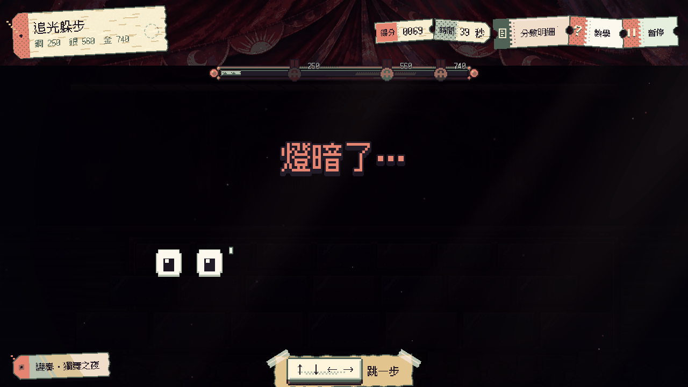

# [SG-82] 實作追光躲步

> 狀態：完成

## 內文

### 需求

聚光燈在舞台上亂跑，用方向鍵一直待在光圈裡跳舞，離開光圈太久就失敗。佔用鏡之馬戲團的 game-054 位置，取代原本偏向規劃與多按鈕的設計。

### 來源

2026-11-28 使用者要求持續精進遊戲內容與畫面、做到票都完成後繼續找可做的事；鏡之馬戲團十二格只開放了一部分。依 design/00-principles/simple-fun-minigames.md 改寫為單一動詞的街機式小遊戲（Bomberman Land 3 方向）。

### 驗收條件

- [x] 光圈會分裂、縮小、突然換方向，後段有兩盞燈互相交錯。
- [x] 失敗時燈全暗，只剩主角兩隻眼睛在黑暗裡眨。
- [x] 整款只用方向鍵與一到兩顆按鍵，畫面上沒有操作按鈕面板；進場五秒內開始操作，沒有強制教學頁。
- [x] 一回合不超過 60 秒，回合內速度或變化明顯升級；至少兩種隨機出現的變奏。
- [x] 結算只顯示一個分數、銅銀金獎牌與一句評語；銅牌取得普通拍貼，未用輔助的金牌取得小惡魔拍貼。
- [x] 玩法物件達到街機小遊戲的畫面下限：沒有大面積純色、有材質與受光、描邊、接地陰影，色調與背景一致。
- [x] 鍵盤與手把都能完成；開啟減少動態後仍可遊玩。
- [x] 通過稽核十問，結果寫在設計目錄的該款說明；該區原有互動與其他小遊戲不受影響。

### 測試流程

1. 從區域攤位進場，不看說明直接玩一回合。
2. 故意失敗一次，再玩到銅牌與金牌。
3. 開啟減少動態與手把各玩一回合，確認拍貼入冊與重開後保留。

---

# 跟其他票的關係

- Blocks：無
- Blocked by：無
- Related：SG-66、ART-57

---

# Commit-1

## 內文

設計目錄的 game-054 還是要踏步、蹲身並停在暗拍的舊案，馬戲團第六格沒有可玩的遊戲。
現在鏡廊裡、誰是假倒影旁邊多了一座頂上有小燈架、聚光燈照著格子地板上舉手小舞者的攤位，開放「追光躲步」。畫面是熄了大燈的帳篷舞台：舞台上鋪著七乘三格、紫藍相間的漆面舞池，上方桁架掛著黃銅聚光燈，打下光束與暖色光圈。用方向鍵（或十字鍵）一按跳一格，主角每跳一步換一個舞姿；在光圈裡持續跳舞會一直加分（站著不動不算分，沒按鍵的回合一定是零分），跳進光裡的那一步再加分並累積連擊（連續跳進光裡越跳越多）。離開光圈時主角變成冷藍色、腳下的紅圈逐漸填滿並跳出「回光裡！」；填滿時全場燈滅，黑暗中只剩主角兩顆大眼睛左右張望、眨眼、冒冷汗，觀眾小聲說「咦？」「停電？」，過一會兒燈從主角頭上重新亮起。
一回合 45 秒，燈速由每秒 1.1 格加快到 2.4 格，光圈由 1.35 格縮到 0.85 格，突然換方向越來越頻繁，中段光圈分裂成兩盞、各自小一點並互相交錯。可在暗處停留的時間由 1.6 秒縮到 1.0 秒。每回合隨機一種變奏：獨舞之夜、雙燈交錯（很早就分裂）、抽風燈（頻繁換方向）。倒數時主角自己跟著光跳幾步示範。第一次燈滅不算失誤。
馬戲團野外已有一款「站在聚光燈裡」的自由走動小遊戲，所以這款不做成同樣的走位，而是一按一格的跳舞：分數只來自在光裡跳舞與跳進光裡的舞步連擊，站著不動不加分；失敗也不是被噓，而是全場燈滅只剩眼睛。差異寫在設計目錄的修訂理由。
在原生畫面以實際按鍵事件走過倒數示範、跟著光跳、故意走進暗處、燈滅與眼睛、雙燈交錯、結算，並開啟減少動態再走一次。截圖使用新的拼貼式遊戲介面，逐張確認舞台物件與介面不互相遮擋；逐張看過後修掉了：燈滅時的眼睛太小看不出表情（改成大眼睛加冷汗）、大燈關得太暗連帳篷都看不見。規則測試以模擬輸入每 0.3 秒朝最近的光跳一步，在三種變奏都拿到金牌（762 至 819 分），每 0.7 秒才跳一步的玩家拿到銅牌 428 分，完全不按的回合 0 分並一再燈滅；輔助金牌不發小惡魔拍貼。手把以十字鍵對應同一組方向驗證，沒有接實體手把。難度與「看一眼就懂」依畫面與模擬輸入判斷，尚未由真人試玩。

### 測試結果

| 項目 | 結果 |
|---|---|
| 追光躲步規則 | 通過：跳步與按住連跳、光裡加分與連擊、換方向、縮小、分裂、暗處紅圈與燈滅、加速、三種變奏、金牌與銅牌整回合 |
| 局部回歸 | 9 組 Godot 測試通過：遊戲目錄、馬戲團世界、區域往返、街機共用流程、失敗拍貼、教學頁、場景規範與啟動 |
| 設計與資料驗證 | 5 個範圍通過；Python 測試 全數通過 |
| 原生畫面 | 遊玩與結算過程無 ERROR；攤位在鏡廊，互動點可走到 |

### 截圖

