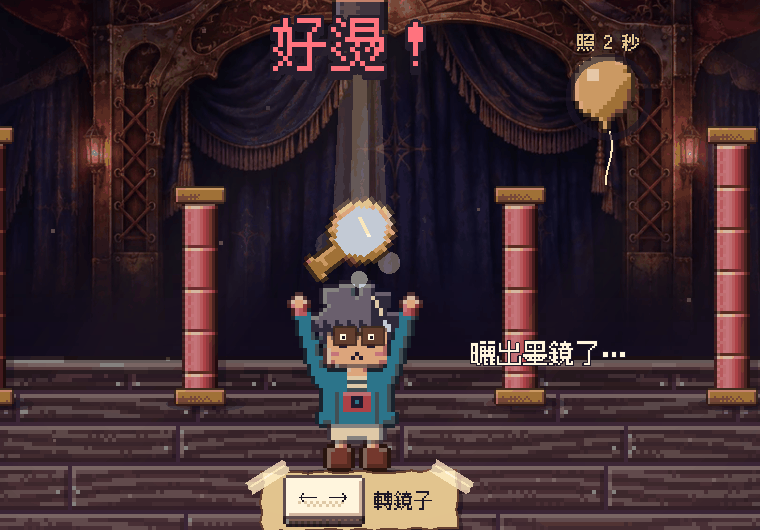

# [SG-83] 實作折鏡迷箱

> 狀態：完成

## 內文

### 需求

左右轉動手上的鏡子，把頂棚射下來的光反射到場邊一閃一閃的氣球靶上打破它們。佔用鏡之馬戲團的 game-056 位置，取代原本偏向規劃與多按鈕的設計。

### 來源

2026-11-28 使用者要求持續精進遊戲內容與畫面、做到票都完成後繼續找可做的事；鏡之馬戲團十二格只開放了一部分。依 design/00-principles/simple-fun-minigames.md 改寫為單一動詞的街機式小遊戲（Bomberman Land 3 方向）。

### 驗收條件

- [x] 靶會移動、會躲到柱子後，金色靶要連續照兩秒。
- [x] 反射光打到自己臉上時主角被曬出墨鏡形狀的黑眼圈。
- [x] 整款只用方向鍵與一到兩顆按鍵，畫面上沒有操作按鈕面板；進場五秒內開始操作，沒有強制教學頁。
- [x] 一回合不超過 60 秒，回合內速度或變化明顯升級；至少兩種隨機出現的變奏。
- [x] 結算只顯示一個分數、銅銀金獎牌與一句評語；銅牌取得普通拍貼，未用輔助的金牌取得小惡魔拍貼。
- [x] 玩法物件達到街機小遊戲的畫面下限：沒有大面積純色、有材質與受光、描邊、接地陰影，色調與背景一致。
- [x] 鍵盤與手把都能完成；開啟減少動態後仍可遊玩。
- [x] 通過稽核十問，結果寫在設計目錄的該款說明；該區原有互動與其他小遊戲不受影響。

### 測試流程

1. 從區域攤位進場，不看說明直接玩一回合。
2. 故意失敗一次，再玩到銅牌與金牌。
3. 開啟減少動態與手把各玩一回合，確認拍貼入冊與重開後保留。

---

# 跟其他票的關係

- Blocks：無
- Blocked by：無
- Related：SG-66、ART-57

---

# Commit-1

## 內文

設計目錄的 game-056 還是要折疊箱壁、推入光球的舊案，馬戲團第八格沒有可玩的遊戲。
現在鏡廊西側牆邊多了一座頂上立著金框手鏡、一道光束斜斜射向小紅氣球的攤位，開放「折鏡迷箱」。畫面在帳篷的拱門前：頂棚的黃銅聚光燈把一道光柱照在主角高舉的金框手鏡上，按住左右鍵（或十字鍵）轉鏡子，反射光帶跟著掃過場地；碰到兩旁一閃一閃的氣球就「啪！」一聲破掉，連續打破有連擊加分。金色氣球外圈有一個進度環、寫著「照 2 秒」，要連續照住兩秒才會破，分數最高。場上立著紅色矮柱，光可以從上方越過去打高處的氣球，飄得低的氣球會躲到柱子後面打不到。鏡子轉過頭時光照回主角自己臉上，先跳出「好亮！」，再照下去就「好燙！」：主角被曬出墨鏡形狀的黑眼圈、頭上冒煙，之後整回合都帶著那副曬痕。
一回合 45 秒，氣球越來越多（同時 3 顆增加到 6 顆）、飄得越來越快，金色氣球後段更常出現。每回合隨機一種變奏：氣球大會、柱子迷宮（四根柱子）、金色之夜（金色氣球多、飄得慢）。倒數時鏡子自己轉過去打破一顆氣球示範；倒數時就按住方向鍵的話，一開始就會跟著轉。第一次曬黑不算失誤。
沒有按鍵時鏡子把光直射回頂棚，氣球只會在兩旁飄、不會飄進鏡子正上方那一道，所以完全不按的回合一定是零分（以 24 個不同的亂數種子驗證）。
在原生畫面以實際按鍵事件走過倒數示範、轉鏡子打破氣球、照住金色氣球、轉過頭照到臉、曬黑與之後帶著曬痕繼續玩、結算，並開啟減少動態再走一次；截圖使用新的拼貼式遊戲介面。逐張看過後修掉了：鏡子擋在主角臉上、頂棚的燈擠到獎牌列、曬黑時臉上的強光和「好亮！」沒有消失、「曬出墨鏡了…」字樣被鏡子蓋住，以及柱子太高把幾乎所有氣球擋住（改成矮柱）。規則測試以模擬輸入在三種變奏都以約 0.15 秒換下一個目標的玩法拿到金牌（632 至 672 分），1.3 秒才換目標、瞄得粗的玩家拿到銅牌 142 分；輔助金牌不發小惡魔拍貼。手把以十字鍵對應同一組方向驗證，沒有接實體手把。難度與「看一眼就懂」依畫面與模擬輸入判斷，尚未由真人試玩。

### 測試結果

| 項目 | 結果 |
|---|---|
| 折鏡迷箱規則 | 通過：轉鏡子、光束與柱子、打破氣球、金色氣球、氣球只在兩旁（不按零分）、曬黑、加速、三種變奏、金牌與銅牌整回合 |
| 局部回歸 | 9 組 Godot 測試通過：遊戲目錄、馬戲團世界、區域往返、街機共用流程、失敗拍貼（新增「一直按住方向鍵」的試法）、教學頁、場景規範與啟動 |
| 設計與資料驗證 | 5 個範圍通過；Python 測試 全數通過 |
| 原生畫面 | 遊玩與結算過程無 ERROR；攤位在鏡廊西側，互動點可走到 |

### 截圖

