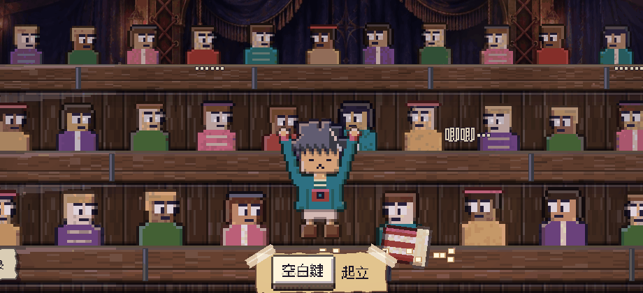

# [SG-84] 實作觀眾席波浪

> 狀態：完成

## 內文

### 需求

觀眾席的人浪一區一區傳過來，在人浪到自己那區的瞬間按鍵起立，讓人浪繞場不斷。佔用鏡之馬戲團的 game-058 位置，取代原本偏向規劃與多按鈕的設計。

### 來源

2026-11-28 使用者要求持續精進遊戲內容與畫面、做到票都完成後繼續找可做的事；鏡之馬戲團十二格只開放了一部分。依 design/00-principles/simple-fun-minigames.md 改寫為單一動詞的街機式小遊戲（Bomberman Land 3 方向）。

### 驗收條件

- [x] 人浪速度忽快忽慢，偶爾有假動作的觀眾提早站起來。
- [x] 站錯時全場只有主角一個人站著，大家轉頭看他，爆米花撒一地。
- [x] 整款只用方向鍵與一到兩顆按鍵，畫面上沒有操作按鈕面板；進場五秒內開始操作，沒有強制教學頁。
- [x] 一回合不超過 60 秒，回合內速度或變化明顯升級；至少兩種隨機出現的變奏。
- [x] 結算只顯示一個分數、銅銀金獎牌與一句評語；銅牌取得普通拍貼，未用輔助的金牌取得小惡魔拍貼。
- [x] 玩法物件達到街機小遊戲的畫面下限：沒有大面積純色、有材質與受光、描邊、接地陰影，色調與背景一致。
- [x] 鍵盤與手把都能完成；開啟減少動態後仍可遊玩。
- [x] 通過稽核十問，結果寫在設計目錄的該款說明；該區原有互動與其他小遊戲不受影響。

### 測試流程

1. 從區域攤位進場，不看說明直接玩一回合。
2. 故意失敗一次，再玩到銅牌與金牌。
3. 開啟減少動態與手把各玩一回合，確認拍貼入冊與重開後保留。

---

# 跟其他票的關係

- Blocks：無
- Blocked by：無
- Related：SG-66、ART-57

---

# Commit-1

## 內文

設計目錄的 game-058 還是要傳遞起立波、選分岔席的舊案，馬戲團第十格沒有可玩的遊戲。
現在砲彈安全墊東側、帽中套物旁邊多了一座頂上有迷你三層看台、中間兩位觀眾舉著雙手的攤位，開放「觀眾席波浪」。畫面是坐滿觀眾的三層木頭看台：每層座位錯開排列，觀眾有不同的髮型、帽子、眼鏡和衣服花紋，主角坐在前排正中間，旁邊放著一桶爆米花。一道舉手站起來的人浪從看台一邊傳過來，傳到主角的座位時按空白鍵（或 E、↑、手把 A 鍵）站起來就接上了，人浪繼續繞場；剛好在正中間是「完美！」，連續接上的次數會寫在主角頭上。沒接到人浪就在主角這裡斷掉，後面的人都不站了，跳出「人浪斷了…」。坐在主角旁邊的觀眾有時會喊「嘿！」先站起來假動作；這時跟著站，全場只有主角一個人站著，所有人轉頭盯著他，爆米花桶翻倒撒了一地，只剩「唧唧…」。
一回合 45 秒，人浪一圈比一圈快、每一圈的速度忽快忽慢，後段圈內也會時快時慢，假動作越來越多。每回合隨機一種變奏：週末人浪、雙重人浪（一圈裡連續兩道）、反向人浪（有時從另一邊來）。倒數時一道人浪傳過來、主角自己跟著站起來示範。第一次站錯不算失誤。沒按鍵的回合一定是零分。
在原生畫面以實際按鍵事件走過倒數示範、人浪接近、接上人浪、假動作、只有自己站著、人浪斷掉、結算，並開啟減少動態再走一次；截圖使用新的拼貼式遊戲介面。逐張看過後重做了看台：原本觀眾太小、一排排一模一樣像格子、排與排之間是空的，改成較大、錯開、各有特色的觀眾和有立板的木頭看台，盯著主角的眼神也改大到看得出來。規則測試以模擬輸入在三種變奏都以剛好站起的時機拿到金牌（420 至 570 分），晚 0.12 秒站起又每次都被假動作騙的玩家拿到銅牌 106 分，完全不按 0 分；輔助金牌不發小惡魔拍貼。手把以 A 鍵對應同一顆按鍵驗證，沒有接實體手把。難度與「看一眼就懂」依畫面與模擬輸入判斷，尚未由真人試玩。

### 測試結果

| 項目 | 結果 |
|---|---|
| 觀眾席波浪規則 | 通過：人浪繞圈、接上與完美、連續加分、錯過斷掉、假動作、只有自己站著、加速、三種變奏、金牌與銅牌整回合、不按零分 |
| 局部回歸 | 觀眾席波浪、遊戲目錄、馬戲團世界、區域往返、街機共用流程與教學頁測試通過；場景規範測試通過。電腦負載過高時完整匯入逾時，這幾組改以既有匯入快取直接執行 |
| 設計與資料驗證 | 5 個範圍通過；Python 測試 全數通過 |
| 原生畫面 | 遊玩與結算過程無 ERROR；攤位在砲彈安全墊東側，互動點可走到 |

### 截圖

