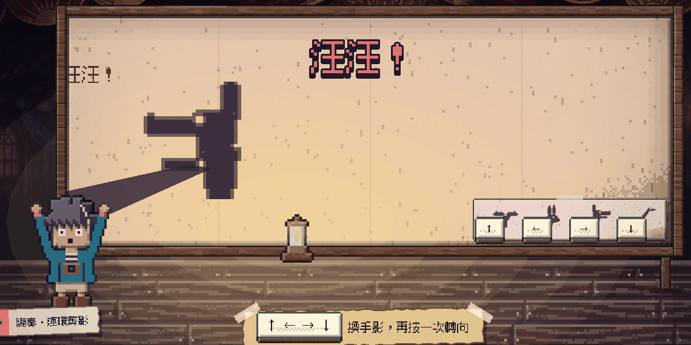

# [SG-85] 實作影偶搭梯

> 狀態：完成

## 內文

### 需求

幕布上出現一個影子剪影（兔子、鳥、狗），在時間內用方向鍵擺出對應的手影。佔用鏡之馬戲團的 game-059 位置，取代原本偏向規劃與多按鈕的設計。

### 來源

2026-11-28 使用者要求持續精進遊戲內容與畫面、做到票都完成後繼續找可做的事；鏡之馬戲團十二格只開放了一部分。依 design/00-principles/simple-fun-minigames.md 改寫為單一動詞的街機式小遊戲（Bomberman Land 3 方向）。

### 驗收條件

- [x] 剪影出現時間越來越短，後段會連續出兩個或左右翻轉。
- [x] 擺錯時手影變成一隻狗，轉頭對主角汪汪叫。
- [x] 整款只用方向鍵與一到兩顆按鍵，畫面上沒有操作按鈕面板；進場五秒內開始操作，沒有強制教學頁。
- [x] 一回合不超過 60 秒，回合內速度或變化明顯升級；至少兩種隨機出現的變奏。
- [x] 結算只顯示一個分數、銅銀金獎牌與一句評語；銅牌取得普通拍貼，未用輔助的金牌取得小惡魔拍貼。
- [x] 玩法物件達到街機小遊戲的畫面下限：沒有大面積純色、有材質與受光、描邊、接地陰影，色調與背景一致。
- [x] 鍵盤與手把都能完成；開啟減少動態後仍可遊玩。
- [x] 通過稽核十問，結果寫在設計目錄的該款說明；該區原有互動與其他小遊戲不受影響。

### 測試流程

1. 從區域攤位進場，不看說明直接玩一回合。
2. 故意失敗一次，再玩到銅牌與金牌。
3. 開啟減少動態與手把各玩一回合，確認拍貼入冊與重開後保留。

---

# 跟其他票的關係

- Blocks：無
- Blocked by：無
- Related：SG-66、ART-57

---

# Commit-1

## 內文

設計目錄的 game-059 還是要擺姿、固定關節並轉投光的舊案，馬戲團第十一格沒有可玩的遊戲。
現在砲彈安全墊西側、人肉砲彈旁邊多了一座頂上有小紙幕、幕上映著兔子手影、下面點著蠟燭的攤位，開放「影偶搭梯」。畫面是舞台上一面木框燈箱紙幕，下方的油燈把紙照得暖亮，主角坐在左邊舉著手，在紙上投出手影。掛在棍子上的剪影（兔子、鳥、狗、鵝）從右邊一隻隻飄過來，靠近時上方會寫出名字；在它碰到手影之前按方向鍵擺出一樣的手影：↑ 鳥、← 兔子、→ 狗、↓ 鵝，同一個方向再按一次手影會轉向。形狀和方向都對上，剪影就從手影中間穿過去，閃出金光，「穿過去！」；連續對上的次數寫在主角頭上。框邊貼著一張四種手影對應方向鍵的小卡。擺錯時手影變成一隻狗，張著嘴轉頭對主角汪汪叫，主角嚇得往後縮。一開始的手是一個拳頭，什麼都對不上，所以完全不按的回合一定是零分。
一回合 45 秒，剪影飄過來的時間由 3.2 秒縮到 1.4 秒，後段會連續兩隻、或左右翻轉（要再按一次轉向，對上多 5 分）。每回合隨機一種變奏：影子劇場、鏡像之夜（翻轉的剪影多）、連環剪影（兩隻連發多）。倒數時一隻兔子剪影飄過來、主角自己擺出兔子示範。第一次被狗叫不算失誤。輔助回合擺錯時剪影會在手邊停一下，讓你有機會改。
為了不和舞台換景（聽到名字就按對應方向）重複，這款做成剪影飄向自己的「穿牆」式，再加上轉向，理由寫在設計目錄的修訂理由。
在原生畫面以實際按鍵事件走過倒數示範、拳頭等剪影、擺出兔子讓它穿過、轉向的鵝、擺錯被狗叫、結算，並開啟減少動態再走一次；截圖使用新的拼貼式遊戲介面。逐張看過後把手影與剪影放大到和紙幕相稱、把狗的頭和張開的嘴畫得更清楚，並把「汪汪！」字樣移離框邊。規則測試以模擬輸入在三種變奏都以剪影出現 0.4 秒後擺好的玩法拿到金牌（435 至 480 分），讀得慢又不會轉向的玩家拿到銅牌 214 分，完全不按 0 分；輔助金牌不發小惡魔拍貼。手把以十字鍵對應同一組方向驗證，沒有接實體手把。難度與「看一眼就懂」依畫面與模擬輸入判斷，尚未由真人試玩。

### 測試結果

| 項目 | 結果 |
|---|---|
| 影偶搭梯規則 | 通過：擺手影與轉向、剪影飄來、穿過與連續、翻轉與兩隻連發、擺錯被狗叫、輔助停頓、加速、三種變奏、金牌與銅牌整回合、不按零分 |
| 局部回歸 | 遊戲目錄、馬戲團世界、區域往返、教學頁、街機共用流程與場景規範測試通過（以既有匯入快取直接執行） |
| 設計與資料驗證 | 5 個範圍通過；教學文字長度檢查通過 |
| 原生畫面 | 遊玩與結算過程無 ERROR；攤位在砲彈安全墊西側，互動點可走到 |

### 截圖

