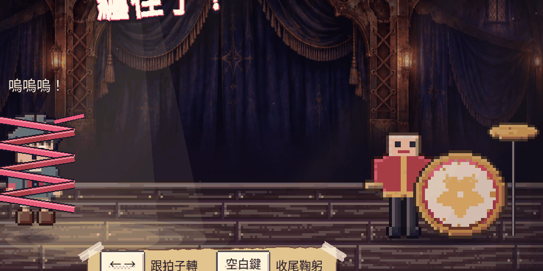

# [SG-86] 實作謝幕回旋

> 狀態：完成

## 內文

### 需求

交替按左右鍵讓主角旋轉，絲帶在空中畫圓，節奏穩定時圓越畫越大，最後在鼓聲收尾時停下鞠躬。佔用鏡之馬戲團的 game-060 位置，取代原本偏向規劃與多按鈕的設計。

### 來源

2026-11-28 使用者要求持續精進遊戲內容與畫面、做到票都完成後繼續找可做的事；鏡之馬戲團十二格只開放了一部分。依 design/00-principles/simple-fun-minigames.md 改寫為單一動詞的街機式小遊戲（Bomberman Land 3 方向）。

### 驗收條件

- [x] 鼓手會變換節奏，跟上變化得高分；收尾停太早或太晚扣分。
- [x] 節奏亂掉時絲帶把主角捆成木乃伊，蹦蹦跳下台。
- [x] 整款只用方向鍵與一到兩顆按鍵，畫面上沒有操作按鈕面板；進場五秒內開始操作，沒有強制教學頁。
- [x] 一回合不超過 60 秒，回合內速度或變化明顯升級；至少兩種隨機出現的變奏。
- [x] 結算只顯示一個分數、銅銀金獎牌與一句評語；銅牌取得普通拍貼，未用輔助的金牌取得小惡魔拍貼。
- [x] 玩法物件達到街機小遊戲的畫面下限：沒有大面積純色、有材質與受光、描邊、接地陰影，色調與背景一致。
- [x] 鍵盤與手把都能完成；開啟減少動態後仍可遊玩。
- [x] 通過稽核十問，結果寫在設計目錄的該款說明；該區原有互動與其他小遊戲不受影響。

### 測試流程

1. 從區域攤位進場，不看說明直接玩一回合。
2. 故意失敗一次，再玩到銅牌與金牌。
3. 開啟減少動態與手把各玩一回合，確認拍貼入冊與重開後保留。

---

# 跟其他票的關係

- Blocks：無
- Blocked by：無
- Related：SG-66、ART-57

---

# Commit-1

## 內文

設計目錄的 game-060 還是要旋身、拋絲帶並收束的舊案，馬戲團最後一格沒有可玩的遊戲。
現在影子台南側、進影子台的走道旁多了一座頂上有小舞者站在鼓上、粉紅絲帶繞著她轉的攤位，開放「謝幕回旋」，鏡之馬戲團十二格全部開放。畫面是聚光燈下的帳篷舞台：主角拿著絲帶棒站在中間，右邊穿紅外套的鼓手敲著大鼓。主角腳下的金圈在每一拍收緊，圈上寫著下一下要按的方向；跟著鼓聲左右交替按（← →），主角就轉一圈，粉紅絲帶在身邊畫出的圓一圈比一圈大，圓越大每一圈越多分，踩得剛好會跳出「漂亮！」。鼓手要換拍前會把鼓棒舉高、喊「變快！」或「變慢！」。每段跳完鼓手會「咚咚咚…」打一段鼓，「鏘！」的那一下按空白鍵（或 E、手把 A 鍵）鞠躬，絲帶落在腳邊盤成一圈圈；停太早或太晚都會扣分。連續兩拍按錯邊、按不在拍子上或漏拍，絲帶就把主角捆成木乃伊，喊著「嗚嗚嗚！」蹦蹦跳下台再跳回來。沒按鍵就不會轉，完全不按的回合一定是零分。
一回合 50 秒，節拍由每拍 0.62 秒加快到 0.38 秒、每段越來越長、越後面越常換拍。每回合隨機一種變奏：謝幕回旋、搖擺鼓手（常換拍）、假收尾（鼓手會先輕敲一下假的「鏘…還沒！」）。倒數時主角自己跟著鼓聲轉幾圈示範。第一次被捆住不算失誤。
攤位用的是原本保留給下一款、但會擋住進影子台走道的那個位置，往後挪到走道旁，讓走道保持暢通。
在原生畫面以實際按鍵事件走過倒數示範、跟拍轉圈、換拍預告、收尾鼓聲與鞠躬、捆成木乃伊、結算，並開啟減少動態再走一次；截圖使用新的拼貼式遊戲介面。逐張看過後把細線般的絲帶改成會翻面的寬緞帶、把鞠躬時套在主角身上像靶心的圈圈改成落在地上的絲帶圈、把鼓手和大鼓放大並在鼓面畫上金星，並加上照在主角身上的聚光燈。規則測試以模擬輸入在三種變奏都以拍子正中間按、剛好在鏘時鞠躬的玩法拿到金牌（1852 至 1996 分），每拍晚 0.1 秒、每七拍按錯一次、鞠躬慢半拍的玩家拿到銅牌 952 分，完全不按 0 分；輔助金牌不發小惡魔拍貼。手把以十字鍵與 A 鍵對應同一組按鍵驗證，沒有接實體手把。難度與「看一眼就懂」依畫面與模擬輸入判斷，尚未由真人試玩。

### 測試結果

| 項目 | 結果 |
|---|---|
| 謝幕回旋規則 | 通過：拍子、左右交替轉圈與絲帶大小、換拍、漏拍與捆住、收尾鼓聲與鞠躬、加速、三種變奏、金牌與銅牌整回合、不按零分 |
| 局部回歸 | 遊戲目錄、馬戲團世界（含挪動後的攤位走道）、教學頁、街機共用流程與場景規範測試通過（以既有匯入快取直接執行） |
| 區域往返 | 未全過：糖果工廠與馬戲團的地圖在 800×600、1.25 倍字級下超出畫面。糖果工廠這次沒有任何改動也一樣失敗，判斷是新字型造成、主線原本就有的問題，另外回報 |
| 設計與資料驗證 | 5 個範圍通過；教學文字長度檢查通過 |
| 原生畫面 | 遊玩與結算過程無 ERROR；攤位在影子台南側，互動點可走到 |

### 截圖

