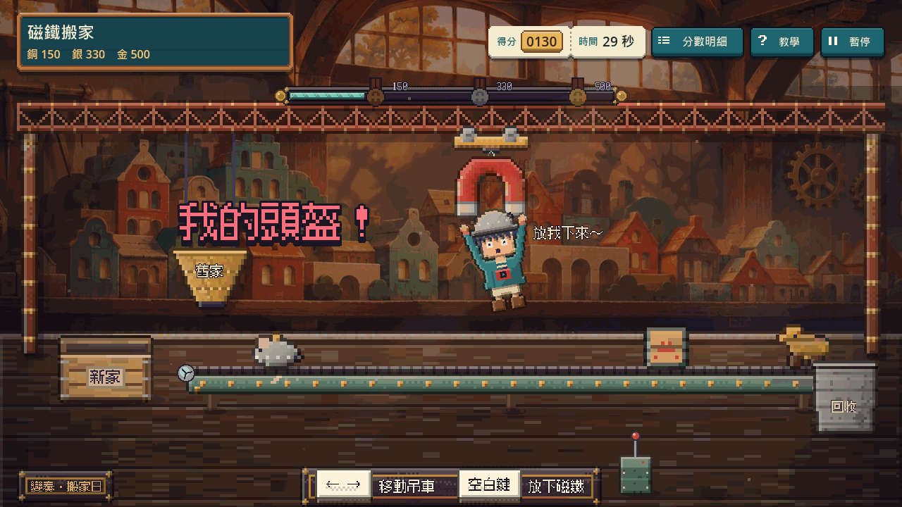

# [SG-87] 實作磁鐵搬家

> 狀態：完成

## 內文

### 需求

左右移動吊車上的磁鐵，按鍵放下吸起鐵製玩具丟進箱子，木頭玩具吸不起來。佔用發條玩具城的 game-063 位置，取代原本偏向規劃與多按鈕的設計。

### 來源

2026-11-28 使用者要求持續精進遊戲內容與畫面、做到票都完成後繼續找可做的事；發條玩具城十二格只開放了一部分。依 design/00-principles/simple-fun-minigames.md 改寫為單一動詞的街機式小遊戲（Bomberman Land 3 方向）。

### 驗收條件

- [x] 玩具在輸送帶上移動，偶爾出現很重的鐵塊會讓吊車往下沉。
- [x] 失敗時磁鐵把主角的頭盔吸走，主角被吊在半空中晃。
- [x] 整款只用方向鍵與一到兩顆按鍵，畫面上沒有操作按鈕面板；進場五秒內開始操作，沒有強制教學頁。
- [x] 一回合不超過 60 秒，回合內速度或變化明顯升級；至少兩種隨機出現的變奏。
- [x] 結算只顯示一個分數、銅銀金獎牌與一句評語；銅牌取得普通拍貼，未用輔助的金牌取得小惡魔拍貼。
- [x] 玩法物件達到街機小遊戲的畫面下限：沒有大面積純色、有材質與受光、描邊、接地陰影，色調與背景一致。
- [x] 鍵盤與手把都能完成；開啟減少動態後仍可遊玩。
- [x] 通過稽核十問，結果寫在設計目錄的該款說明；該區原有互動與其他小遊戲不受影響。

### 測試流程

1. 從區域攤位進場，不看說明直接玩一回合。
2. 故意失敗一次，再玩到銅牌與金牌。
3. 開啟減少動態與手把各玩一回合，確認拍貼入冊與重開後保留。

---

# 跟其他票的關係

- Blocks：無
- Blocked by：無
- Related：SG-66、ART-57

---

---

# Commit-1

## 內文

發條玩具城第三格原本是要移磁鐵、翻極又控制高度的設計，偏操作面板與規劃，玩具城裡也沒有這一站。
現在車站岔道東側多了一座屋頂架著小吊臂、紅色馬蹄磁鐵吊著鐵皮機器人、櫃台上擺著木箱和木頭鴨子的攤位，開放第三站「磁鐵搬家」。工作坊裡一根鉚釘桁架橫過整個畫面，玩具從寫著「舊家」的漏斗掉到輸送帶上往右跑；左右移動吊車、按一下放下磁鐵，底下的鐵皮機器人、鐵皮車、鐵皮鼓和發條老鼠會「噹」一聲貼上磁極，木頭鴨子和積木只會被敲得「咚」一下。磁鐵經過時只有鐵皮玩具會抖著往上跳。一次最多吸三個，吊到左邊寫著「新家」的木箱上方再按同一顆鍵就放進去，三個一起放有滿載加分；越貪心往右吸，回程越遠。中段開始偶爾掉下一噸鐵塊，吸起來吊車整個往下沉、嘎嘎地慢慢爬，但分數很高。磁鐵底下沒有任何鐵的話，它會吸走主角的鐵頭盔，把主角吊在半空中晃、喊「放我下來～」，摔回地上一臉抱歉，這段時間吊車動不了；每回合第一次不算失誤。輸送帶越跑越快、玩具越來越密，後段混進木頭做的假機器人。每回合隨機一種變奏：搬家日、趕時間、木頭假貨；倒數時吊車會自己越過木頭積木把鐵皮機器人搬進箱子，再開回中間。
以原生畫面用模擬按鍵玩過一段，逐張看過開場示範、吊著兩個玩具回箱、吸起一噸鐵塊、頭盔被吸走吊起、摔回地上、後段木頭假貨與減少動態下的吊起畫面，並在玩具城以原生畫面確認攤位外觀與位置。規則測試以模擬方向鍵與空白鍵玩出三種變奏的金牌、一次只搬一個又常休息的銅牌、原地亂按的回合（不得牌）與輔助金牌（不發小惡魔），並以手把 A 鈕與 ↓ 鍵驗證放下磁鐵。手把與減少動態為程式與擷取畫面確認，尚未由真人以手把實際玩完一回合；難度與「看一眼就懂」是依畫面與模擬輸入判斷，尚未由真人試玩。

### 測試結果

| 項目 | 結果 |
|---|---|
| 磁鐵搬家規則 | 通過：示範、吊車移動、鐵皮吸起與木頭被敲、一次三個上限、滿載加分、掉進回收桶、一噸鐵塊減速、頭盔吊起與第二次算失誤、加速、三種變奏、輔助、手把、金牌與銅牌整回合 |
| 局部回歸 | 遊戲目錄、街機共用流程、失敗拍貼、玩具城世界、區域往返、教學目錄與教學圖片、場景規範、遊戲啟動通過 |
| 設計與資料驗證 | 全部範圍通過；Python 測試 217 項通過 |

### 截圖

