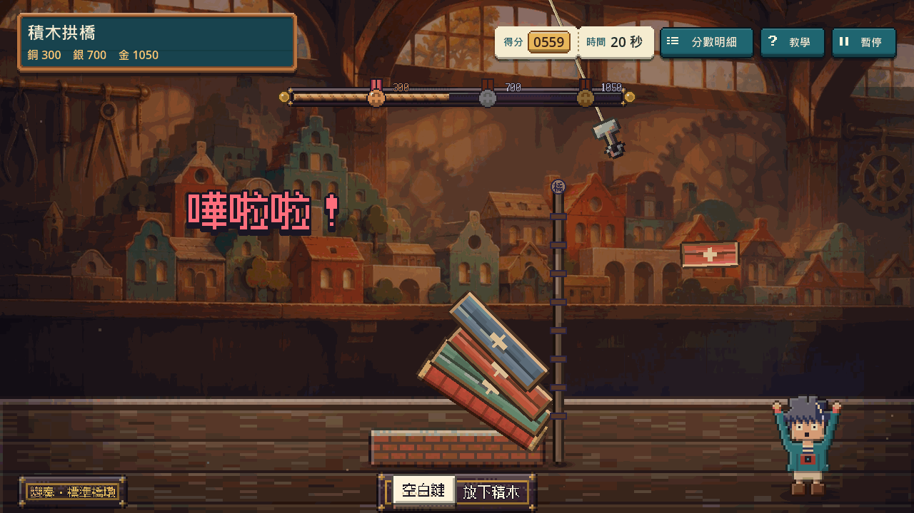

# [SG-88] 實作積木拱橋

> 狀態：完成

## 內文

### 需求

積木在吊鉤上左右擺動，按鍵放下疊高，對不準的部分會被切掉，疊越高分越多。佔用發條玩具城的 game-064 位置，取代原本偏向規劃與多按鈕的設計。

### 來源

2026-11-28 使用者要求持續精進遊戲內容與畫面、做到票都完成後繼續找可做的事；發條玩具城十二格只開放了一部分。依 design/00-principles/simple-fun-minigames.md 改寫為單一動詞的街機式小遊戲（Bomberman Land 3 方向）。

### 驗收條件

- [x] 擺動越來越快，後段出現圓柱、三角等形狀的積木。
- [x] 倒塌時積木一路骨牌倒下砸到主角，主角頭上疊了一塊積木。
- [x] 整款只用方向鍵與一到兩顆按鍵，畫面上沒有操作按鈕面板；進場五秒內開始操作，沒有強制教學頁。
- [x] 一回合不超過 60 秒，回合內速度或變化明顯升級；至少兩種隨機出現的變奏。
- [x] 結算只顯示一個分數、銅銀金獎牌與一句評語；銅牌取得普通拍貼，未用輔助的金牌取得小惡魔拍貼。
- [x] 玩法物件達到街機小遊戲的畫面下限：沒有大面積純色、有材質與受光、描邊、接地陰影，色調與背景一致。
- [x] 鍵盤與手把都能完成；開啟減少動態後仍可遊玩。
- [x] 通過稽核十問，結果寫在設計目錄的該款說明；該區原有互動與其他小遊戲不受影響。

### 測試流程

1. 從區域攤位進場，不看說明直接玩一回合。
2. 故意失敗一次，再玩到銅牌與金牌。
3. 開啟減少動態與手把各玩一回合，確認拍貼入冊與重開後保留。

---

# 跟其他票的關係

- Blocks：無
- Blocked by：無
- Related：SG-66、ART-57

---

---

# Commit-1

## 內文

發條玩具城第四格原本要堆楔塊、撤支架，靠物理支點撐起拱橋，偏規劃與作業感，玩具城裡也沒有這一站。
現在車站岔道東側、磁鐵搬家旁邊多了一座屋頂吊著一串彩色積木、櫃台上擺著小木拱橋和玩具火車頭的攤位，開放第四站「積木拱橋」。工作坊裡一條長繩從上方垂下，吊鉤掛著一塊彩色木積木左右擺；看準了按一下，積木直直掉到磚砌底座上的橋墩頂。剛好對準會閃一下、跳出「剛好！」加分，連續三次剛好會把積木補寬一點；歪出去的部分當場被鋸掉、翻滾著掉下去，下一塊就跟著變窄。橋墩旁有一根刻度柱，疊滿八塊時兩道木拱架上橋墩、玩具火車嘟嘟開過去，接著換一座新橋墩從頭疊。整塊沒落在橋墩上時，整根橋墩一路倒向旁邊的主角，最上面那塊飛過去疊在主角頭上冒星星，要從底座重疊；每回合第一次倒塌不算失誤。擺動越來越快、橋墩越高擺得越快，後段混進側躺的圓木和三角拱心石，拱心石放上去就直接封頂通車。每回合隨機一種變奏：標準橋墩、大塊積木（積木更寬但擺得更快）、午後微風（擺動忽快忽慢）；倒數時吊鉤會自己放下一塊積木示範。
以原生畫面用模擬按鍵玩過一段，逐張看過開場示範、鋸掉一截、吊鉤擺到橋墩上方、通車、倒塌、積木疊在主角頭上、減少動態下的倒塌結果、後段的圓木與拱心石。規則測試以模擬空白鍵玩出三種變奏的金牌、對不準又放得慢的銅牌、亂按的回合（不得牌）與輔助金牌（不發小惡魔），並以手把 A 鈕與 ↓ 鍵驗證放下積木。手把與減少動態為程式與擷取畫面確認，尚未由真人以手把實際玩完一回合；難度與「看一眼就懂」是依畫面與模擬輸入判斷，尚未由真人試玩。

### 測試結果

| 項目 | 結果 |
|---|---|
| 積木拱橋規則 | 通過：示範、擺動、剛好與鋸掉、補寬、八塊通車、圓木與拱心石、倒塌與第二次算失誤、加速、三種變奏、輔助、手把、金牌與銅牌整回合 |
| 局部回歸 | 遊戲目錄、街機共用流程、失敗拍貼、玩具城世界、區域往返、教學目錄與教學圖片、場景規範、遊戲啟動通過 |
| 設計與資料驗證 | 全部範圍通過；Python 測試 217 項通過 |

### 截圖

