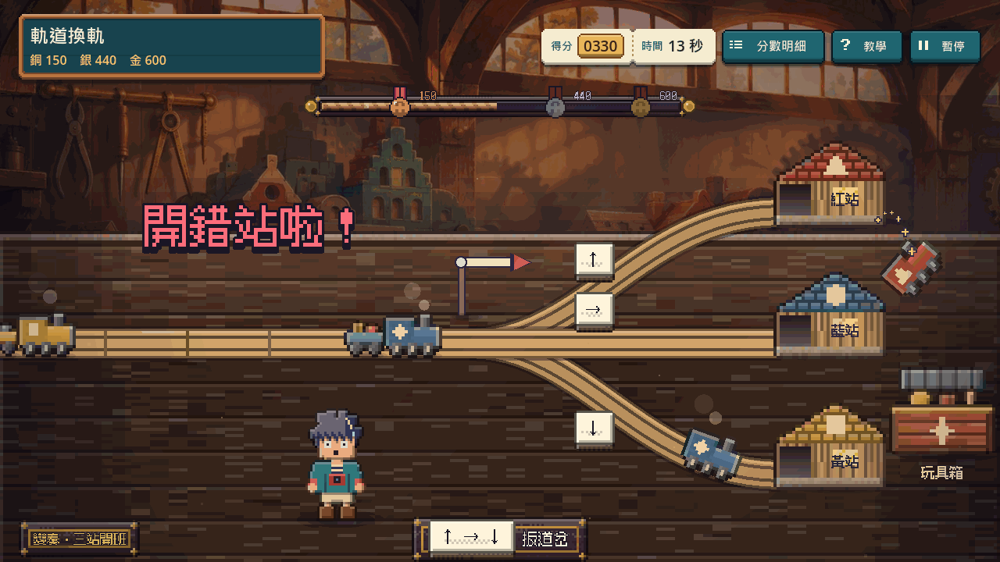

# [SG-89] 實作軌道換軌

> 狀態：完成

## 內文

### 需求

不同顏色的玩具火車開過來，按鍵切換道岔讓每輛車開進同色的車站。佔用發條玩具城的 game-066 位置，取代原本偏向規劃與多按鈕的設計。

### 來源

2026-11-28 使用者要求持續精進遊戲內容與畫面、做到票都完成後繼續找可做的事；發條玩具城十二格只開放了一部分。依 design/00-principles/simple-fun-minigames.md 改寫為單一動詞的街機式小遊戲（Bomberman Land 3 方向）。

### 驗收條件

- [x] 同時出現的火車越來越多，有一輛會倒退開回來。
- [x] 開錯站時火車翻進玩具箱，車頭冒出一串嘟嘟的小星星。
- [x] 整款只用方向鍵與一到兩顆按鍵，畫面上沒有操作按鈕面板；進場五秒內開始操作，沒有強制教學頁。
- [x] 一回合不超過 60 秒，回合內速度或變化明顯升級；至少兩種隨機出現的變奏。
- [x] 結算只顯示一個分數、銅銀金獎牌與一句評語；銅牌取得普通拍貼，未用輔助的金牌取得小惡魔拍貼。
- [x] 玩法物件達到街機小遊戲的畫面下限：沒有大面積純色、有材質與受光、描邊、接地陰影，色調與背景一致。
- [x] 鍵盤與手把都能完成；開啟減少動態後仍可遊玩。
- [x] 通過稽核十問，結果寫在設計目錄的該款說明；該區原有互動與其他小遊戲不受影響。

### 測試流程

1. 從區域攤位進場，不看說明直接玩一回合。
2. 故意失敗一次，再玩到銅牌與金牌。
3. 開啟減少動態與手把各玩一回合，確認拍貼入冊與重開後保留。

---

# 跟其他票的關係

- Blocks：無
- Blocked by：無
- Related：SG-66、ART-57

---

---

# Commit-1

## 內文

發條玩具城第六格原本要扳道岔又掛解貨車、把三列車分送不同工房，偏規劃與多按鈕，玩具城裡也沒有這一站。
現在鐘樓東側多了一座屋頂立著三色號誌燈、櫃台上擺著三岔木頭軌道和小火車頭的攤位，開放第六站「軌道換軌」。工作坊長凳上，一條有溝槽的木頭玩具軌道從左邊伸到一組三向道岔，再彎向上、中、下三座小車站，三站分別是紅、藍、黃色的屋頂，屋頂和車頭都有三角、圓、方的記號。按 ↑ → ↓ 把道岔扳向那一站，號誌箭頭會跟著擺過去；火車的車頭開過道岔那一刻，箭頭指哪站就去哪站。開進同色的車站會鑽進站房、跳出「到站！」，每節車廂都算分，連續到站越多加越多；開錯站的火車從站尾飛出去，翻著跟頭栽進右邊的大玩具箱，車頭拖著一串嘟嘟的小星星，主角嚇一跳；每回合第一次翻車不算失誤。火車越開越快、越來越密、車廂越拖越長，後段有火車開到道岔前停下來「嘟？」一聲倒車，再衝過來。每回合隨機一種變奏：三站開班、特快車、站牌換色（站牌會先晃一下喊「要換了！」再換顏色，已經過道岔的火車不受影響）；倒數時道岔會自己扳好，示範一輛紅車開進紅站。
以原生畫面用模擬按鍵玩過一段，逐張看過開場示範、多輛火車同時在線上、倒車的火車、開錯站翻進玩具箱、減少動態下的翻車畫面與站牌換色前的提示。規則測試以模擬方向鍵玩出三種變奏的金牌、常忘記扳道岔的銅牌、亂扳的回合（不得牌）與輔助金牌（不發小惡魔），並以手把十字鍵與 WASD 驗證扳道岔。手把與減少動態為程式與擷取畫面確認，尚未由真人以手把實際玩完一回合；難度與「看一眼就懂」是依畫面與模擬輸入判斷，尚未由真人試玩。

### 測試結果

| 項目 | 結果 |
|---|---|
| 軌道換軌規則 | 通過：示範、三向道岔與空白鍵輪切、到站與開錯站、車廂與連續到站加分、第二次翻車算失誤、前後車保持距離、倒車火車、加速與車廂變長、站牌換色、三種變奏、輔助、手把、金牌與銅牌整回合 |
| 局部回歸 | 遊戲目錄、街機共用流程、失敗拍貼、玩具城世界、區域往返、教學目錄與教學圖片、場景規範、遊戲啟動通過 |
| 設計與資料驗證 | 全部範圍通過；Python 測試 217 項通過 |

### 截圖

