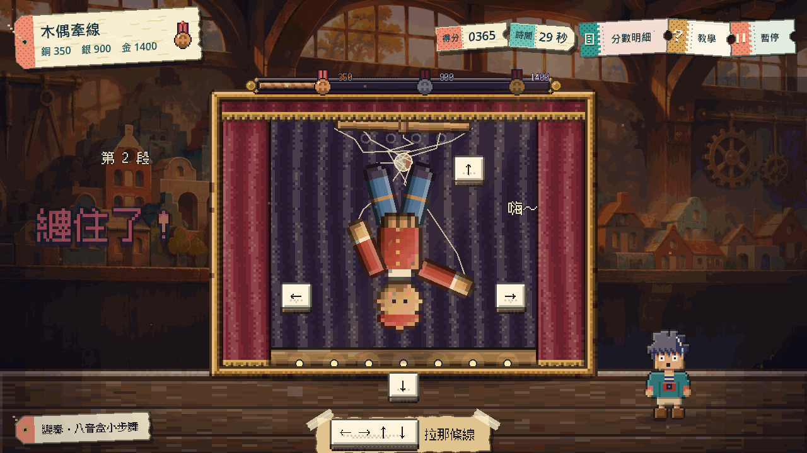

# [SG-90] 實作木偶牽線

> 狀態：完成

## 內文

### 需求

木偶隨音樂跳舞，按畫面提示的方向拉起對應的手腳線，跟上拍子木偶就跳得漂亮。佔用發條玩具城的 game-067 位置，取代原本偏向規劃與多按鈕的設計。

### 來源

2026-11-28 使用者要求持續精進遊戲內容與畫面、做到票都完成後繼續找可做的事；發條玩具城十二格只開放了一部分。依 design/00-principles/simple-fun-minigames.md 改寫為單一動詞的街機式小遊戲（Bomberman Land 3 方向）。

### 驗收條件

- [x] 節奏逐段加快，出現同時拉兩條線的拍子。
- [x] 失誤太多時線全纏在一起，木偶倒吊著對主角揮手。
- [x] 整款只用方向鍵與一到兩顆按鍵，畫面上沒有操作按鈕面板；進場五秒內開始操作，沒有強制教學頁。
- [x] 一回合不超過 60 秒，回合內速度或變化明顯升級；至少兩種隨機出現的變奏。
- [x] 結算只顯示一個分數、銅銀金獎牌與一句評語；銅牌取得普通拍貼，未用輔助的金牌取得小惡魔拍貼。
- [x] 玩法物件達到街機小遊戲的畫面下限：沒有大面積純色、有材質與受光、描邊、接地陰影，色調與背景一致。
- [x] 鍵盤與手把都能完成；開啟減少動態後仍可遊玩。
- [x] 通過稽核十問，結果寫在設計目錄的該款說明；該區原有互動與其他小遊戲不受影響。

### 測試流程

1. 從區域攤位進場，不看說明直接玩一回合。
2. 故意失敗一次，再玩到銅牌與金牌。
3. 開啟減少動態與手把各玩一回合，確認拍貼入冊與重開後保留。

---

# 跟其他票的關係

- Blocks：無
- Blocked by：無
- Related：SG-66、ART-57

---

---

# Commit-1

## 內文

發條玩具城第七格原本要調四條繩的長短並鎖繩、讓木偶撿東西爬台階，偏規劃與多按鈕，玩具城裡也沒有這一站。
現在鐘樓廣場前、旋轉陀螺旁多了一座屋頂吊著小木偶、櫃台上擺著掛紅絲絨布簾小舞台的攤位，開放第七站「木偶牽線」。小劇場裡，穿紅外套的木偶由十字控制桿吊著四條線；印著箭頭的黃銅珠子順著線滑下來，滑到頭、雙手或雙腳上發亮的圈圈時按那個方向（← 左手、→ 右手、↑ 頭、↓ 雙腳），木偶就把那隻手腳甩起來跳舞，剛好在拍子上跳出「漂亮！」，連拍越多加越多，台前的腳燈跟著拍子亮。漏拉的珠子會掉下去、亂拉會扣分，兩者都在控制桿上打一個結，拉到的珠子會解開半個結；結滿四個時線全纏成一團，木偶倒吊在半空朝主角揮手說「嗨～」，過一會兒才解開；每回合第一次纏住不算失誤。曲子分四段一段比一段快，後段出現同時拉兩條線的拍子和反拍的珠子。每回合隨機一種變奏：八音盒小步舞、快步吉格舞、雙線雙人舞（一開始就有兩條線一起拉）；倒數時木偶會自己拉兩條線跳給你看。
以原生畫面用模擬按鍵玩過一段，逐張看過開場示範、珠子滑下與拉線跳舞、線纏住後倒吊揮手、減少動態下的倒吊畫面與後段的雙人舞，並在玩具城以原生畫面確認攤位外觀與位置。規則測試以模擬方向鍵玩出三種變奏的金牌、常常差一點又漏拉四分之一的銅牌、亂拉的回合與放著不玩的回合（都不得牌）以及輔助金牌（不發小惡魔），並以手把十字鍵與 WASD 驗證拉線。手把與減少動態為程式與擷取畫面確認，尚未由真人以手把實際玩完一回合；八音盒的拍子聲只在規則裡送出音符，尚未真人試聽；難度與「看一眼就懂」是依畫面與模擬輸入判斷，尚未由真人試玩。

### 測試結果

| 項目 | 結果 |
|---|---|
| 木偶牽線規則 | 通過：示範、四條線各自對應、剛好與差一點、連拍加分、漏拉與亂拉打結、拉到解結、纏住倒吊與第二次算失誤、纏住時不能拉、四段加速、雙線拍子、三種變奏、輔助、手把、金牌與銅牌整回合、放著不玩 0 分 |
| 局部回歸 | 遊戲目錄、街機共用流程、失敗拍貼、玩具城世界（含走到每座攤位）、區域往返、教學目錄與教學圖片、場景規範、遊戲啟動通過 |
| 設計與資料驗證 | 全部範圍通過；Python 測試 217 項通過 |

### 截圖

---

# Commit-2

## 內文

線纏住時跳出的「纏住了！」字樣蓋在木偶的腿、纏成一團的線和 ↑ 按鍵上，倒吊揮手的笑點看不清楚。
現在木偶牽線的回饋字一律跳在舞台左側的空處，不再壓在木偶、線與按鍵上；倒吊的木偶、纏成一團的線與揮手都完整露出來。
以原生畫面重新擷取線纏住的畫面確認，教學圖與票上的截圖一併換新。

### 截圖

