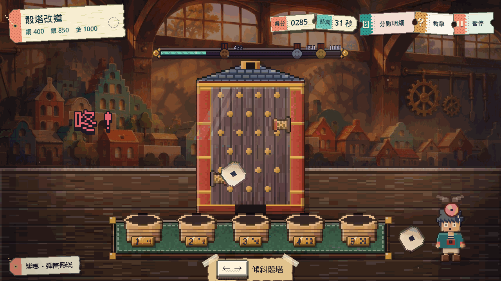

# [SG-91] 實作骰塔改道

> 狀態：完成

## 內文

### 需求

骰子從塔頂掉下，左右傾斜骰塔讓骰子滾進指定點數的杯子。佔用發條玩具城的 game-069 位置，取代原本偏向規劃與多按鈕的設計。

### 來源

2026-11-28 使用者要求持續精進遊戲內容與畫面、做到票都完成後繼續找可做的事；發條玩具城十二格只開放了一部分。依 design/00-principles/simple-fun-minigames.md 改寫為單一動詞的街機式小遊戲（Bomberman Land 3 方向）。

### 驗收條件

- [x] 塔裡有彈簧與旋轉擋片，後段一次掉兩顆骰子。
- [x] 失敗時骰子彈出塔外敲在主角頭上，額頭印出一點。
- [x] 整款只用方向鍵與一到兩顆按鍵，畫面上沒有操作按鈕面板；進場五秒內開始操作，沒有強制教學頁。
- [x] 一回合不超過 60 秒，回合內速度或變化明顯升級；至少兩種隨機出現的變奏。
- [x] 結算只顯示一個分數、銅銀金獎牌與一句評語；銅牌取得普通拍貼，未用輔助的金牌取得小惡魔拍貼。
- [x] 玩法物件達到街機小遊戲的畫面下限：沒有大面積純色、有材質與受光、描邊、接地陰影，色調與背景一致。
- [x] 鍵盤與手把都能完成；開啟減少動態後仍可遊玩。
- [x] 通過稽核十問，結果寫在設計目錄的該款說明；該區原有互動與其他小遊戲不受影響。

### 測試流程

1. 從區域攤位進場，不看說明直接玩一回合。
2. 故意失敗一次，再玩到銅牌與金牌。
3. 開啟減少動態與手把各玩一回合，確認拍貼入冊與重開後保留。

---

# 跟其他票的關係

- Blocks：無
- Blocked by：無
- Related：SG-66、ART-57

---

---

# Commit-1

## 內文

發條玩具城第九格原本要移動擋片並轉動塔口方向、讓三顆骰子到對應出口，偏規劃與多按鈕，玩具城裡也沒有這一站。
現在維修台旁多了一座屋頂立著小骰塔、櫃台上擺著毛氈杯盤和骰子的攤位，開放第九站「骰塔改道」。工作坊長凳上立著一座有城垛和黃銅包角的木頭骰塔，正面剖開看得見塔裡；印著點數的骰子從塔頂掉下來，按住 ← 或 → 整座塔就往那邊傾斜，塔裡的骰子跟著往低的那邊滑，放開塔就站直、骰子也停住。骰子從塔底的拱門滾到下面的綠色毛氈盤，盤上排著一到五號的木杯，骰子上幾點就要進幾號杯：進杯 20 分、正中再加分，連續進杯越多加越多。沒進對的杯子，骰子會彈起來敲在主角頭上，頭上腫起一個包、包上印著那顆骰子的點數（主角的瀏海蓋住額頭，點數改印在頭頂的包上才看得清楚）；每回合第一次被敲不算失誤。骰子越掉越快，中段塔壁冒出會把骰子彈回去的彈簧，接著塔中間出現旋轉擋片，後段一次掉兩顆，兩顆的點數一定相差夠多，用同一個傾斜角度能同時送進兩杯。每回合隨機一種變奏：標準骰塔、彈簧骰塔、雙骰日；倒數時骰塔會自己傾斜，把一顆四點的骰子送進四號杯。什麼都不按的回合骰子還是會掉，但不會得分。
以原生畫面用模擬按鍵玩過一段，逐張看過開場示範、傾斜中的骰塔與正中進杯、被敲出包、減少動態下的被敲畫面與雙骰同時落下，並在玩具城確認攤位位置可以走到。規則測試以模擬方向鍵玩出三種變奏的金牌、只顧一部分骰子的銅牌、亂搖骰塔的回合（不得牌）與輔助金牌（不發小惡魔），並以手把十字鍵與 AD 驗證傾斜。手把與減少動態為程式與擷取畫面確認，尚未由真人以手把實際玩完一回合；難度與「看一眼就懂」是依畫面與模擬輸入判斷，尚未由真人試玩。

### 測試結果

| 項目 | 結果 |
|---|---|
| 骰塔改道規則 | 通過：示範、傾斜與回正、滑動與牆、進杯正中與連續加分、敲頭與第二次算失誤、杯緣也算沒進、沒人操作不得分、彈簧、擋片、雙骰、加速、三種變奏、輔助、手把、金牌與銅牌整回合 |
| 局部回歸 | 遊戲目錄、街機共用流程（含每款放著不玩 0 分）、失敗拍貼、玩具城世界（含走到每座攤位）、區域往返、教學目錄與教學圖片、場景規範、遊戲啟動通過 |
| 設計與資料驗證 | 全部範圍通過；Python 測試 217 項通過 |

### 截圖

---

# Commit-2

## 內文

骰塔看起來像一大塊暗色長方形加直條紋，骰子是小小一顆模糊的方塊，杯子是平平的盒子擺在一條純綠色的長條上，離其他街機小遊戲的完成度有一段距離。
現在骰塔是一座上了漆的玩具塔：紅色漆面的塔身有黃色飾條和黃銅包角，上面蓋著藍色瓦片屋頂、屋頂中間有讓骰子掉進去的黃銅漏斗，底下是有拱門出口的台座；正面是一片玻璃，看得見塔裡釘滿黃銅釘的木板背牆、牆上的彈簧和旋轉擋片，玻璃上有斜斜的反光。骰子變大、點點更粗，有圓角與左上的柔光，掉落時會翻滾。杯盤換成有縫線邊與絨毛紋路的綠色毛氈，四角有黃銅包角，五個車旋木杯各有一塊黃銅號碼牌，寫著號碼和點數。
以原生畫面重新擷取傾斜中與被敲出包的畫面逐張看過；規則測試、街機共用檢查與教學圖片檢查重新跑過。

### 截圖

