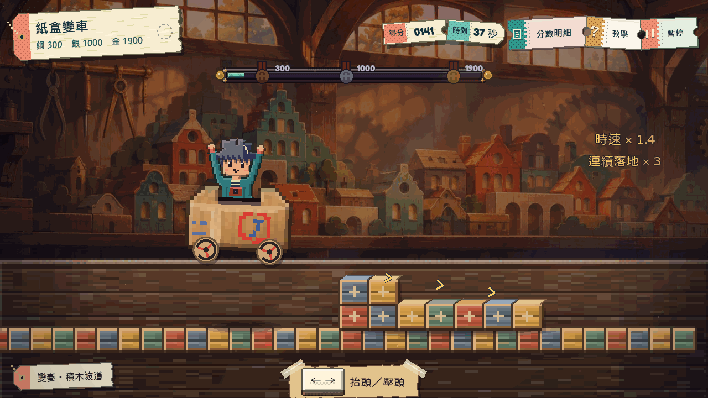

# [SG-92] 實作紙盒變車

> 狀態：完成

## 內文

### 需求

坐在紙箱車裡從積木坡道衝下，空中按前後調整車身，落地要平穩才能保速衝線。佔用發條玩具城的 game-071 位置，取代原本偏向規劃與多按鈕的設計。

### 來源

2026-11-28 使用者要求持續精進遊戲內容與畫面、做到票都完成後繼續找可做的事；發條玩具城十二格只開放了一部分。依 design/00-principles/simple-fun-minigames.md 改寫為單一動詞的街機式小遊戲（Bomberman Land 3 方向）。

### 驗收條件

- [x] 坡道越來越陡，出現連續小跳台與蹺蹺板。
- [x] 落地太歪時紙箱整個摺起來，主角從箱縫露出一隻手揮白旗。
- [x] 整款只用方向鍵與一到兩顆按鍵，畫面上沒有操作按鈕面板；進場五秒內開始操作，沒有強制教學頁。
- [x] 一回合不超過 60 秒，回合內速度或變化明顯升級；至少兩種隨機出現的變奏。
- [x] 結算只顯示一個分數、銅銀金獎牌與一句評語；銅牌取得普通拍貼，未用輔助的金牌取得小惡魔拍貼。
- [x] 玩法物件達到街機小遊戲的畫面下限：沒有大面積純色、有材質與受光、描邊、接地陰影，色調與背景一致。
- [x] 鍵盤與手把都能完成；開啟減少動態後仍可遊玩。
- [x] 通過稽核十問，結果寫在設計目錄的該款說明；該區原有互動與其他小遊戲不受影響。

### 測試流程

1. 從區域攤位進場，不看說明直接玩一回合。
2. 故意失敗一次，再玩到銅牌與金牌。
3. 開啟減少動態與手把各玩一回合，確認拍貼入冊與重開後保留。

---

# 跟其他票的關係

- Blocks：無
- Blocked by：無
- Related：SG-66、ART-57

---

---

# Commit-1

## 內文

發條玩具城第十一格原本要折紙板、插車軸再試跑，造一台能過坡、縫和低門的車，偏規劃與多按鈕，玩具城裡也沒有這一站。
現在入口廣場西側多了一座屋頂擺著積木坡道和衝出去的紙箱車、櫃台上放著一台瓶蓋輪子小紙箱車的攤位，開放第十一站「紙盒變車」。主角坐在貼著膠帶、裝著瓶蓋輪子的紙箱車裡，沿著彩色積木賽道一路衝，每個積木跳台都會飛起來；在空中車頭會一直往下栽，按住 ← 抬起車頭、→ 壓低車頭，讓車底和前面那段落地坡道一樣斜。落得剛好是「完美落地」，揚起灰塵還會加速，速度越快每次落地分數越高；差一點也算穩穩落地、保住速度；落地太歪時紙箱整個摺扁，主角從箱縫伸出一隻手揮白旗喊「投降～」，速度掉下來；每回合第一次摺起來不算失誤。坡道越來越陡、車頭栽得越快，中段出現一連串的小跳台，後段出現飛到一半會翻過去的蹺蹺板，要在空中改變角度。每回合隨機一種變奏：積木坡道、陡坡大會、蹺蹺板日；倒數時紙箱車會自己飛一次並扶正落地。放著不按的話車頭會一路栽下去摺起來，也不會得分。
以原生畫面用模擬按鍵玩過一段，逐張看過開場示範、空中的紙箱車與落地坡道、摺扁揮白旗、減少動態下的摺扁畫面與蹺蹺板，並在玩具城確認攤位位置可以走到。規則測試以模擬方向鍵玩出三種變奏的金牌、常常落得歪一點的銅牌、亂搖的回合（不得牌）與輔助金牌（不發小惡魔），並以手把十字鍵與 AD 驗證調整車身。手把與減少動態為程式與擷取畫面確認，尚未由真人以手把實際玩完一回合；難度與「看一眼就懂」是依畫面與模擬輸入判斷，尚未由真人試玩。

### 測試結果

| 項目 | 結果 |
|---|---|
| 紙盒變車規則 | 通過：示範、空中抬頭壓頭、車頭自己栽、完美／穩穩／摺扁落地、加速與連續落地加分、第二次摺起來算失誤、沒人操作不得分、小跳台、蹺蹺板中途翻面、坡道變陡、三種變奏、輔助、手把、金牌與銅牌整回合 |
| 局部回歸 | 遊戲目錄、街機共用流程（含每款放著不玩 0 分）、失敗拍貼、玩具城世界（含走到每座攤位）、區域往返、教學目錄與教學圖片、場景規範、遊戲啟動通過 |
| 設計與資料驗證 | 全部範圍通過；Python 測試 217 項通過 |

### 截圖

---

# Commit-2

## 內文

紙箱車只是一塊平平的米色長方形，坡道只有一根細細的木條架在積木上，看起來像還沒畫完的填充圖。
現在紙箱車有往外翻開的四片箱蓋、黏過箱口和正面的牛皮膠帶，側面用蠟筆畫了圈起來的賽車號碼和速度線，輪子是用蠟筆畫上輻條和輪圈的圓紙板，主角在箱子裡露出頭，平常兩手抓著箱口、飛起來時舉高雙手。坡道改成一階一階疊起來的大塊彩色積木，最上面那塊有受光的頂面、每塊都有往右下的影子，起跳台頂端是一塊斜面積木做的跳口，落地的積木階梯上有指出方向的箭頭；蹺蹺板的支點也換成兩塊疊起來的積木。
以原生畫面重新擷取空中與摺扁的畫面逐張看過，教學圖與票上的截圖一併換新；規則測試與教學圖片檢查重新跑過。

### 截圖

