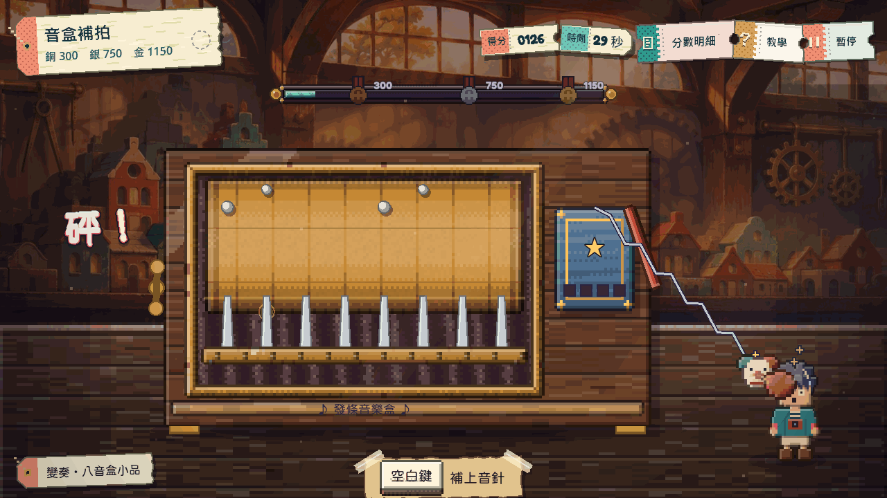

# [SG-93] 實作音盒補拍

> 狀態：完成

## 內文

### 需求

音盒圓筒轉動時有些音針缺了，在缺口經過音梳的瞬間按鍵補上，讓曲子完整播完。佔用發條玩具城的 game-072 位置，取代原本偏向規劃與多按鈕的設計。

### 來源

2026-11-28 使用者要求持續精進遊戲內容與畫面、做到票都完成後繼續找可做的事；發條玩具城十二格只開放了一部分。依 design/00-principles/simple-fun-minigames.md 改寫為單一動詞的街機式小遊戲（Bomberman Land 3 方向）。

### 驗收條件

- [x] 圓筒會變速，後段缺口連續出現。
- [x] 錯過太多拍時盒蓋彈開，小丑彈簧拳打在主角臉上。
- [x] 整款只用方向鍵與一到兩顆按鍵，畫面上沒有操作按鈕面板；進場五秒內開始操作，沒有強制教學頁。
- [x] 一回合不超過 60 秒，回合內速度或變化明顯升級；至少兩種隨機出現的變奏。
- [x] 結算只顯示一個分數、銅銀金獎牌與一句評語；銅牌取得普通拍貼，未用輔助的金牌取得小惡魔拍貼。
- [x] 玩法物件達到街機小遊戲的畫面下限：沒有大面積純色、有材質與受光、描邊、接地陰影，色調與背景一致。
- [x] 鍵盤與手把都能完成；開啟減少動態後仍可遊玩。
- [x] 通過稽核十問，結果寫在設計目錄的該款說明；該區原有互動與其他小遊戲不受影響。

### 測試流程

1. 從區域攤位進場，不看說明直接玩一回合。
2. 故意失敗一次，再玩到銅牌與金牌。
3. 開啟減少動態與手把各玩一回合，確認拍貼入冊與重開後保留。

---

# 跟其他票的關係

- Blocks：無
- Blocked by：無
- Related：SG-66、ART-57

---

# Commit-1

## 內文

發條玩具城第十二格原本要插拔音針、轉曲柄、補齊三段缺口旋律，偏規劃與多按鈕，玩具城裡也沒有這一站。
現在入口廣場東側多了一座屋頂擺著打開的大音樂盒、盒裡彈出彈簧小丑，櫃台上放著小黃銅圓筒和音梳的攤位，開放第十二站「音盒補拍」，玩具城十二站全部開放。胡桃木音樂盒裡的黃銅圓筒朝玩家轉過來，一顆顆鋼音針滾到音梳那條線就自己撥響一個音、冒出音符；有些音針掉了，只剩一個黑黑的空孔和越靠近音梳越亮的金圈，空孔轉到音梳時按下就補上一根金色的針、把那個音唱出來。剛好壓線是「叮！」，稍早稍晚也算補上，連續補上會越拿越多分。漏掉的空孔會打叉，亂按會「咚」地撞一下音梳，兩種都會讓旁邊的藍色小盒子越來越鼓；鼓到底時盒蓋啪地彈開，小丑踩著彈簧一拳打在主角臉上，主角冒星星，這一小段的曲子也跟著漏掉；每回合第一次被打不算失誤。圓筒越轉越快、空孔越來越多，後段空孔兩三個連在一起。每回合隨機一種變奏：八音盒小品、發條快鬆了（忽快忽慢）、掉針大放送；倒數時音盒會自己轉一小段並補上一個空孔示範。放著不按的話空孔一路漏掉，也不會得分。
以原生畫面用模擬按鍵玩過一段，逐張看過開場示範、轉動中的圓筒與空孔、小丑出拳、減少動態下的出拳畫面與掉針大放送後段，並在玩具城確認攤位位置可以走到。規則測試以模擬按鍵玩出三種變奏的金牌、常常按偏又漏拍的銅牌、一直亂按的回合（不得牌）、放著不玩的回合（0 分）與輔助金牌（不發小惡魔），並驗證 ↓ 與手把 A 鈕都能補拍。手把與減少動態為程式與擷取畫面確認，尚未由真人以手把實際玩完一回合；難度與「看一眼就懂」是依畫面與模擬輸入判斷，尚未由真人試玩。

### 測試結果

| 項目 | 結果 |
|---|---|
| 音盒補拍規則 | 通過：示範、音針自己響、剛好與稍早補拍、連拍加分、漏拍與亂按累積壓力、補上會洩壓、盒蓋彈開與小丑出拳、第二次被打算失誤、沒人操作不得分、圓筒變快、空孔變多與連續空孔、三種變奏、輔助、手把、金牌與銅牌整回合 |
| 局部回歸 | 遊戲目錄、街機共用流程（含每款放著不玩 0 分）、玩具城世界（含走到每座攤位）、教學目錄與教學圖片、場景規範通過；區域往返其餘項目通過，但「800x600、字級 1.25 時地圖與底部按鈕放得下」在糖果城、馬戲團與玩具城都未通過——共用的區域地圖在一區有十二站時放不下，糖果城與馬戲團原本就未通過，玩具城開到第十二站後也碰到同一個問題，需另開票修共用地圖 |
| 設計與資料驗證 | 全部範圍通過；街機教學文字檢查通過 |

### 截圖

