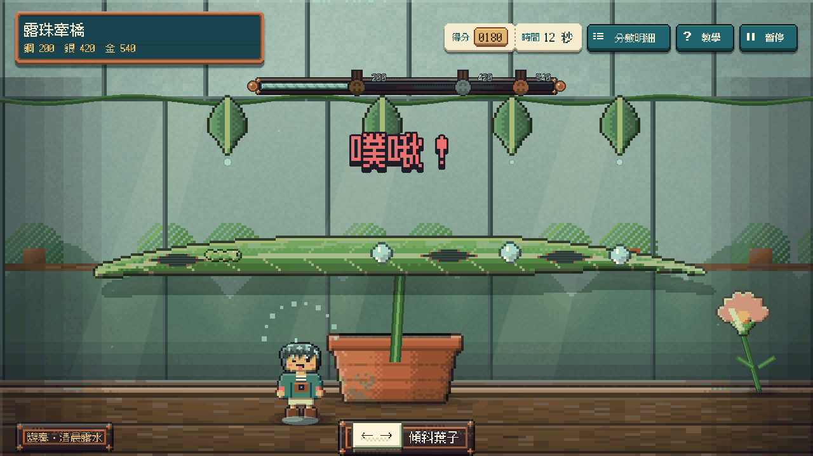

# [SG-94] 實作露珠牽橋

> 狀態：完成

## 內文

### 需求

左右傾斜大葉子讓露珠滾動，吃掉小露珠變大，但不能從葉緣滾下去。佔用苔光溫室的 game-074 位置，取代原本偏向規劃與多按鈕的設計。

### 來源

2026-11-28 使用者要求持續精進遊戲內容與畫面、做到票都完成後繼續找可做的事；苔光溫室十二格只開放了一部分。依 design/00-principles/simple-fun-minigames.md 改寫為單一動詞的街機式小遊戲（Bomberman Land 3 方向）。

### 驗收條件

- [x] 葉子上有蟲洞與會滴水的葉尖，露珠越大越難停。
- [x] 露珠滾下去時正好砸在主角頭上，濕透的頭髮塌成一片。
- [x] 整款只用方向鍵與一到兩顆按鍵，畫面上沒有操作按鈕面板；進場五秒內開始操作，沒有強制教學頁。
- [x] 一回合不超過 60 秒，回合內速度或變化明顯升級；至少兩種隨機出現的變奏。
- [x] 結算只顯示一個分數、銅銀金獎牌與一句評語；銅牌取得普通拍貼，未用輔助的金牌取得小惡魔拍貼。
- [x] 玩法物件達到街機小遊戲的畫面下限：沒有大面積純色、有材質與受光、描邊、接地陰影，色調與背景一致。
- [x] 鍵盤與手把都能完成；開啟減少動態後仍可遊玩。
- [x] 通過稽核十問，結果寫在設計目錄的該款說明；該區原有互動與其他小遊戲不受影響。

### 測試流程

1. 從區域攤位進場，不看說明直接玩一回合。
2. 故意失敗一次，再玩到銅牌與金牌。
3. 開啟減少動態與手把各玩一回合，確認拍貼入冊與重開後保留。

---

# 跟其他票的關係

- Blocks：無
- Blocked by：無
- Related：SG-66、ART-57

---

# Commit-1

## 內文

設計目錄的 game-074 還是要牽葉柄、把露珠合併又分開送到三個乾芽的舊案，苔光溫室第二格沒有可玩的遊戲。
現在溫室藤蔓層南側、蘑菇撐傘旁邊多了一座頂上斜放著大葉子與一顆露珠、櫃台擺著小花苞盆栽的攤位，開放「露珠牽橋」。畫面是清晨的溫室：一片大葉子架在花盆的莖上，按住 ← 或 → 葉子就往那邊斜，葉面上的露珠跟著滾；放開葉子會慢慢放平。玻璃屋頂的藤蔓垂下四片葉尖，水珠在尖端慢慢鼓起、滴到大葉子上；露珠滾過去就一口喝掉、變大一點，頭上顯示喝了幾口。露珠越大越滑、越停不住。從葉尖滾出去落進花苞，花苞會開成粉紅花朵，露珠越大分數越多，喝滿八口再加「滿開」獎勵，所以「現在就送」和「再喝一口」變成取捨。葉子上有毛毛蟲邊啃邊把蟲洞咬大，半場還會再咬一個，通常在葉柄附近，但露珠要是一直停著不動，牠就從露珠正下方冒出來咬；小露珠滾到洞上就掉下去，喝夠水的大露珠會撐在洞上像一座小橋滾過去，這就是名字裡的「橋」。主角一直在葉子底下跟著露珠跑來跑去抬頭看，所以露珠從葉柄那頭或蟲洞掉下去時，「噗啾！」正好砸在主角頭上，刺刺的頭髮濕成扁扁一片、還在滴水，腳下一灘水。
一回合 45 秒，蟲洞越啃越寬、葉尖滴水越來越快。每回合隨機一種變奏：清晨露水、穿堂風（每隔幾秒一陣風把露珠往葉柄吹）、大顆水滴（每顆水珠讓露珠長得快一倍，但滴得比較慢）。倒數時葉子自己斜一下、露珠滾過去喝掉一顆水珠示範，開始時葉子放平、露珠停在遠離蟲洞與葉緣的地方。第一次掉下去不算失誤。輔助讓葉面比較不滑、露珠能撐過更寬的蟲洞、喝水範圍比較大，輔助回合不發小惡魔拍貼。
主角圖多了一種「濕透」的表情，頭髮塌平、髮梢滴水，其他小遊戲之後也能用。
在原生畫面走過倒數示範、喝水長大、撐過蟲洞、送進花苞開花、從葉柄掉下去砸到主角，逐張看過後修掉了：毛毛蟲出現在每個洞旁、花苞與開花是一把線條像掃把、遠處玻璃外是一塊塊方格雜訊、花盆是一片平塗、主角站得太低被下方的操作提示擋住、濕頭髮的反光浮在頭頂上，也拿掉和「噗啾！」重複的第二個字。攤位第一次擺在藤蔓層東側時擋住了往北庭的步道，改放到蘑菇撐傘旁邊。規則測試以模擬按鍵在三種變奏都拿到金牌（570、600、680 分）、反應慢又急著送的玩家拿到銅牌 400 分、完全不動 0 分而且半場會被毛毛蟲從底下咬穿（另以 80 個固定種子、有無輔助各 40 回合確認：沒碰過方向鍵的回合不會得分，就算穿堂風把露珠吹到水珠上也一樣），輔助金牌不發小惡魔拍貼。手把以模擬的左搖桿與十字鍵事件確認能斜葉子，沒有接實體手把；減少動態以原生畫面確認露珠不變形、葉尖與毛毛蟲不晃、落水的水灘直接出現，仍可照常遊玩。難度與「看一眼就懂」依畫面與模擬輸入判斷，尚未由真人試玩。

### 測試結果

| 項目 | 結果 |
|---|---|
| 露珠牽橋規則 | 通過：倒數示範、傾斜與滾動、鍵盤與手把、喝水長大、越大越滑、送進花苞、蟲洞掉落與撐橋、砸到主角、加速、三種變奏、金牌與銅牌整回合 |
| 局部回歸 | 遊戲目錄、溫室世界、區域往返、街機共用流程、場景規範、啟動、教學頁三組全部通過 |
| 設計與資料驗證 | 5 個範圍通過；Python 測試 217 / 217 |
| 原生畫面 | 遊玩、結算與減少動態過程無 ERROR；攤位白天與夜晚都看得到，互動點可走到 |

### 截圖

