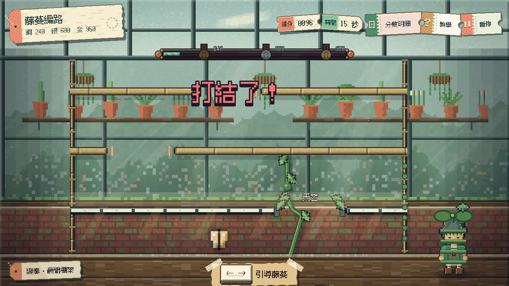

# [SG-95] 實作藤蔓編路

> 狀態：完成

## 內文

### 需求

藤蔓尖端一直往上長，左右控制方向穿過棚架的空隙爬到天窗。佔用苔光溫室的 game-075 位置，取代原本偏向規劃與多按鈕的設計。

### 來源

2026-11-28 使用者要求持續精進遊戲內容與畫面、做到票都完成後繼續找可做的事；苔光溫室十二格只開放了一部分。依 design/00-principles/simple-fun-minigames.md 改寫為單一動詞的街機式小遊戲（Bomberman Land 3 方向）。

### 驗收條件

- [x] 生長速度逐漸加快，空隙會開合，蝴蝶停在路上要繞開。
- [x] 撞到棚架時藤蔓纏住主角，把他打成一個蝴蝶結。
- [x] 整款只用方向鍵與一到兩顆按鍵，畫面上沒有操作按鈕面板；進場五秒內開始操作，沒有強制教學頁。
- [x] 一回合不超過 60 秒，回合內速度或變化明顯升級；至少兩種隨機出現的變奏。
- [x] 結算只顯示一個分數、銅銀金獎牌與一句評語；銅牌取得普通拍貼，未用輔助的金牌取得小惡魔拍貼。
- [x] 玩法物件達到街機小遊戲的畫面下限：沒有大面積純色、有材質與受光、描邊、接地陰影，色調與背景一致。
- [x] 鍵盤與手把都能完成；開啟減少動態後仍可遊玩。
- [x] 通過稽核十問，結果寫在設計目錄的該款說明；該區原有互動與其他小遊戲不受影響。

### 測試流程

1. 從區域攤位進場，不看說明直接玩一回合。
2. 故意失敗一次，再玩到銅牌與金牌。
3. 開啟減少動態與手把各玩一回合，確認拍貼入冊與重開後保留。

---

# 跟其他票的關係

- Blocks：無
- Blocked by：無
- Related：SG-66、ART-57

---

# Commit-1

## 內文

設計目錄的 game-075 還是要牽引芽尖、修剪分枝長成爬到三個平台藤路的舊案，苔光溫室第三格沒有可玩的遊戲。
現在夜芽庭東北角、竹棚架前多了一座頂上搭著小竹棚、藤蔓穿過空隙開出粉紅花、櫃台擺著麻繩捲與幼苗的攤位，開放「藤蔓編路」。畫面是溫室牆邊的一大片竹棚架：藤蔓尖自己一直往上長、後面留下一串葉子，按住 ← 或 → 就把尖端往那邊引。每根竹橫竿只有一個缺口，兩端綁著麻繩，對準了穿過去就得分，從正中央穿與連續穿過再加分，連穿越多音越高。下一個空隙一定偏在左邊或右邊，放著不管的藤蔓會一路撞上去。每八根橫竿是一扇鐵框天窗，爬到時陽光灑下來、藤蔓上開出一朵花並加大獎。撞到竹竿時，藤蔓一路甩下來把站在棚架旁的主角綁成一個綠色蝴蝶結，頭頂一個大結，主角一臉無奈；解開後藤蔓從撞到的地方下面重新長。
一回合 45 秒，藤蔓越長越快、空隙越來越窄；後段有些空隙兩邊是會開開合合的葉片，蝴蝶也會停在路上，擦到牠藤蔓會愣一下、蝴蝶飛走（不算失誤），但牠們只停在兩個空隙連線的旁邊，永遠有路可繞。每回合隨機一種變奏：晨間棚架、搖擺棚架（空隙左右滑動）、蝴蝶季（蝴蝶更多）。倒數時藤蔓自己長上去穿過第一個空隙示範，開始時藤蔓從底下重新長、正對第一個空隙、還有一整根橫竿的距離。第一次打結不算失誤。輔助讓藤蔓長得慢一點、空隙寬一點，輔助回合不發小惡魔拍貼。
溫室的街機小遊戲現在共用一張溫室背景：玻璃屋頂與鐵框分出受光與陰影、背後玻璃外有樹林與花叢、窗前的層架上擺著蕨類與花盆、屋頂垂下吊籃、矮磚牆長著青苔，還有慢慢晃動的陽光與飄著的灰塵。
在原生畫面走過倒數示範、穿空隙、天窗開花、蝴蝶、撞竿打結，逐張看過後修掉了：竹竿與藤蔓畫到前景的木檯和下方操作提示上、蝴蝶太小看不出來、天窗只是一條細玻璃看不出是天窗。攤位第一次放在夜芽庭時壓到東邊的夜芽花床，改放到花床東邊、竹棚架前。規則測試以模擬按鍵在三種變奏都拿到金牌（1515、1446、1231 分）、反應慢又常偏掉的玩家拿到銅牌 264 分、完全不動 17 分，輔助金牌不發小惡魔拍貼。手把以模擬的左搖桿與十字鍵事件確認能引導藤蔓，沒有接實體手把；減少動態以原生畫面確認蝴蝶不拍翅、藤蔓尖不捲動、打結直接到位，仍可照常遊玩。難度與「看一眼就懂」依畫面與模擬輸入判斷，尚未由真人試玩。

### 測試結果

| 項目 | 結果 |
|---|---|
| 藤蔓編路規則 | 通過：倒數示範、左右引導與手把、穿空隙與置中加分、開合空隙、蝴蝶、天窗、撞竿打結、加速、三種變奏、金牌與銅牌整回合 |
| 局部回歸 | 遊戲目錄、溫室世界、區域往返、街機共用流程、失敗拍貼、場景規範、啟動、露珠牽橋、教學頁兩組全部通過 |
| 設計與資料驗證 | 5 個範圍通過；Python 測試 217 / 217 |
| 原生畫面 | 遊玩、結算與減少動態過程無 ERROR；攤位白天與夜晚都看得到，互動點可走到 |

### 截圖

