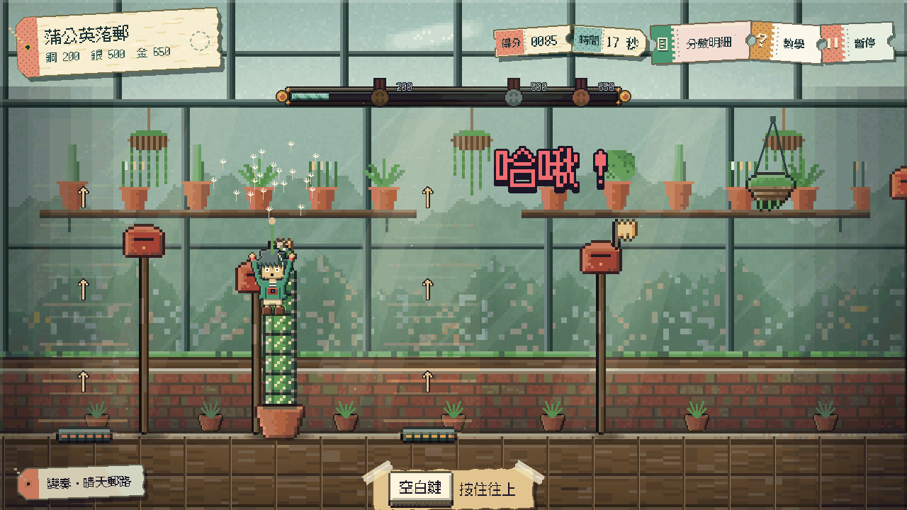

# [SG-96] 實作蒲公英落郵

> 狀態：完成

## 內文

### 需求

抓著蒲公英種子飄在溫室裡，按住往上、放開往下，碰到揮旗的信箱就把信投進去。佔用苔光溫室的 game-076 位置，取代原本偏向規劃與多按鈕的設計。

### 來源

2026-11-28 使用者要求持續精進遊戲內容與畫面、做到票都完成後繼續找可做的事；苔光溫室十二格只開放了一部分。依 design/00-principles/simple-fun-minigames.md 改寫為單一動詞的街機式小遊戲（Bomberman Land 3 方向）。

### 驗收條件

- [x] 上升氣流與噴水器改變飛行，信箱會在不同高度出現。
- [x] 撞到時打一個大噴嚏，種子散了一整片，主角抱著一根光禿禿的莖掉下來。
- [x] 整款只用方向鍵與一到兩顆按鍵，畫面上沒有操作按鈕面板；進場五秒內開始操作，沒有強制教學頁。
- [x] 一回合不超過 60 秒，回合內速度或變化明顯升級；至少兩種隨機出現的變奏。
- [x] 結算只顯示一個分數、銅銀金獎牌與一句評語；銅牌取得普通拍貼，未用輔助的金牌取得小惡魔拍貼。
- [x] 玩法物件達到街機小遊戲的畫面下限：沒有大面積純色、有材質與受光、描邊、接地陰影，色調與背景一致。
- [x] 鍵盤與手把都能完成；開啟減少動態後仍可遊玩。
- [x] 通過稽核十問，結果寫在設計目錄的該款說明；該區原有互動與其他小遊戲不受影響。

### 測試流程

1. 從區域攤位進場，不看說明直接玩一回合。
2. 故意失敗一次，再玩到銅牌與金牌。
3. 開啟減少動態與手把各玩一回合，確認拍貼入冊與重開後保留。

---

# 跟其他票的關係

- Blocks：無
- Blocked by：無
- Related：SG-66、ART-57

---

# Commit-1

## 內文

設計目錄的 game-076 還是要放出種子、開合種傘並切換風層的舊案，苔光溫室第四格沒有可玩的遊戲。
現在溫室西北角的日晷旁多了一座頂上插著一顆大蒲公英、底下夾著一封信，櫃台擺著豎起小黃旗的紅色信箱的攤位，開放「蒲公英落郵」。畫面是一路往右飄過去的溫室：主角高舉一根莖、吊在一顆白色蒲公英絨球下，腰間掛著信。按住空白鍵（或 ↑、手把 A 鈕、按住畫面）絨球就兜住空氣往上飄，放開就慢慢往下沉。紅色鐵皮信箱有的站在木樁上、有的用鐵鍊吊在屋頂，揮著黃旗的才收信；碰到它，信就滑進投信口、旗子放下，投進正中央跳出「正中信箱！」，連續投信再加分。地上的暖氣格子冒著熱氣把人往上推、屋頂的灑水器把人往下壓。撞到盆栽仙人掌、吊籃、地板或屋頂玻璃時，主角打一個大噴嚏「哈啾！」，絨球炸成一整片小降落傘飄走，主角抱著一根光禿禿的莖掉到地上，換一顆新的蒲公英再出發。一直不按會一路沉到地上打噴嚏，沒碰過按鍵的回合一分都不得。
一回合 45 秒，溫室越飄越快、信箱的高低越拉越開，後段仙人掌與吊籃也越來越多。每回合隨機一種變奏：晴天郵路、暖氣日（暖氣格子更多）、灑水日（灑水器更多）。倒數時蒲公英自己往上飄、把信投進前面的信箱示範，開始時主角停在半空、前方一個畫面內什麼都沒有。第一個噴嚏不算失誤。輔助讓投信口寬一點、主角撞到東西的範圍小一點，輔助回合不發小惡魔拍貼。
在原生畫面走過倒數示範、飛行投信、正中投信、暖氣與吊籃、撞仙人掌打噴嚏，逐張看過後修掉了：路上太空、一個畫面常常只有一個信箱（信箱間距縮短、障礙變多，地面後方加上一排飄過的小盆栽當背景）、暖氣的熱氣幾乎看不見、大字回饋蓋住飛高時的主角。規則測試以模擬按鍵在三種變奏都拿到金牌（670、1025、1040 分）、反應慢又常偏的玩家拿到銅牌 450 分、完全不按 0 分（另以 80 個固定種子、有無輔助各 40 回合確認完全不按都是 0 分），輔助金牌不發小惡魔拍貼。手把以模擬的 A 鈕事件確認能往上飄，沒有接實體手把；減少動態以原生畫面確認旗子與吊籃不晃、熱氣與水柱靜止、噴嚏時種子直接散開、主角直接落地，仍可照常遊玩。難度與「看一眼就懂」依畫面與模擬輸入判斷，尚未由真人試玩。

### 測試結果

| 項目 | 結果 |
|---|---|
| 蒲公英落郵規則 | 通過：倒數示範、按住上飄放開下沉、鍵盤與手把、投信與正中、連投、旗子放下不收、暖氣與灑水器、四種噴嚏、加速、三種變奏、不按不得分、金牌與銅牌整回合 |
| 局部回歸 | 遊戲目錄、溫室世界、區域往返、街機共用流程、失敗拍貼、場景規範、啟動、教學頁兩組全部通過 |
| 設計與資料驗證 | 5 個範圍通過；Python 測試 217 / 217 |
| 原生畫面 | 遊玩、結算與減少動態過程無 ERROR；攤位白天與夜晚都看得到，互動點可走到 |

### 截圖

