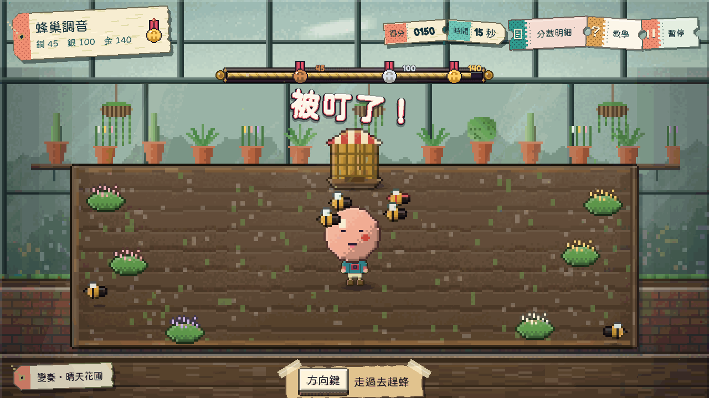

# [SG-97] 實作蜂巢調音

> 狀態：完成

## 內文

### 需求

移動主角把四處亂飛的蜜蜂趕回蜂巢，蜜蜂會遠離主角，要從反方向繞過去推。佔用苔光溫室的 game-078 位置，取代原本偏向規劃與多按鈕的設計。

### 來源

2026-11-28 使用者要求持續精進遊戲內容與畫面、做到票都完成後繼續找可做的事；苔光溫室十二格只開放了一部分。依 design/00-principles/simple-fun-minigames.md 改寫為單一動詞的街機式小遊戲（Bomberman Land 3 方向）。

### 驗收條件

- [x] 蜜蜂越來越多，有一隻愛唱反調的蜂會往主角飛來。
- [x] 被蜂群包圍時主角的臉腫成一顆圓氣球。
- [x] 整款只用方向鍵與一到兩顆按鍵，畫面上沒有操作按鈕面板；進場五秒內開始操作，沒有強制教學頁。
- [x] 一回合不超過 60 秒，回合內速度或變化明顯升級；至少兩種隨機出現的變奏。
- [x] 結算只顯示一個分數、銅銀金獎牌與一句評語；銅牌取得普通拍貼，未用輔助的金牌取得小惡魔拍貼。
- [x] 玩法物件達到街機小遊戲的畫面下限：沒有大面積純色、有材質與受光、描邊、接地陰影，色調與背景一致。
- [x] 鍵盤與手把都能完成；開啟減少動態後仍可遊玩。
- [x] 通過稽核十問，結果寫在設計目錄的該款說明；該區原有互動與其他小遊戲不受影響。

### 測試流程

1. 從區域攤位進場，不看說明直接玩一回合。
2. 故意失敗一次，再玩到銅牌與金牌。
3. 開啟減少動態與手把各玩一回合，確認拍貼入冊與重開後保留。

---

# 跟其他票的關係

- Blocks：無
- Blocked by：無
- Related：SG-66、ART-57

---

# Commit-1

## 內文

設計目錄的 game-078 還是要轉花瓣口、敲共鳴蜂房調音的舊案，苔光溫室第六格沒有可玩的遊戲。
現在溫室東側上層的看葉臺木平台上多了一座屋頂放著紅白條紋蜂箱、三隻小蜜蜂吊在細線上繞著巢口，櫃台擺著一盆粉紅花的攤位，開放「蜂巢調音」。畫面是溫室裡一塊架高的花圃：後牆中間是一座紅白條紋屋頂的木蜂箱，花圃上散著幾叢開花的矮草，蜜蜂拍著翅膀到處亂飛。用方向鍵（或 WASD、手把十字鍵、左搖桿）走動，蜜蜂一看到主角靠近就往反方向飛開，所以要繞到蜜蜂後面、往蜂巢的方向推；被趕的蜜蜂飛到巢口附近會被蜂巢「哼」進去，巢口發亮、冒出音符，接連趕進去跳出「連續回巢！」再加分。只是自己飄過巢口、沒被趕過的蜜蜂不算，沒碰過按鍵的回合一分都不得。花叢會不斷飛出新蜜蜂，蜜蜂也越飛越快；過了四分之一場會出現一隻紅條紋、皺著眉的反調蜂，牠不怕人，會慢慢朝主角飛過來，要邊趕蜂邊閃開。被反調蜂撞上、或被三隻蜜蜂圍住（多半是把蜂群逼進角落時）就會被叮：主角的臉腫成一顆粉紅色圓氣球，三隻蜜蜂繞著氣球頭轉，大約兩秒消腫才能再走；叮完人的反調蜂會得意地飛走一陣子。
一回合 45 秒。每回合隨機一種變奏：晴天花圃、微風花圃（一陣風把蜜蜂慢慢往一邊吹、再吹回來）、蜂群日（一開始就有六隻、新蜂飛出更快）。倒數時主角自己繞到一隻蜜蜂後面把牠趕進蜂巢示範，開始時主角在花圃前方、所有蜜蜂都離主角和蜂巢有段距離。第一次被叮不算失誤。輔助讓蜂巢把被趕的蜜蜂吸進去的範圍大一點、閒晃的蜜蜂和反調蜂飛慢一點，輔助回合不發小惡魔拍貼。
在原生畫面走過倒數示範、趕蜂、連續回巢、被叮變氣球頭，逐張看過後修掉了：花圃土壤雜點太多像雜訊（改成一條條耙過的土溝、零星小石子與苔蘚）、氣球頭是平滑向量圓跟像素畫不搭（改成烘焙的像素氣球，有亮點、瞇眼、嘟嘴和紅色叮痕）、大字回饋蓋住蜂巢（往上移）、右上角重複的「連續回巢 ×N」小字（拿掉）、主角走到花圃框外。玩法上修掉了：蜜蜂會卡進主角走不到的牆角（蜜蜂現在會避開花圃邊框，後牆兩側留更寬）、被叮後反調蜂馬上又叮一次（改成叮完先飛走）。

### 測試結果

| 項目 | 結果 |
|---|---|
| 蜂巢調音規則 | 通過：倒數示範、走動與手把、蜜蜂躲開、趕進蜂巢與連續回巢、反調蜂追人且不回巢、被叮與第一次不算失誤、叮完飛走、被圍住會叮、加速與新蜂、三種變奏、輔助、不按不得分、金牌與銅牌整回合 |
| 局部回歸 | 遊戲目錄、溫室世界（走得到新攤位、上層平台原有的看葉臺路線不受影響）、街機共用流程、場景規範、區域往返、啟動、失敗拍貼、教學頁兩組全部通過 |
| 設計與資料驗證 | 5 個範圍通過；Python 測試 217 / 217 |
| 原生畫面 | 遊玩、連續回巢、被叮與減少動態過程沒有腳本錯誤；攤位在白天畫面看得到、靠近時跳出「玩蜂巢調音」 |

規則測試以模擬按鍵玩整回合，每種情況取四個固定種子的平均：三種變奏的趕蜂玩家平均都到金牌（晴天 183、微風 186、蜂群 147 分）、玩到四分之一就放棄的玩家平均拿到銅牌（105、65、45、45 分）、完全不按 0 分（另以 80 個固定種子、有無輔助各 40 回合確認完全不按都是 0 分），輔助回合到金牌也不發小惡魔拍貼。手把以模擬的搖桿與十字鍵事件確認能走動，沒有接實體手把；減少動態以原生畫面確認翅膀不拍、蜜蜂不上下晃、氣球臉直接到位，仍可照常遊玩。分數門檻依模擬玩家訂定，難度與「看一眼就懂」尚未由真人試玩。

### 截圖

