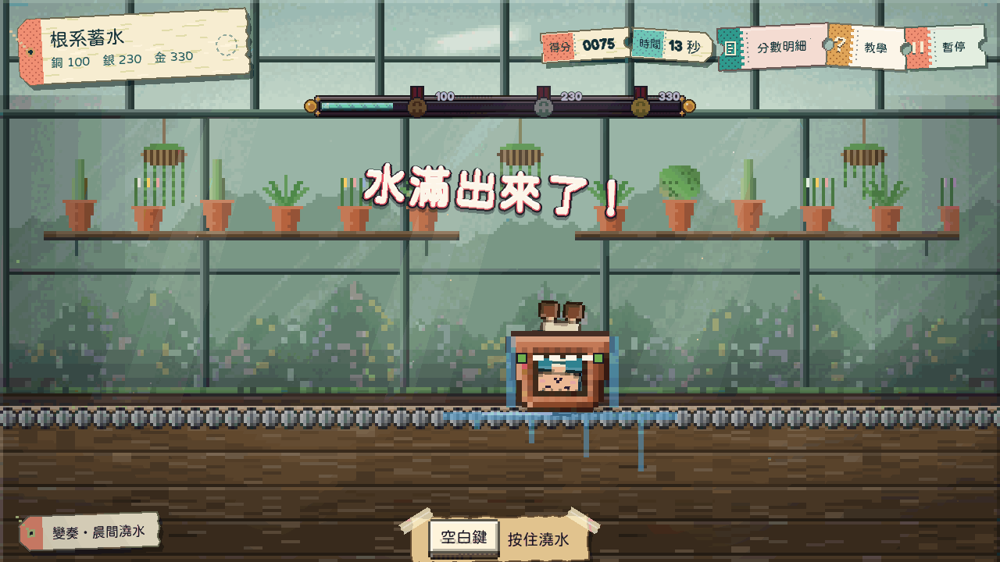

# [SG-98] 實作根系蓄水

> 狀態：完成

## 內文

### 需求

按住替盆栽澆水，水位停在刻線就放手，不同大小的盆子水位上升速度不同。佔用苔光溫室的 game-081 位置，取代原本偏向規劃與多按鈕的設計。

### 來源

2026-11-28 使用者要求持續精進遊戲內容與畫面、做到票都完成後繼續找可做的事；苔光溫室十二格只開放了一部分。依 design/00-principles/simple-fun-minigames.md 改寫為單一動詞的街機式小遊戲（Bomberman Land 3 方向）。

### 驗收條件

- [x] 盆栽一盆接一盆移過來，後段有會漏水與會突然長大的盆。
- [x] 澆太多時水漫出來，主角踩到水滑一跤坐進盆裡。
- [x] 整款只用方向鍵與一到兩顆按鍵，畫面上沒有操作按鈕面板；進場五秒內開始操作，沒有強制教學頁。
- [x] 一回合不超過 60 秒，回合內速度或變化明顯升級；至少兩種隨機出現的變奏。
- [x] 結算只顯示一個分數、銅銀金獎牌與一句評語；銅牌取得普通拍貼，未用輔助的金牌取得小惡魔拍貼。
- [x] 玩法物件達到街機小遊戲的畫面下限：沒有大面積純色、有材質與受光、描邊、接地陰影，色調與背景一致。
- [x] 鍵盤與手把都能完成；開啟減少動態後仍可遊玩。
- [x] 通過稽核十問，結果寫在設計目錄的該款說明；該區原有互動與其他小遊戲不受影響。

### 測試流程

1. 從區域攤位進場，不看說明直接玩一回合。
2. 故意失敗一次，再玩到銅牌與金牌。
3. 開啟減少動態與手把各玩一回合，確認拍貼入冊與重開後保留。

---

# 跟其他票的關係

- Blocks：無
- Blocked by：無
- Related：SG-66、ART-57

---

# Commit-1

## 內文

設計目錄的 game-081 還是要夾放根節、切換儲水囊撐過三次乾期的舊案，苔光溫室第九格沒有可玩的遊戲。
現在溫室東側斜坡上去的下層木平台上多了一座屋頂上一把綠色大水壺正往小盆栽倒水、櫃台擺著三盆冒芽小盆的攤位，開放「根系蓄水」。畫面是溫室裡一張長長的育苗工作台，台邊一排滾輪；陶盆一盆接一盆滑到主角面前停下。每個盆子正面是一片玻璃，看得到裡面的泥土和根，盆上有一條粉筆刻線，兩端各伸出一片葉子小旗。主角站在工作台後面的木箱上拿著綠色水壺，按住空白鍵（或 Enter、手把 A 鈕、按住畫面）水壺就傾斜、一串水滴落進盆裡，泥土從盆底往上被染成藍色；放開就停。小盆子水漲得快、大盆子漲得慢。盆子停一下就滑走，滑走時水位剛好在刻線上跳出「剛剛好！」、根亮起來、盆裡冒出一株新芽，連續剛好再加分；差一點拿少少的分；不夠就「還渴！」。澆過盆口，水從盆口滿出來流了工作台一片，主角滑一跤、頭下腳上栽進盆裡，從玻璃看得到他泡在泥水裡的臉，只剩靴子露出盆口；這盆不算分。沒碰過按鍵的回合一分都不得。
一回合 45 秒，盆子停的時間越來越短、滑得越來越快；四分之一場後出現有補丁、會滴水的漏水盆，離開前要再補一點；接近半場出現繞著一圈條紋的長大盆，澆到一半會「砰」地長大一號，水位跟著掉下去。每回合隨機一種變奏：晨間澆水、大盆日（大盆比較多）、漏水日（一開始就有漏水盆）。倒數時水壺自己把一盆小盆澆到刻線示範，開始時第一盆才剛滑進來、還沒有水。第一次滿出來不算失誤。輔助讓刻線容許的範圍寬一點、盆子停久一點，輔助回合不發小惡魔拍貼。
在原生畫面走過倒數示範、澆水、剛剛好與冒芽、滿出來栽進盆裡，逐張看過後修掉了：盆子太小、水位看不清楚（盆子和水壺放大到原本的 1.75 倍，水的顏色加深）、水壺比盆口還低倒不進去（主角改站在工作台後的木箱上）、倒數的大字橫幅蓋住整個工作台和示範的盆子（整個工作台往上移）、積水畫在畫面最下面蓋到按鍵提示（改成攤在工作台上、順著台面往下流）。

### 測試結果

| 項目 | 結果 |
|---|---|
| 根系蓄水規則 | 通過：倒數示範、按住澆水放開停、鍵盤與手把、盆子大小不同漲速、刻線判定（剛好、差一點、太乾、太多）、連續剛好、漏水盆與長大盆只在後段出現、滿出來與滑倒、第一次不算失誤、加速、三種變奏、輔助、不按不得分、金牌與銅牌整回合 |
| 局部回歸 | 遊戲目錄、溫室世界（走得到新攤位、東側繞行路線與上層平台不受影響）、街機共用流程、場景規範全部通過 |
| 設計與資料驗證 | 5 個範圍通過；Python 測試 217 / 217 |
| 原生畫面 | 遊玩、剛剛好冒芽、滿出來栽進盆裡與減少動態過程沒有腳本錯誤；攤位在白天畫面看得到、靠近時跳出「玩根系蓄水」 |

規則測試以模擬按鍵玩整回合，每種情況取四個固定種子的平均：看著水位、到刻線就放手的玩家在三種變奏都拿到金牌（每回合 595 分）、每次都晚 0.2 秒才放手的玩家拿到銅牌（124、165、112、181 分）、完全不按 0 分（另以 80 個固定種子、有無輔助各 40 回合確認完全不按都是 0 分），輔助回合到金牌（395 分）也不發小惡魔拍貼。手把以模擬的 A 鈕事件確認能澆水，沒有接實體手把；減少動態以原生畫面確認水面不晃、水滴不落、滾輪不轉、栽進盆裡直接到位，仍可照常遊玩。分數門檻依模擬玩家訂定，難度與「看一眼就懂」尚未由真人試玩。

### 截圖

