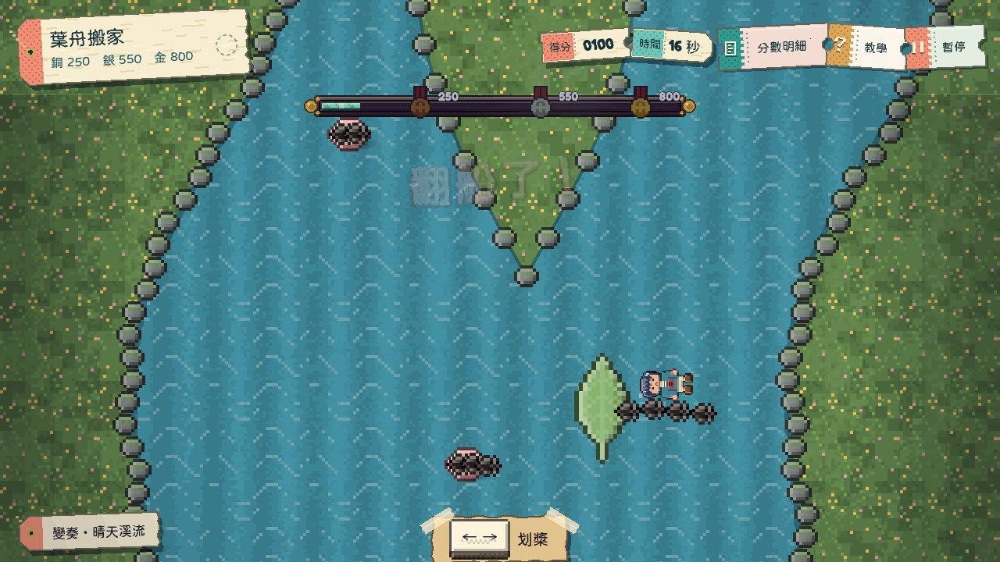

# [SG-99] 實作葉舟搬家

> 狀態：完成

## 內文

### 需求

交替左右划槳讓葉子小船載著螞蟻順溪流而下，閃過石頭與漩渦。佔用苔光溫室的 game-082 位置，取代原本偏向規劃與多按鈕的設計。

### 來源

2026-11-28 使用者要求持續精進遊戲內容與畫面、做到票都完成後繼續找可做的事；苔光溫室十二格只開放了一部分。依 design/00-principles/simple-fun-minigames.md 改寫為單一動詞的街機式小遊戲（Bomberman Land 3 方向）。

### 驗收條件

- [x] 溪流越來越急，岔路有一條能撿到更多螞蟻。
- [x] 翻船時一群螞蟻把濕淋淋的主角扛起來搬走。
- [x] 整款只用方向鍵與一到兩顆按鍵，畫面上沒有操作按鈕面板；進場五秒內開始操作，沒有強制教學頁。
- [x] 一回合不超過 60 秒，回合內速度或變化明顯升級；至少兩種隨機出現的變奏。
- [x] 結算只顯示一個分數、銅銀金獎牌與一句評語；銅牌取得普通拍貼，未用輔助的金牌取得小惡魔拍貼。
- [x] 玩法物件達到街機小遊戲的畫面下限：沒有大面積純色、有材質與受光、描邊、接地陰影，色調與背景一致。
- [x] 鍵盤與手把都能完成；開啟減少動態後仍可遊玩。
- [x] 通過稽核十問，結果寫在設計目錄的該款說明；該區原有互動與其他小遊戲不受影響。

### 測試流程

1. 從區域攤位進場，不看說明直接玩一回合。
2. 故意失敗一次，再玩到銅牌與金牌。
3. 開啟減少動態與手把各玩一回合，確認拍貼入冊與重開後保留。

---

# 跟其他票的關係

- Blocks：無
- Blocked by：無
- Related：SG-66、ART-57

---

# Commit-1

## 內文

設計目錄的 game-082 還是要摺葉、撥水並掛岸枝運三隻小蝸牛的舊案，苔光溫室第十格沒有可玩的遊戲。
現在溫室東側上層看葉臺的另一邊多了一座屋頂上擺著一艘捲邊綠葉小船和一支小槳、櫃台放著一片站著螞蟻的粉紅花瓣的攤位，開放「葉舟搬家」。畫面是從上往下看的溫室小溪，溪水往畫面上方流，兩岸是長著蕨類和小花的青苔岸，岸邊排著一顆顆小石頭。主角坐在一片捲邊的綠葉裡，按 ← 就往左邊划一槳、按 → 往右邊划一槳（手把十字鍵、左搖桿也行），槳伸到那一邊、濺起水花，葉子往那邊偏；左右交替划最快最直，一直划同一邊只會轉彎。漂來的粉紅花瓣上有螞蟻揮手，葉子擦過時螞蟻跳上船、排在葉緣，接連載到再加分。長青苔的石頭邊有一圈白浪；三成場後出現漩渦，一圈圈白色水紋轉著，會把葉子往中心拖。每隔一段溪流會被一座長長的青苔小島分成兩邊：窄的一邊擠滿螞蟻但多一顆石頭，寬的一邊安全卻只有一隻。撞上石頭或被捲進漩渦中心就翻船：葉子翻過來漂著，一排螞蟻把濕淋淋的主角頂在頭上扛到岸邊，前面一段的石頭和漩渦會清掉再讓你出發。撞到岸邊或小島只會彈開、不會翻。沒碰過按鍵的回合一分都不得。
一回合 45 秒，溪水越流越快、石頭越來越密。每回合隨機一種變奏：晴天溪流、雨後急流（水流更快、花瓣上的螞蟻更多）、漩渦日（一開始就有漩渦）。倒數時葉舟自己划過去載上一片花瓣的螞蟻示範，開始時葉舟在溪流中間、前方只有一片花瓣沒有石頭。第一次翻船不算失誤。輔助讓石頭的碰撞範圍小一點、溪水流慢一點、漩渦吸力弱一點，輔助回合不發小惡魔拍貼。
在原生畫面走過倒數示範、划槳、載螞蟻、翻船被螞蟻扛走，逐張看過後修掉了：水面和青苔岸的貼圖接縫出現一整片黑色格線（改成不帶描邊的無縫貼圖）、螞蟻小到看起來像一排黑色梳子（重畫成有頭、細腰、肚子和六隻腳的螞蟻並放大）、葉子小船太小看不清乘客（放大）、小島下面有一大片不自然的黑影（拿掉，改成岸邊一圈小石頭）、漩渦水紋太淡。

### 測試結果

| 項目 | 結果 |
|---|---|
| 葉舟搬家規則 | 通過：倒數示範、鍵盤與手把划槳、左右交替比單邊快又直、撞岸邊不翻船、小島把溪流分成兩邊、螞蟻上船與連續加分、一整群螞蟻、撞石頭翻船與第一次不算失誤、翻船時不能划、翻船後前方清空、漩渦把葉子拖進中心翻船、岔路窄的一邊螞蟻多、溪水加速、漩渦後段才出現、三種變奏、輔助、不按不得分、金牌與銅牌整回合 |
| 局部回歸 | 遊戲目錄、溫室世界（走得到新攤位、上層平台原有路線不受影響）、街機共用流程、場景規範全部通過 |
| 設計與資料驗證 | 5 個範圍通過；Python 測試 217 / 217 |
| 原生畫面 | 遊玩、載螞蟻、翻船被扛走與減少動態過程沒有腳本錯誤；攤位在白天畫面看得到、靠近時跳出「玩葉舟搬家」 |

規則測試以模擬按鍵玩整回合，每種情況取四個固定種子的平均：每 0.12 秒判斷一次、朝最近的花瓣划又會閃石頭和漩渦的玩家在三種變奏都拿到金牌（平均 1002、1202、1016 分）、每 0.7 秒才划一下的玩家拿到銅牌（535、445、340、390 分）、完全不按 0 分（另以 80 個固定種子、有無輔助各 40 回合確認完全不按都是 0 分），輔助回合到金牌也不發小惡魔拍貼。手把以模擬的十字鍵事件確認能划，沒有接實體手把；減少動態以原生畫面確認水不流、花瓣不晃、漩渦不轉、螞蟻扛人直接到岸邊，仍可照常遊玩。分數門檻依模擬玩家訂定，難度與「看一眼就懂」尚未由真人試玩。

### 截圖

# Commit-2

## 內文

第一版的螞蟻是黑色、擠成一團，看起來像一團帶刺的黑影；花瓣上的螞蟻疊在一起變成粉紅黑色的一坨；漩渦只是一個深色圓點。
現在螞蟻改成紅褐色：圓圓的肚子、細腰、胸和頭，頭上有一顆小亮眼、兩根彎彎的觸角，左右各三隻腳，一看就是螞蟻。花瓣顏色調淡，上面最多三隻螞蟻分開站著揮手。上了船的螞蟻排在葉子船尾和船頭、不再擠到主角身上，每一隻頭上都頂著一小塊麵包屑或糖粒，一邊走一邊上下晃（減少動態時不晃）。翻船時扛主角的四隻螞蟻間隔開來，看得出是一排螞蟻。石頭改成灰色圓石，左上受光、頂上長著青苔、底部比較暗，水流撞上石頭的那一側有一圈白色浪花，石頭後面拖出兩道細細的水痕。漩渦改成一圈較深的水面上兩條白色浪花螺旋臂往中心捲進去，中心是深色的漩渦眼。
在原生畫面看過划槳、載螞蟻、翻船被扛走三張，規則與分數沒有改動。

### 測試結果

| 項目 | 結果 |
|---|---|
| 葉舟搬家規則 | 通過（只改畫面，規則與分數不變） |
| 局部回歸 | 街機共用流程、場景規範通過 |
| 設計與資料驗證 | 5 個範圍通過 |

### 截圖

