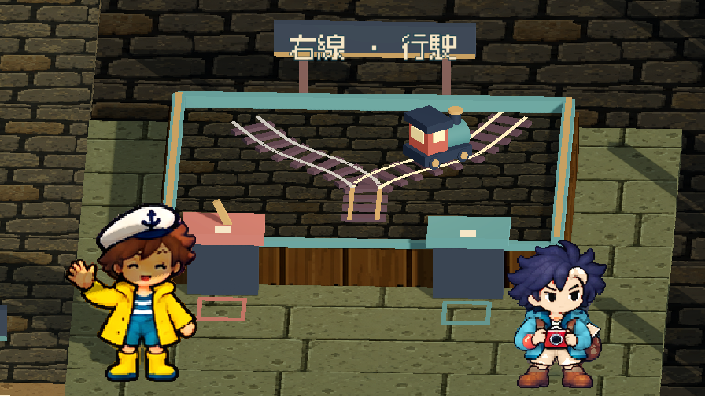

# [ST-10] 補齊玩具城登記與合照

> 狀態：完成

## 內文

### 需求

發條玩具城入口開放當班角色的短對話與正式合照。第一次合照同時登記造訪並收藏。照片取景收進角色和車站實景，保留玩家原本的列車與岔道狀態。

### 來源

[普通主線自由巡園](../../design/03-story/story.md) 與 2026-11-26 使用者要求繼續後續章節並打磨地圖、畫面與動態。

### 驗收條件

- [x] 迎賓點可開始短對話、略過長文本和合照，無指定小遊戲或先收小惡魔的條件。
- [x] 取景含實際角色、車站及列車。一般與減少動態均可合照，結束後玩家及列車狀態復原。
- [x] 正式合照與造訪一起儲存。中止不發卡。劇情可重播，原始照片可在相簿查看與重新開啟。
- [x] 既有兩區合照、30 張門檻與免費返程仍正常。PM 留一張必要截圖與摘要。

### 測試流程

1. 以 30 張普通卡前往玩具城，步行到迎賓點，檢查開始、略過、中止與正式快門。
2. 改變列車與岔道狀態，再拍攝並核對返回後的狀態。
3. 用獨立存檔重開原始相片並重播，檢查夜市與馬戲團的合照和旅券。

---

# 跟其他票的關係

- Blocks：無
- Blocked by：無
- Related：MAIN-45、ST-9

---

# Commit-1

玩家可在發條玩具城入口東側找阿浪看短劇《列車倒著報到》。相機取景收進實際車站、列車和兩名角色。關閉相機後，玩家與列車維持原來的位置和進度。首次快門同時保存原照與造訪，相簿之後可重演並查看同一張原照。

### 測試結果

| 項目 | 結果 |
|---|---|
| Godot 4.7.2 局部 | 玩具城短劇與步道、旅行、進度、夜市與馬戲團短劇、旅券 7 組通過 |
| 800×600，字級 125%，減少動態 | 原生流程 45 項，重開 8 項 |
| 1280×720，字級 125% | 原生流程 44 項，重開 8 項 |
| 1920×1080，字級 125% | 原生流程 44 項，重開 8 項 |
| 規格與工具 | 5 項設計檢查及 215 項 Python 測試通過 |

