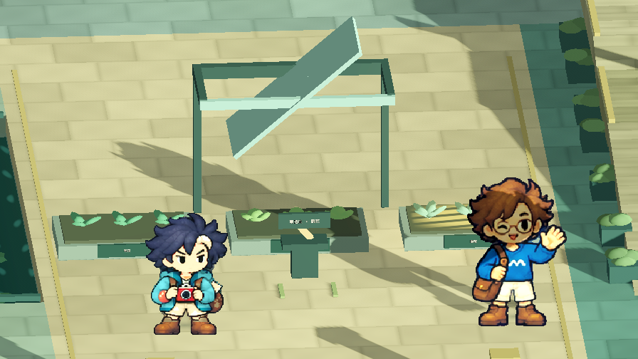

# [ST-11] 演出苔光溫室主線合照

> 狀態：完成

## 內文

### 需求

玩家在日照窗旁找票票登記。票票用盆栽坐到頭排的笑話帶出幕幕為首演留座位的想法。可直接略過到合照。合照把溫室當下的植床光斑和兩個角色拍進畫框，首次保存同時登記造訪及普通主線拍貼。

### 來源

2026-11-26 使用者要求接續後面章節，並打磨光源、動態、畫面及操作。[自由巡園主線規格](../../design/03-story/story.md)安排固定迎賓點、可以略過的短對話和區域合照。

### 驗收條件

- [x] 從溫室入口可步行到固定迎賓點。短對話帶出幕幕首演，可直接略過到合照。
- [x] 保留玩家選定的百葉與植床實際受光，兩個角色和光斑在三種原生尺寸皆完整入鏡。取消可回原地。
- [x] 首次實景快門同時登記造訪與一張普通主線拍貼，重開可查看。重演保留首次原照與收藏數。
- [x] 未拍照、取消或寫入失敗時，造訪及收藏都不增加，既有入場與探索可繼續操作。

### 測試流程

1. 從入口走到日照窗轉動百葉，再去找票票。分別走過完整對話及略過入口。
2. 換不同植床光斑，確認真實畫框及取消復位。再次合照並按快門。
3. 重開後查看相簿並重演，核對造訪、原照與其他收藏。

---

# 跟其他票的關係

- Blocks：無
- Blocked by：無
- Related：MAIN-48、ST-9、ST-10

---

# Commit

### 結果

玩家可在日照窗旁與票票交談，略過或讀完短劇都能合照。照片收下當下的植床光斑、票票和主角。首次快門將造訪與普通主線拍貼一起存檔，取消可回到原地，相簿重演保留首次原照。

### 測試結果

| 項目 | 結果 |
|---|---|
| Windows 實機合照與重開，文字 1.25 | 800×600 51/8、1280×720 50/8、1920×1080 50/8 項全數通過 |
| 園區、展區劇情和存檔回歸 | 溫室劇情 81 項，其餘關聯測試通過 |

### 截圖

