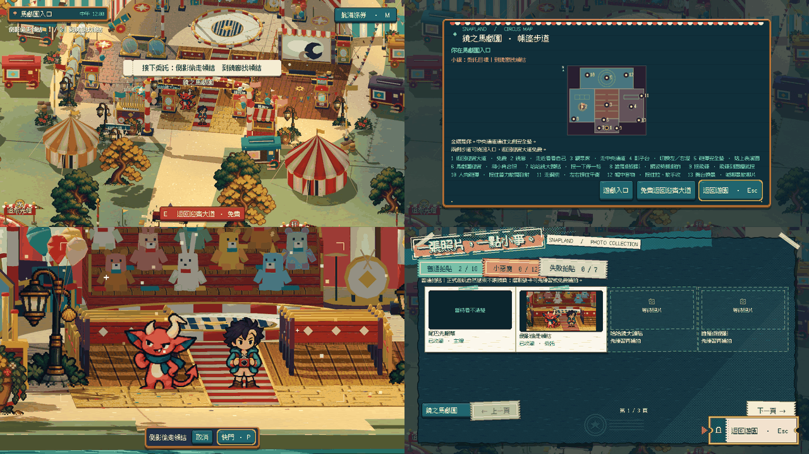

# [ST-12] 加入三個主題區的居民小委託

> 狀態：完成

## 內文

### 需求

鏡之馬戲團、發條玩具城與苔光溫室除了入口的迎賓短劇與合照之外，沒有和居民之間的故事。每區加入一段三步的小委託：居民有一個好笑的小麻煩，主角在區內走動、找東西或使用該區的即玩小遊戲與小玩具來幫忙，最後拍一張合照收進相簿。讓玩家在攤位之外也有理由在各區逛。

### 來源

2026-11-28 使用者要求多新增多樣化、不會重複的內容；協作 session 盤點時列出「馬戲團、玩具城、溫室在迎賓之後的劇情與居民場景」尚無人負責。

### 驗收條件

- [x] 三區各有一位居民委託，各有三個步驟，每步都有一行清楚的目標提示，地圖上標出大概位置。
- [x] 每段委託至少有一步需要走到區內的其他地點，至少一步使用該區已有的即玩小遊戲或小玩具；不需要進入攤位小遊戲。
- [x] 對話短、好笑、可略過，符合各區與角色的個性；完成後的合照取得一張不消耗的故事拍貼並可從相簿重看。
- [x] 進度保存在存檔，中途離開或重開遊戲可以接續；舊存檔不受影響。
- [x] 不影響迎賓短劇、主線合照、攤位、怪盜與即玩小遊戲。

### 測試流程

1. 在三區各接下委託、完成三步並拍下合照。
2. 中途離開該區、重開遊戲後接續完成。
3. 從相簿重看三張合照。

---

# 跟其他票的關係

- Blocks：無
- Blocked by：無
- Related：ST-9、ST-10、ST-11、MAIN-61

---

# Commit-1

## 內文

馬戲團、玩具城與溫室在迎賓合照之後，居民就沒有別的事可做，玩家除了攤位沒有理由在區內走動。
現在拍完迎賓合照後，小角、阿浪、票票各有一段三步小委託：馬戲團的倒影偷走小角的領結（去鏡廊找、玩一場追聚光燈、回來合照）；玩具城的兵兵只會喊「立正」（陪他玩木頭人、把發條鑰匙送到維修台、回車站合照）；溫室的花在打噴嚏（到濕地找源頭、吹散蒲公英、回日照窗合照）。接下委託時對話可略過；畫面左上角一行顯示目前目標，區內地圖與島嶼地圖用小旗標出大概位置，走到區外的小遊戲旁也照樣顯示。最後一步用區內原有的合照舞台拍照，得到一張不消耗的支線拍貼，相簿標示「已收藏 · 委託」並可重看對話與重拍，原照不變；之後再找居民會回到迎賓短劇。
進度隨每一步保存，重開遊戲會從原步驟接續；沒有委託欄位的舊存檔照常讀取。三段委託都從頭到尾跑過，含真實走到地點、完整玩一場即玩小遊戲、玩一次小玩具、中途重開遊戲、取消合照不給獎、拍貼只登記一次與相簿重看。

### 測試結果

| 項目 | 結果 |
|---|---|
| 居民委託測試（三區完整流程、重開接續、相簿重看） | 通過 |
| 馬戲團／玩具城／溫室／夜市迎賓劇情測試 | 通過 4 / 4 |
| 區域旅行、主場景整合、主線劇情整合、劇情資料、遊戲啟動 | 通過 5 / 5 |
| 即玩小遊戲（島嶼與三區）、怪盜、進度、相簿與地圖介面 | 通過 8 / 8 |
| 單元測試 | 通過 217 / 217 |
| 設計資料驗證 | 5 個範圍 0 錯誤 |

### 截圖

