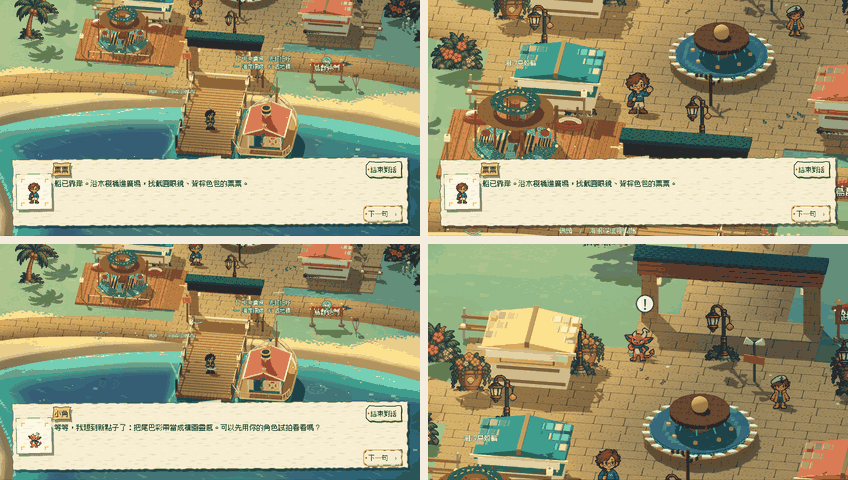

# [ST-13] 建立對話演出工具組

> 狀態：完成

## 內文

### 需求

所有劇情都是同一個下緣字幕板配一個不動的遠景：說話的人常不在畫面裡，角色站著不動，沒有停頓與反應。需要一組能寫在劇情資料裡的演出提示：鏡頭對準說話者或兩人並推近、頭上冒表情泡泡（！？…♪♥ 與汗滴）、說話者做既有動作、台詞前先停頓，以及沒有字幕的默劇節拍。先用在上岸導覽，讓喊「等等」的小角真的跳進畫面。

### 來源

2026-11-28 主線與演出改善任務；現況與研究見 `design/03-story/staging-research.md`。

### 驗收條件

- [x] 劇情資料的每句台詞可選擇附上鏡頭、表情泡泡、動作與停頓提示，不改程式即可編排。
- [x] 鏡頭保持原本角度，只滑動與推近；說話者在字幕板上方清楚可見。
- [x] 表情泡泡符合拼貼風格，出現在角色頭上，數秒後消失。
- [x] 沒有字幕的默劇節拍會自己往下走，也能按鍵跳過。
- [x] 略過、結束對話、重播或中途離開後，鏡頭、角色與操作完全還原。
- [x] 降低動態時改為直接切換、泡泡不彈跳，但誰在說話與停頓仍保留。
- [x] 上岸導覽使用工具組：票票說話時鏡頭對準她，小角插話時鏡頭切到他、頭上冒「！」。

### 測試流程

1. 新存檔走完晚風號，進入上岸導覽，逐句截圖比對前後。
2. 中途按結束對話、從暫停選單重播，確認鏡頭回到主角。
3. 開啟降低動態重做一次。

---

# 跟其他票的關係

- Blocks：ST-14、ST-15、ST-17、ST-18、ST-19
- Blocked by：無
- Related：ST-2、ST-6、ART-64

---

# Commit-1

## 內文

所有劇情原本都是一個字幕板配一個不動的遠景：上岸時票票用文字描述自己長什麼樣子，小角喊「等等」時根本不在畫面裡。
現在劇情資料的每句台詞可以附上演出提示：鏡頭保持原本角度，滑到說話者並推近，讓人站在字幕板上方；頭上冒拼貼風格的表情泡泡（！？…♪♥ 與汗滴），約一秒半後消失；說話者做既有動作；台詞前先停一拍再出字幕；也可以是沒有字幕、自己往下走的默劇節拍。按鍵會先結束停頓，不會跳過台詞。結束、略過或中途離開對話時，鏡頭交還原本視角，演出用的東西全部清掉。降低動態時鏡頭直接切換、泡泡不彈跳，停頓與誰在說話照樣保留。
上岸導覽先用上：票票說話時鏡頭推近到她，她邊揮手邊描述自己；小角插話前畫面先停一拍、切到他頭上冒出「！」，再出字幕；最後回到票票，她冒一滴汗。台詞內容與存檔流程不變。這是腳本驅動的原生畫面檢查與自動測試，不是人工試玩。

### 測試結果

| 項目 | 結果 |
|---|---|
| 演出提示測試（鏡頭、泡泡、停頓、默劇、降低動態、還原、不發獎） | 通過 |
| 遊戲啟動、夜市劇情、NPC 對話停住、晚風號整合、劇情資料、主線整合、相簿照片、島嶼對話 | 通過 8 / 8 |
| 場景規範 | 通過 |
| 單元測試 | 通過 217 / 217 |
| 設計資料驗證 | 5 個範圍 0 錯誤 |

機器負載很高時，島嶼對話與演出提示套件以放寬的逾時重跑通過；第一次逾時是匯入階段，不是斷言失敗。

### 截圖

