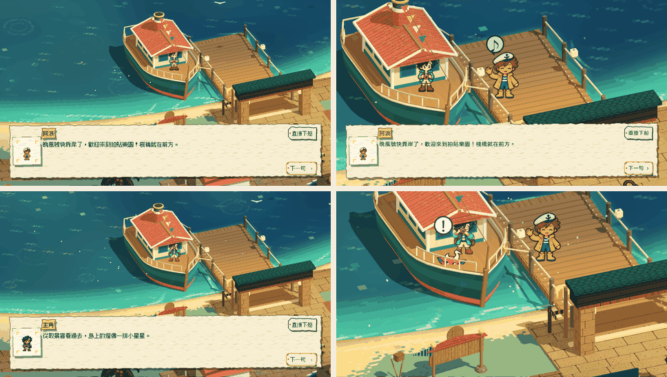

# [ST-14] 重新演出晚風號上島

> 狀態：完成

## 內文

### 需求

晚風號序章從頭到尾一個固定遠景：說話的阿浪不在畫面，「島上的燈像一排小星星」時看不到島。改成有起承轉合的上島：船靠岸時看見島、主角舉起取景窗時鏡頭望向島上的燈、阿浪在棧橋上招手，最後一拍留下「照片多了一條尾巴」的開場笑話伏筆。

### 來源

2026-11-28 主線與演出改善任務；`design/03-story/staging-research.md`。

### 驗收條件

- [x] 阿浪說話時看得到他本人。
- [x] 主角舉相機那一句，鏡頭望向島上，畫面看得到島。
- [x] 至少一個無字幕的默劇節拍，好笑或溫暖，不拉長總時間超過十秒。
- [x] 仍可隨時直接下船、從暫停選單重播；舊存檔不被強迫重看。
- [x] 降低動態、800×600 與放大文字下仍可讀可操作。

### 測試流程

1. 新存檔逐句截圖晚風號序章，與改前對照。
2. 中途直接下船、重播後略過，確認回到原地。

---

# 跟其他票的關係

- Blocks：無
- Blocked by：ST-13
- Related：ST-6

---

# Commit-1

## 內文

晚風號序章原本從頭到尾一個固定遠景：說話的阿浪不在畫面上，主角說看見島時也看不到島。
現在阿浪站在棧橋上揮手迎接，頭上冒出音符；主角扣相機背帶時鏡頭推近；舉起取景窗那一句先停一拍，鏡頭滑過海灣看向島上的廣場。接著是一個沒有字幕的節拍：主角按下快門的瞬間，小角從欄杆後面探頭入鏡、冒出驚嘆號，下一拍就不見了；主角頭上冒問號：「……剛剛取景窗裡，是不是多了一條尾巴？」呼應第一幕「照片多了一條尾巴」。最後阿浪和主角同框揮手，回到原本的遠景下船。白天島上的燈不會亮，所以「燈像一排小星星」改成「整座島都擠進小小的框裡」，驗收條件同步調整。
阿浪在棧橋上時，廣場上的阿浪會先藏起來，序章結束再回來，不會同時出現兩個。直接下船、從暫停選單重播與舊存檔流程不變，結束後鏡頭與人物完全還原。默劇節拍約一秒半，可以按鍵或點畫面跳過。這是腳本驅動的原生畫面檢查與自動測試，不是人工試玩。

### 測試結果

| 項目 | 結果 |
|---|---|
| 晚風號序章狀態、舞台、整合測試（七拍、棧橋上的阿浪、小角只出現一拍、重播還原） | 通過 3 / 3 |
| 演出提示、劇情資料 | 通過 2 / 2 |
| 原生 800×600、降低動態、1.25 倍文字：七拍、上岸導覽、暫停重播與略過 | 通過 |
| 設計資料驗證 | 5 個範圍 0 錯誤 |

### 截圖

