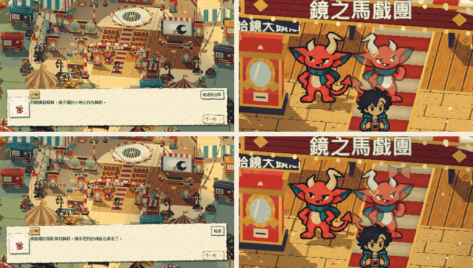

# [ST-15] 重新演出馬戲團迎賓與領結委託

> 狀態：完成

## 內文

### 需求

鏡之馬戲團的笑點全是畫面笑點（鏡子裡的小角先鞠躬、倒影拿走領結），現在只用字幕講。改成真的演：鏡子裡的倒影先鞠躬、小角愣一拍再跟著鞠躬，雙人鏡頭推近，合照前有一個小停頓；委託開頭的倒影偷領結也演出來。

### 來源

2026-11-28 主線與演出改善任務；`design/03-story/staging-research.md`。

### 驗收條件

- [x] 迎賓時看得到倒影比小角先動，小角有反應（泡泡或動作）再接台詞。
- [x] 委託開頭看得到領結不見的那一刻。
- [x] 對話到合照之間有過場，不是直接跳框。
- [x] 可略過、從相簿重看、降低動態下意思不變；不重複授予拍貼。

### 測試流程

1. 到馬戲團迎賓點逐句截圖，完成合照。
2. 接下委託，截圖開頭；從相簿重看迎賓。

---

# 跟其他票的關係

- Blocks：無
- Blocked by：ST-13
- Related：ST-9、ST-12

---

# Commit-1

## 內文

馬戲團的笑點全是畫面笑點，原本只用字幕講：鏡子裡的小角比他先鞠躬、倒影拿走他的領結。
現在迎賓一開始鏡頭推近，旁邊多了一個淡藍色、左右相反的倒影小角，先比出招呼的姿勢，本尊站著沒動；下一拍本尊頭上冒「!?」，接著才跟著比出同一個姿勢、冒汗說台詞。兩人同框之後倒影退場，拍照前再停一拍冒出音符，才打開取景框。接委託時，倒影比完姿勢手上舉著小角的領結，下一拍就帶著領結消失；委託收尾時領結回到小角身上。
在別區從相簿重看只播台詞，不去找不在場的角色；在現場重看照常演出。略過、合照、拍貼與造訪登記都和原本一樣，演出用的倒影、領結與姿勢在對話結束時全部收回。演出工具組因此多了倒影分身、手持小道具、退場，以及沒有動畫的角色也能擺出一拍姿勢。這是腳本驅動的原生畫面檢查與自動測試，不是人工試玩。

### 測試結果

| 項目 | 結果 |
|---|---|
| 馬戲團劇情、居民委託（含別區重看只剩台詞） | 通過 2 / 2 |
| 演出提示（含姿勢在結束時交還）、晚風號整合、劇情資料 | 通過 3 / 3 |
| 設計資料驗證 | 5 個範圍 0 錯誤 |

### 截圖

