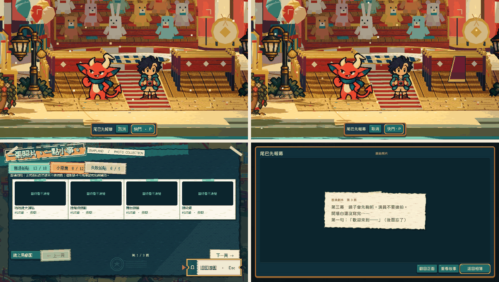

# [ST-16] 在合照邊緣埋下主線謎團

> 狀態：完成

## 內文

### 需求

各區都說「幕幕在籌備首演」，但看不到任何線索，主線只剩口頭。依「照片邊緣的人」提案：每張主線與迎賓合照的邊緣出現一點不屬於畫面的東西（披風一角、手套、帽緣），拍貼背面是一頁首演劇本，寫著該區被借去當布景的東西。不加章節標題卡，線索只在照片與相簿裡被發現；派對時小角把幕幕拉進畫面揭曉。

### 來源

2026-11-28 主線與演出改善任務；提案見 `design/03-story/staging-research.md`「照片邊緣的人」。

### 驗收條件

- [x] 已開放四區的迎賓合照，邊緣各有一個看得出但不搶戲的線索物；迎賓大道主線卡沒有實拍照片，改由背面劇本頁開頭。
- [x] 相簿可翻看這些拍貼的背面，各有一句符合該區台詞的劇本頁。
- [x] 線索不影響卡片、門檻、任務或存檔相容；舊照片照常可看、背面照樣能翻；已存的照片不改寫，所以不補上邊緣線索。
- [x] 設計文件記下每區的線索物與背面文字，與 story.md 不衝突。

### 測試流程

1. 依序拍下各區主線合照，檢查邊緣線索。
2. 在相簿翻到背面，逐張讀劇本頁。

---

# 跟其他票的關係

- Blocks：ST-17
- Blocked by：無
- Related：ST-7、ST-9、ST-10、ST-11

---

# Commit-1

## 內文

各區都說幕幕在籌備首演，但玩家只聽得到、看不到任何線索，主線只剩口頭。
現在打開四區迎賓合照的取景框時，右緣會露出半個不屬於這張照片的東西：夜市與溫室是一隻白手套，馬戲團是一角紫色披風，玩具城是兩面帽的帽緣。它會一起被拍進照片，沒有人提起。相簿的照片檢視器多了「翻到背面」：迎賓大道主線卡和四張迎賓合照的背面，各是一頁鉛筆寫的首演劇本，共五頁。內容接各區台詞（夜市的點心紙、馬戲團忘詞、玩具城的車站鈴），透露的是一個緊張、愛站在旁邊、會忘詞的人，但不寫名字；溫室那頁「他們不會出現在照片裡，但他們會來」替幽幽旅館的幽靈留伏筆。迎賓大道主線卡本來就沒有實拍照片，打開時直接顯示背面。
卡片、門檻、任務與存檔格式都不變；已存的照片不改寫，背面照樣能翻。每區的線索物與背面文字記在 design/03-story/staging-research.md。這是腳本驅動的原生畫面檢查與自動測試，不是人工試玩。

### 測試結果

| 項目 | 結果 |
|---|---|
| 劇情資料（五頁劇本、頁碼連續、線索種類） | 通過 |
| 馬戲團劇情（線索在取景框右緣、關閉後收回、翻到背面再翻回） | 通過 |
| 夜市、玩具城、溫室劇情與居民委託 | 通過 4 / 4 |
| 相簿照片檢視器 | 通過 |
| 設計資料驗證 | 5 個範圍 0 錯誤 |

### 截圖

