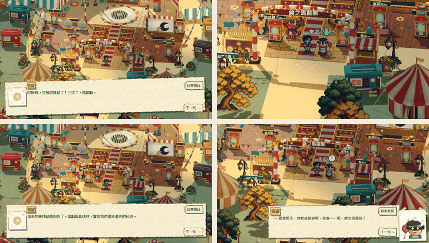

# [ST-17] 把怪盜收尾接上首演伏筆

> 狀態：完成

## 內文

### 需求

怪盜第三次被抓後只有三行字幕，本人不在畫面，與主線無關。改成演出來的收尾：怪盜站在面前、轉頭看相機、冒汗、把東西一件件還回去、留下面具；面具紀念章背面蓋著「道具組」的章與一截披風，讓玩家可以把他和照片邊緣的人連起來，但不說破。

### 來源

2026-11-28 主線與演出改善任務；`design/03-story/staging-research.md`。

### 驗收條件

- [x] 收尾時怪盜本人在畫面上，有至少一個無字幕的反應節拍。
- [x] 面具紀念章背面有連到主線的線索，不直接寫出身分。
- [x] 抓捕次數、紀念章與成就不變，舊存檔不受影響；可略過。

### 測試流程

1. 以隔離存檔完成第三次抓捕，逐句截圖收尾。
2. 打開成就頁看紀念章背面。

---

# 跟其他票的關係

- Blocks：無
- Blocked by：ST-13、ST-16
- Related：無

---

# Commit-1

## 內文

怪盜第三次被抓後只有三行字幕，本人不在鏡頭裡，頭像只是一個「怪」字，和主線完全無關。
其實他抓到後還頭暈站在原地，現在收尾就演在他身上：鏡頭推近，他先冒汗不說話；接著認輸、把東西還回去、送出面具；最後說溜嘴：「……首演那天，你就坐前排吧。我會——呃，總之別遲到！」主角問「首演？什麼首演？」，他又冒一滴汗，對話結束才化成一陣煙溜走。對話胸像換成怪盜本人，頭暈與得意各一個表情。成就頁的「怪盜的面具」拿到後多了一行背面：蓋著「首演道具組」的章，旁邊黏著一根酒紅色的披風線頭。合照邊緣的披風與帽緣也改成怪盜身上的酒紅與深紫，兩條線悄悄連起來，但從不說他是誰。
抓捕次數、紀念章與成就規則不變，收尾可以略過。演出工具組順手修正兩點：用圖集繪製的角色，泡泡位置改按單格高度計算；對話結束時，演出節點立刻離開場景。這是腳本驅動的原生畫面檢查與自動測試，不是人工試玩。

### 測試結果

| 項目 | 結果 |
|---|---|
| 怪盜（收尾演在本人身上、說溜首演、略過還原、面具背面、節點不增加） | 通過 |
| 演出提示、晚風號整合、島嶼對話、劇情資料、馬戲團 | 通過 5 / 5 |
| 設計資料驗證 | 5 個範圍 0 錯誤 |

### 截圖

