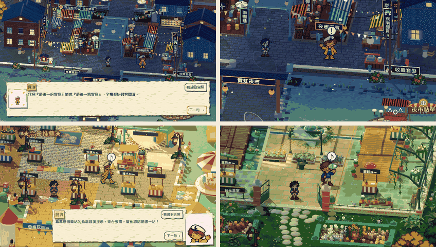

# [ST-18] 重新演出夜市玩具城與溫室迎賓

> 狀態：完成

## 內文

### 需求

霓虹夜市、發條玩具城與苔光溫室的迎賓都是兩人站在大遠景裡講完台詞。用演出工具組替每區編一個看得見的節拍：夜市全攤抬頭等開演、列車倒著進站、盆栽在光轉過時坐到頭排；每段都有說話者特寫、一次反應和合照前的停頓。

### 來源

2026-11-28 主線與演出改善任務；`design/03-story/staging-research.md`。

### 驗收條件

- [x] 三區迎賓各有一個用畫面而非字幕表現的笑點。
- [x] 說話者在畫面中清楚可見，合照前有過場。
- [x] 可略過、可從相簿重看、降低動態意思不變；不重複授予拍貼。

### 測試流程

1. 三區迎賓逐句截圖並完成合照，與改前對照。
2. 從相簿重看三段。

---

# 跟其他票的關係

- Blocks：無
- Blocked by：ST-13
- Related：ST-7、ST-10、ST-11

---

# Commit-1

## 內文

霓虹夜市、發條玩具城與苔光溫室的迎賓，原本都是兩人站在大遠景裡把台詞講完，笑點全靠字幕。
現在三區都先演一拍沒有字幕的笑點，再接台詞：
- 夜市：阿浪喊錯字時揮手冒出驚嘆號，接著全場安靜一拍，他頭上冒出「…」。說到開場白寫在點心紙上時，他手裡拿著那張紙，下一拍紙就不見了。
- 玩具城：阿浪先面朝錯的方向冒問號，下一拍才回過神轉回來。說到借車站的鈴當提示時，他舉著一個銅鈴。
- 溫室：票票得意地舉著葉形座位牌冒音符，下一拍就洩氣。說「留一個亮著的座位給晚到的人」之前，先停半拍。

說話者都有推近鏡頭；拍照前三區都有一拍停頓加音符的過場。點心紙、銅鈴、葉形座位牌是新畫的像素小道具，都有墨線外框、亮面和暗面，在 1280×720 下一眼看得出來。演出工具組也多了「收起道具」和「轉身一拍」兩個動作。略過、合照、拍貼與造訪登記都不變；在別區從相簿重看只播台詞。
劇場收尾規劃（服裝架上的披風與帽子、節目單空白頁、謝幕照邊緣第一次是空的、背面第六頁的署名）已寫進 design/03-story/staging-research.md，實作需要幕幕的像素角色，另開票追蹤。這是腳本驅動的原生畫面檢查與自動測試，不是人工試玩。

### 測試結果

| 項目 | 結果 |
|---|---|
| 夜市、玩具城、溫室劇情（開場默劇、台詞與演出提示有效、合照與重看） | 通過 3 / 3 |
| 馬戲團劇情、居民委託、演出提示、劇情資料 | 通過 4 / 4 |
| 設計資料驗證 | 5 個範圍 0 錯誤 |

### 截圖

